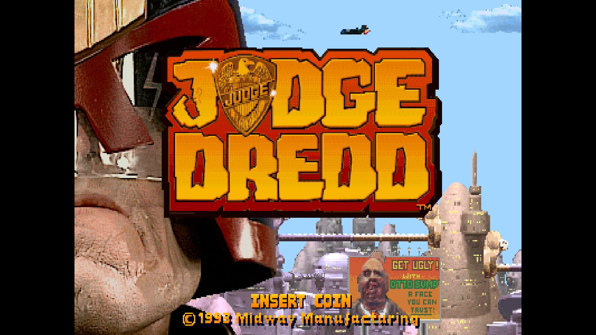
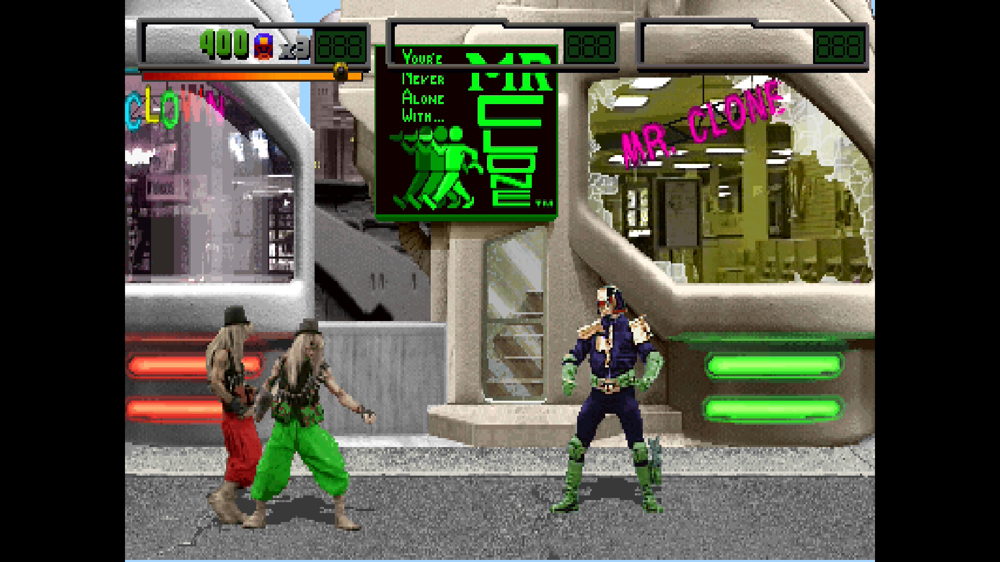
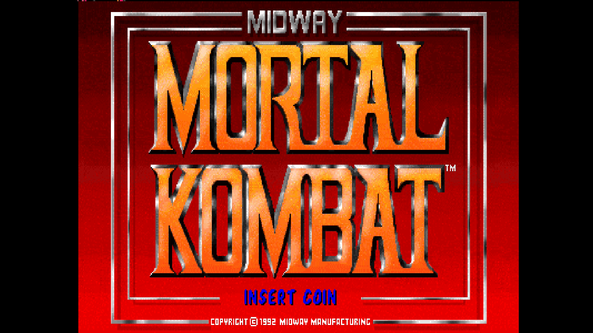
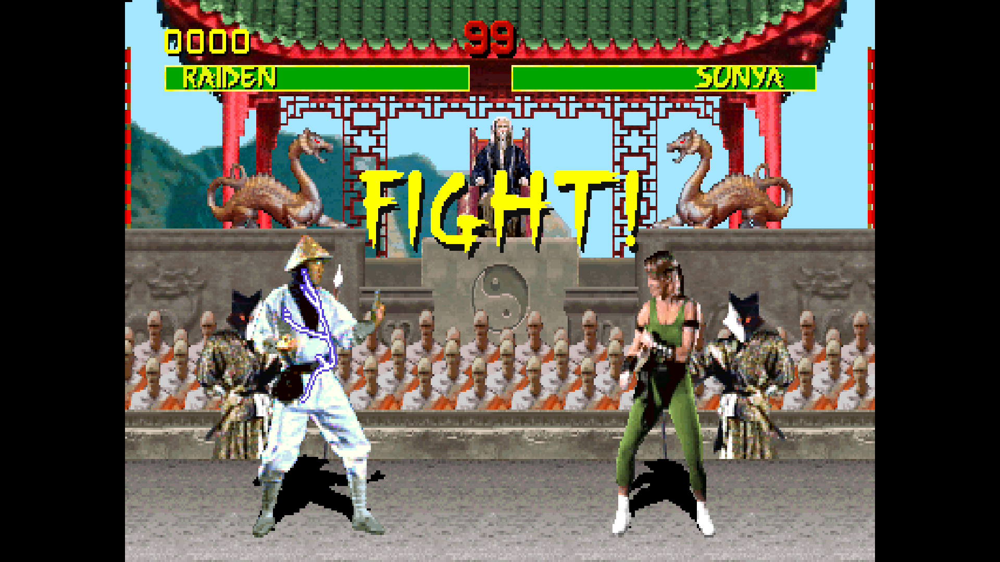
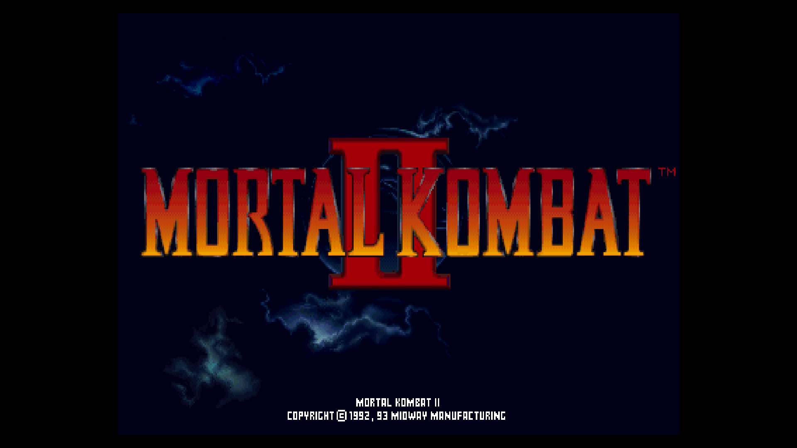
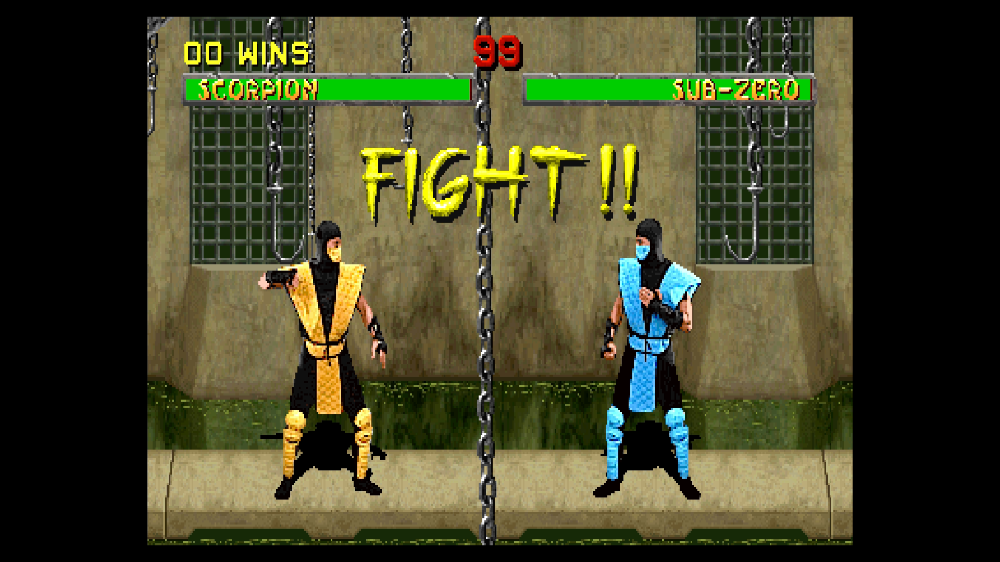
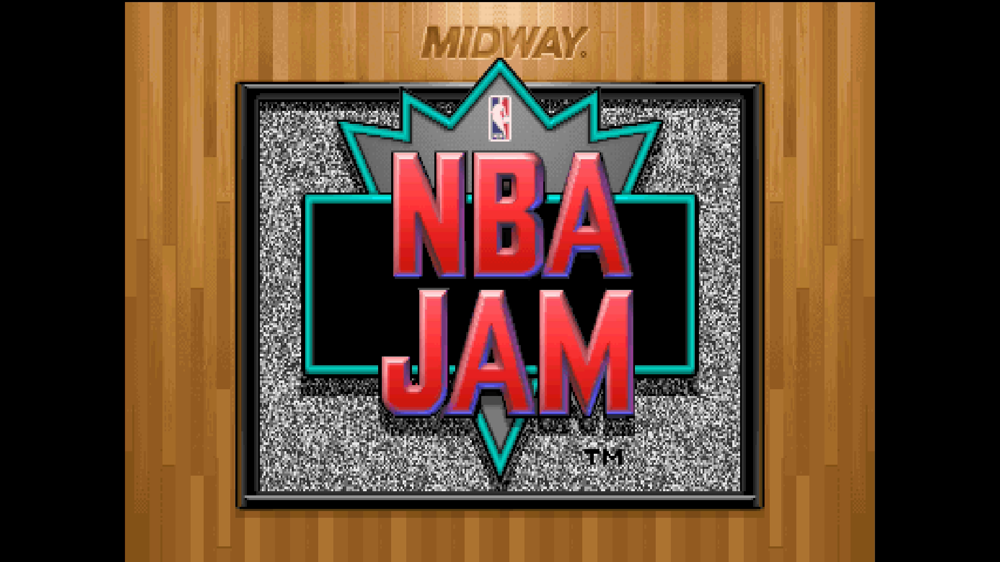
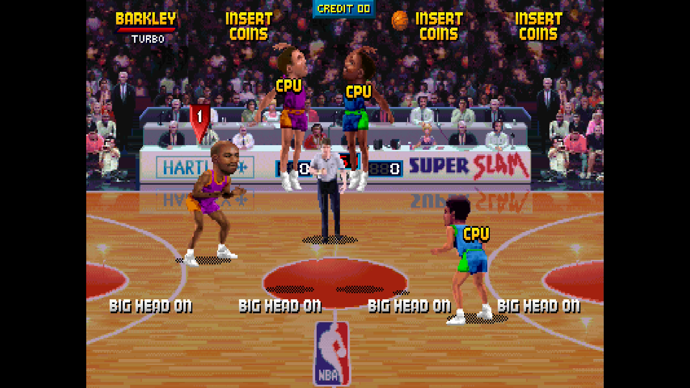
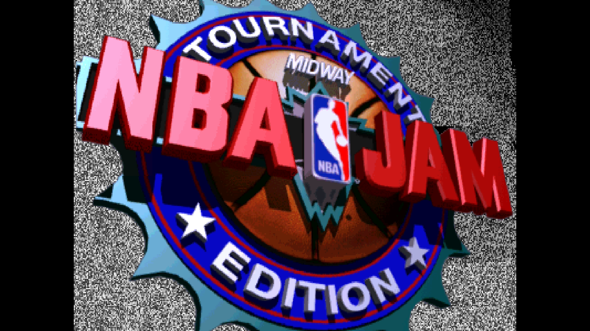
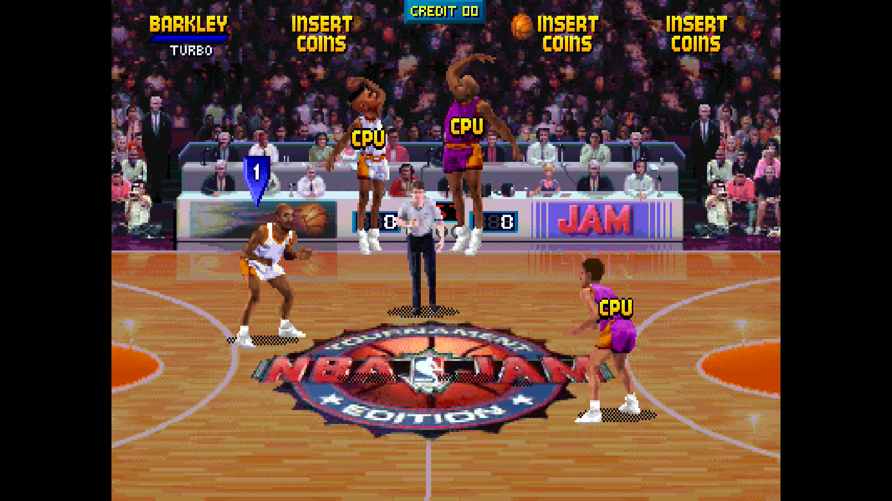

# Williams/Midway T-Unit for [MiSTer](https://github.com/MiSTer-devel/Main_MiSTer/wiki)

> **AI disclosure:** this core was developed using AI and MAME as a reference.
> (Claude, by Anthropic - Opus 5.5 & Sonnet 5.5).

An FPGA implementation of the Williams/Midway T-Unit arcade board (1993-1994),
the TMS34010-based platform behind Mortal Kombat (T-Unit revisions), Mortal
Kombat II, NBA Jam, NBA Jam Tournament Edition and Judge Dredd.

## Table of Contents

- [Hardware](#hardware)
- [Games](#games)
- [Timing and resources](#timing-and-resources)
- [Features](#features)
- [OSD](#osd)
- [ROMs](#roms)
- [Credits and references](#credits-and-references)
- [License](#license)
- [Extra content](docs/ExtraContent.md)

## Hardware

| | |
|---|---|
| Main CPU | TMS34010 graphics system processor, 50 MHz master clock (6.25 MHz instruction clock) |
| Main RAM | 512 KB |
| Video | 512 x 512 x 16-bit frame store; DMA blitter with 1-8 bits per pixel, compressed rows, X/Y scaling, X/Y flip and four-edge clipping |
| Palette | 32768 colours, 15-bit RGB |
| Display | 8 MHz pixel clock, 400 x 254 visible, 54.7 Hz |
| Sound (ADPCM board) | MC6809E @ 2 MHz, YM2151, OKI M6295, 8-bit DAC |
| Sound (DCS board, Mortal Kombat II) | ADSP-2105 @ 10 MHz, banked sound ROMs, 16-bit DAC at 31.25 kHz |
| Protection | Per-game security chips on the 34010 bus and hidden RAM on the ADPCM board, as in MAME |

## Games

Each game has its own page in [`docs`](docs) with its versions, controls and
game-specific features. Everything the core adds, core-wide and per game, is
listed in [Extra content](docs/ExtraContent.md).

| Game | Main set | Title Screen | Gameplay |
|---|---|---|---|
| [Judge Dredd (location test)](docs/JudgeDredd.md) | jdreddp (rev TA1) |  |  |
| [Mortal Kombat](docs/MortalKombat.md) | mk (rev 5.0) |  |  |
| [Mortal Kombat II](docs/MortalKombatII.md) | mk2 (rev L3.1) |  |  |
| [NBA Jam](docs/NBAJam.md) | nbajam (rev 3.01) |  |  |
| [NBA Jam Tournament Edition](docs/NBAJamTE.md) | nbajamte (rev 4.0) |  |  |

Other versions, prototypes and hacks are in the `_alternatives` folder of the
MRAs.

## Timing and resources

<!-- Fill the - cells from the Quartus reports of the latest compilation. -->
Built with Quartus Prime 17.0.2 Lite for the DE10-Nano (Cyclone V
5CSEBA6U23I7), timing model Slow 1100 mV 100 C.

| Clock | Frequency | Setup slack |
|---|---|---|
| System (core PLL) | 96 MHz | - |

| Resource | Used |
|---|---|
| Logic (ALMs) | - / 41,910 |
| Block RAM (M10K blocks) | - / 553 |
| DSP blocks | - / 112 |

## Features

- CRT Adjust by rmonic79, with CRT V-Size (experimental): makes the picture
  taller or shorter in up to 7 steps of 3 lines, in PVM mode (changes the
  lines per frame, for monitors that follow line rate changes) or Cabinet mode
  (keeps the native timing and blends neighbouring lines)
- Video Timing: the board's own 54.7 Hz, or 57 Hz for TVs that do not hold
  54.7 Hz (games run about 4 % faster, audio pitch is unchanged)
- CMOS saved as NVRAM: settings, audits and high scores survive power-off
  (saved when the OSD is opened, if the game changed them)
- DIP switches in the OSD, taken from MAME; changes apply after a reset
- Service Mode, Service Credit and Tilt in the OSD; pause from a button or
  while the OSD is open
- Shortcuts to the hidden menus, screens and debug features of the games that
  have them; the core enters the codes for you
- Mortal Kombat, Mortal Kombat II: Move List, Finishing Moves and Fixed AI
  Difficulty; Mortal Kombat also has Reptile on demand (see the
  [Mortal Kombat page](docs/MortalKombat.md))
- Mortal Kombat II Plus: its own Move List and View Secrets (the secret
  characters, the Kombat Kodes) and Fixed AI Difficulty
- NBA Jam, NBA Jam Tournament Edition: power-up and Tonight's Match-Up codes
  (the tank game, tournament mode) and a Secret Player List

## OSD

| Item | |
|---|---|
| Video Settings | Aspect ratio, scandoubler, scale, Video Timing, CRT Adjust |
| Move List | Mortal Kombat games: shows each fighter's moves over the game; with the OSD closed, Left or Right turns the page |
| Finishing Moves | Mortal Kombat, Mortal Kombat II: enters the chosen fatality at the next FINISH HIM |
| Fixed AI Difficulty | Mortal Kombat, Mortal Kombat II, Mortal Kombat II Plus: the computer opponent's level, Off or 0 (easiest) to 9 |
| View Secret Players | NBA Jam games: shows the secret players and cheat codes over the game; with the OSD closed, Left or Right turns the page |
| View Secrets | Mortal Kombat II Plus: shows how to unlock the secret characters, the Kombat Kodes and other secrets; with the OSD closed, Left or Right turns the page |
| DIP Switches | The game's DIP switches, with Service Credit and Tilt |
| Hidden Items | Hidden menus, cheats and extras, for the games that have them (named Secret Menus for Judge Dredd and Cheat Codes & Hidden Items for the NBA Jam games) |
| Service Mode | The cabinet's test switch |
| Pause when OSD is open | On by default |
| Reset / Reset and close OSD | Reset keeps the OSD open |

## ROMs

ROMs are **not** included in this repository; you need your own dumps of the
games.

Use **merged** ROM sets from MAME 0.289 (recommended). Files are found by
CRC. Put the zips in `games/mame`, the MRA files in `_Arcade` (other versions
in `_Arcade/_alternatives`) and the core in `_Arcade/cores`. Mortal Kombat II
Plus is a hack that is not in MAME: its `mk2.zip` goes in `games/hbmame`.

## Credits and references

- MAME T-Unit driver and video: Alex Pasadyn, Zsolt Vasvari, Ernesto Corvi,
  Aaron Giles (thanks to Kurt Mahan); MAME TMS34010 core, Williams ADPCM
  sound board, DCS sound board and ADSP-21xx core - the reference for this
  core's behaviour (the ADSP-2105 and the DCS board are ports of MAME's
  ADSP-21xx core and DCS board, Aaron Giles)
- Texas Instruments TMS34010 User's Guide
- mc6809 core: Greg Miller (synchronous version by Sorgelig)
- jt51 (YM2151) and jt6295 (OKI M6295): Jose Tejada (jotego)
- SDRAM controller and MiSTer framework: Sorgelig and the MiSTer-devel team
- CRT Adjust and CRT V-Size: Umberto Parisi (rmonic79), with Andrea Bogazzi
  (@asturur)
- [Template_MiSTer](https://github.com/MiSTer-devel/Template_MiSTer),
  [MiSTer-CRT-Adjust](https://github.com/rmonic79/MiSTer-CRT-Adjust)
- ppriest: [MiSTer-CoreSkill](https://github.com/ppriest/MiSTer-CoreSkill),
  the arcade core guidance used while developing and checking this core

## License

GPL-3.0-or-later. Third-party modules keep their own licenses (see `rtl/mc6809`,
`rtl/jt51`, `rtl/jt6295`, `rtl/crt_adjust`). The ADSP-2105 and DCS board ports
follow MAME code under BSD-3-Clause.
