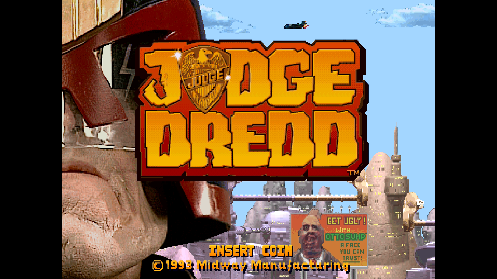
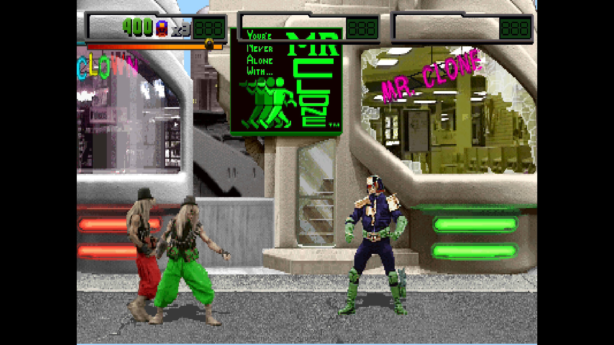
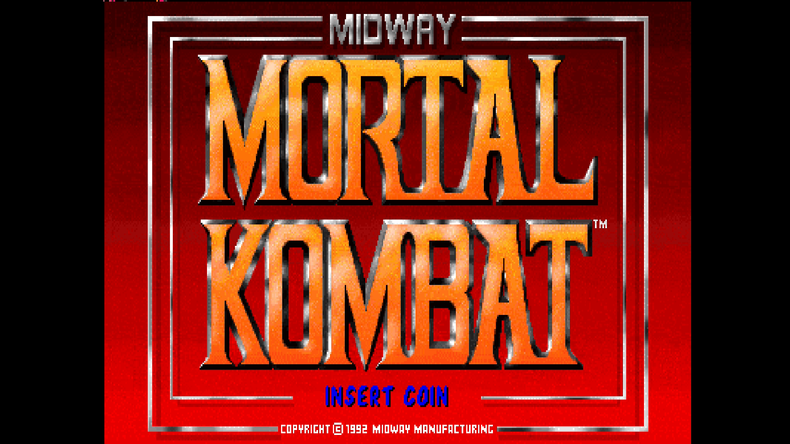
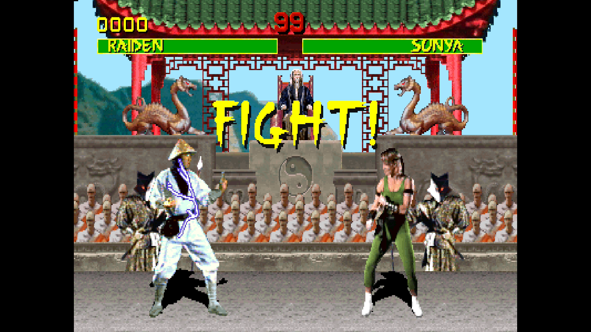
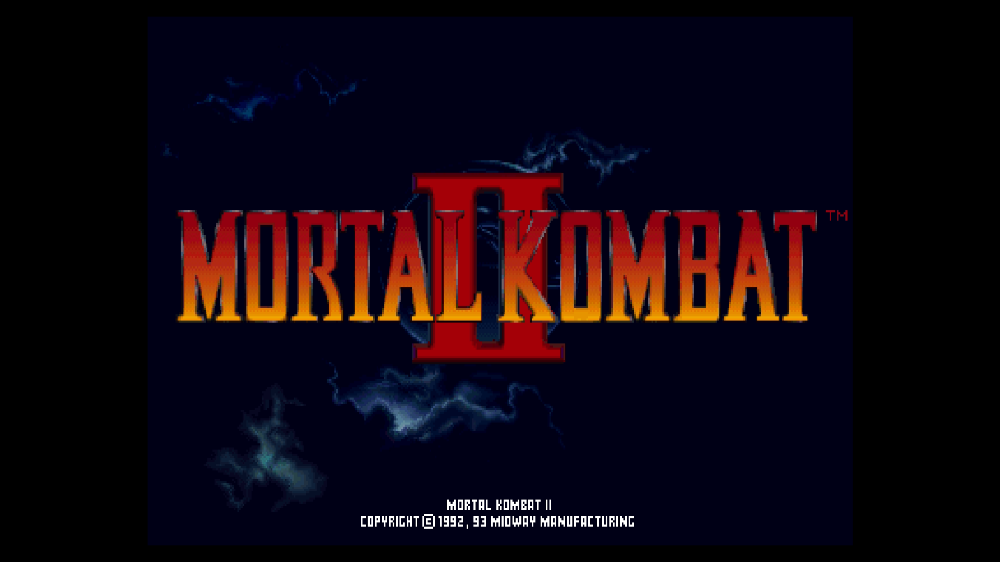
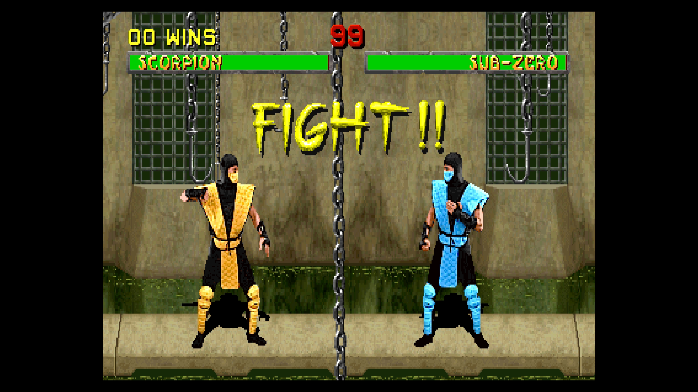
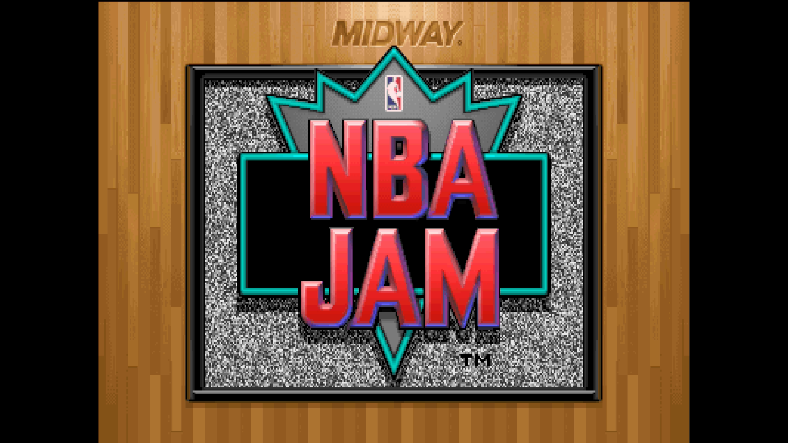
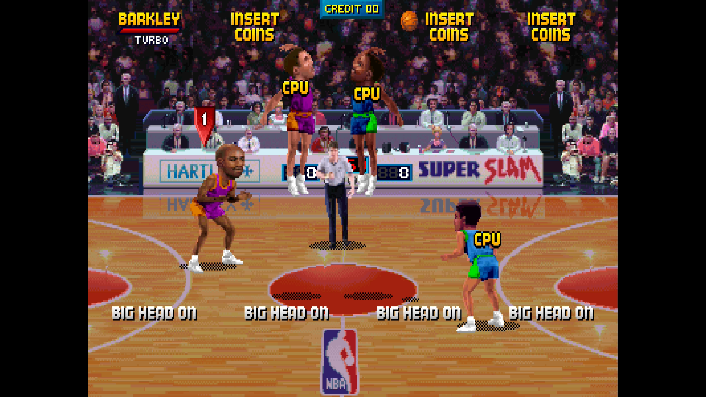
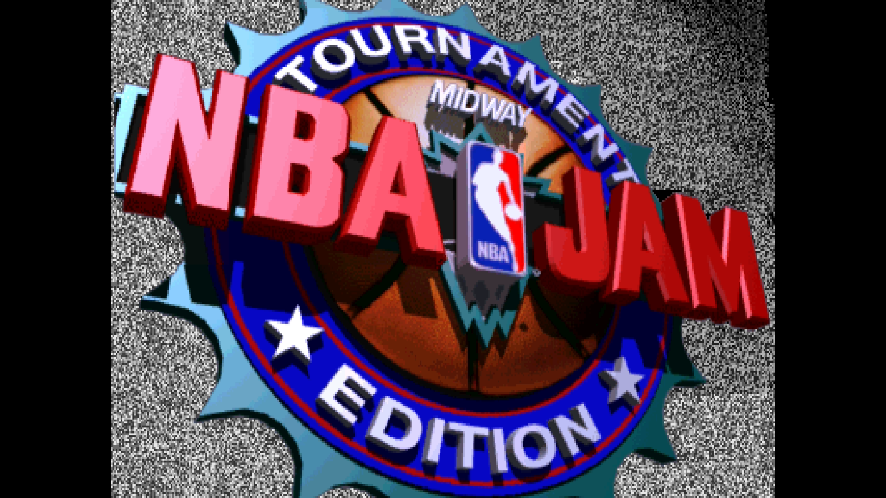
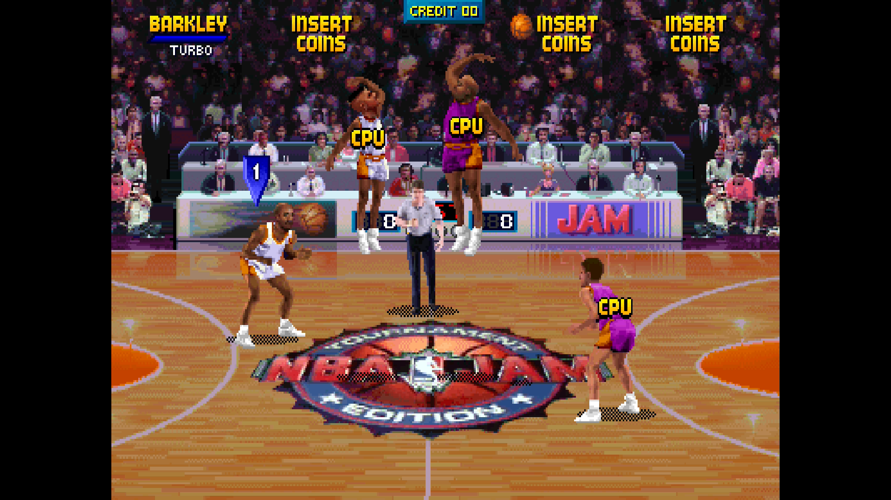

# Williams/Midway T-Unit for [MiSTer](https://github.com/MiSTer-devel/Main_MiSTer/wiki)

> **AI disclosure:** this core was developed using AI and MAME as a reference.
> (Claude, by Anthropic - Opus 5.5 & Sonnet 5.5).

An FPGA implementation of the Williams/Midway T-Unit arcade board (1993-1994),
the TMS34010-based platform behind Mortal Kombat (T-Unit revisions), Mortal
Kombat II, NBA Jam, NBA Jam Tournament Edition and Judge Dredd.

## Table of Contents

- [Hardware](#hardware)
- [Games](#games)
- [Timing and resources](#timing-and-resources)
- [ROMs](#roms)
- [Credits and references](#credits-and-references)
- [License](#license)
- [Extra content](docs/ExtraContent.md)

## Hardware

| | |
|---|---|
| Main CPU | TMS34010 graphics system processor, 50 MHz master clock (6.25 MHz instruction clock) |
| Main RAM | 512 KB |
| Video | 512 x 512 x 16-bit frame store; DMA blitter with 1-8 bits per pixel, compressed rows, X/Y scaling, X/Y flip and four-edge clipping |
| Palette | 32768 colours, 15-bit RGB |
| Display | 8 MHz pixel clock, 400 x 254 visible, 54.7 Hz |
| Sound (ADPCM board) | MC6809E @ 2 MHz, YM2151, OKI M6295, 8-bit DAC |
| Sound (DCS board, Mortal Kombat II) | ADSP-2105 @ 10 MHz, banked sound ROMs, 16-bit DAC at 31.25 kHz |
| Protection | Per-game security chips on the 34010 bus and hidden RAM on the ADPCM board, as in MAME |

## Games

Each game has its own page in [`docs`](docs) with its versions, controls and
game-specific features. Everything the core adds, core-wide and per game, is
listed in [Extra content](docs/ExtraContent.md).

| Game | Main set | Title Screen | Gameplay |
|---|---|---|---|
| [Judge Dredd (location test)](docs/JudgeDredd.md) | jdreddp (rev TA1) |  |  |
| [Mortal Kombat](docs/MortalKombat.md) | mk (rev 5.0) |  |  |
| [Mortal Kombat II](docs/MortalKombatII.md) | mk2 (rev L3.1) |  |  |
| [NBA Jam](docs/NBAJam.md) | nbajam (rev 3.01) |  |  |
| [NBA Jam Tournament Edition](docs/NBAJamTE.md) | nbajamte (rev 4.0) |  |  |

## Timing and resources

<!-- Update the cells from the Quartus reports of the latest compilation (these are Build 104's). -->
Built with Quartus Prime 17.0.2 Lite for the DE10-Nano (Cyclone V
5CSEBA6U23I7), timing model Slow 1100 mV 100 C. Timing and resource use are
from the Build 104 compilation.

Timing is met on every clock, and on every hold, recovery, removal and minimum
pulse width check. The margins move a little with every compilation.

| Clock | Frequency | Setup slack |
|---|---|---|
| System (core PLL) | 96 MHz | 0.083 ns |
| HDMI PLL | 148.54 MHz | 0.440 ns |

Every other clock has at least 4.0 ns of setup slack.

| Resource | Used |
|---|---|
| Logic (ALMs) | 34,359 / 41,910 (82 %) |
| Block RAM (M10K blocks) | 432 / 553 (78 %) |
| DSP blocks | 67 / 112 (60 %) |

## ROMs

ROMs are **not** included in this repository; you need your own dumps of the
games.  Use **merged** ROM sets. Files are found by CRC.  Put the zips in
`games/mame`, the MRA files in `_Arcade` (other versions, prototypes and hacks
in `_Arcade/_alternatives`) and the core in `_Arcade/cores`.

Mortal Kombat Plus (HBMAME's merged `mk.zip`), Mortal Kombat II rev 4.0 and
Mortal Kombat II Plus (HBMAME's merged `mk2.zip`), and the NBA Jam Tournament
Edition hacks, the Special Edition and Rewind (HBMAME's merged `nbajamte.zip`),
go in `games/hbmame`; MAME's `mk.zip`, `mk2.zip` and `nbajamte.zip` stay in
`games/mame`.

## Credits and references

- MAME T-Unit driver and video: Alex Pasadyn, Zsolt Vasvari, Ernesto Corvi,
  Aaron Giles (thanks to Kurt Mahan); MAME TMS34010 core, Williams ADPCM
  sound board, DCS sound board and ADSP-21xx core - the reference for this
  core's behaviour (the ADSP-2105 and the DCS board are ports of MAME's
  ADSP-21xx core and DCS board, Aaron Giles)
- Texas Instruments TMS34010 User's Guide
- mc6809 core: Greg Miller (synchronous version by Sorgelig)
- jt51 (YM2151) and jt6295 (OKI M6295): Jose Tejada (jotego)
- SDRAM controller and MiSTer framework: Sorgelig and the MiSTer-devel team
- CRT Adjust and CRT V-Size: Umberto Parisi (rmonic79), with Andrea Bogazzi
  (@asturur)
- [Template_MiSTer](https://github.com/MiSTer-devel/Template_MiSTer),
  [MiSTer-CRT-Adjust](https://github.com/rmonic79/MiSTer-CRT-Adjust)
- ppriest: [MiSTer-CoreSkill](https://github.com/ppriest/MiSTer-CoreSkill),
  the arcade core guidance used while developing and checking this core
- Move Lists: the Mortal Kombat Plus, Mortal Kombat II Plus and Mortal Kombat
  II rev 4.0 lists follow their guides: MKKomplete's
  [Mortal Kombat Plus](https://icemantraveler.github.io/mkksg/fan_made/mkplus/default.htm)
  and [Mortal Kombat II Plus](https://icemantraveler.github.io/mkksg/fan_made/mk2plus/default.htm)
  (the latter credits Karl Lindsey for additional information on the
  fatalities) and the [MK II v4.0 Move List](https://junkwax.github.io/mk2-rev4/)
  (project junkwax/mk2-rev4). The Mortal Kombat and Mortal Kombat II lists were
  found in the games' programs and played in MAME; MKKomplete's
  [Mortal Kombat](https://icemantraveler.github.io/mkksg/mk1/default.htm) and
  [Mortal Kombat II](https://icemantraveler.github.io/mkksg/mk2/default.htm)
  guides are the reference for them. Each Move List page that has a free
  row ends with the address of its guide

### Cheat credits

The cheats for these games come from the MAME cheat collection (the cheat.txt
of the 27 July 2025 release, for MAME 0.279;
[mamecheat.co.uk](https://www.mamecheat.co.uk)), kept by Martin Pugh (Pugsy)
with the cheat finders named in its contributor list. The Cheats menu offers
them; the cheats the core found in each game's program itself are not from the
collection. Per game, as cheat.txt gives it:

| Game | Credit in cheat.txt |
|---|---|
| Mortal Kombat (mk) | Abystus; Steph and ugetab; Pugsy: Clues, Secret Game Over, CPU Fatality, EJB Menu; nolberto82: Hit Anywhere, One Button Fatalities |
| Mortal Kombat II (mk2) | ugetab; Pugsy: Clues, Secret Game Over, CPU Fatality, EJB Menu; nolberto82: Hit Anywhere, Jade Low Kick Requirement, One Key Fatals; CLE: Automatic Fatality, Automatic Stage Fatality; syndromtr: the others |
| NBA Jam (nbajam) | Abystus: most of them; Pugsy: Invincibility on 3D Tank Game, Computer Assistance Off |
| NBA Jam Tournament Edition (nbajamte) | syndromtr, Abystus and Pugsy |
| NBA Jam Tournament Edition, Special Edition (nbajam03, nbajam05) | Some of nbajamte's, moved to where the hack keeps them |
| NBA Jam Tournament Edition, Rewind (nbajam02, nbajam04, nbajam07) | nbajamte2a's |
| NBA Jam Tournament Edition (nbajamte1, nbajamte2a, nbajamte3) | syndromtr and Abystus |
| Judge Dredd (jdreddp), NBA Jam rev 2.00 (nbajamr2), Tournament Edition (nbajamte2, nbajamte3a, nbajamte4) | Not in cheat.txt's list; their files point to it for the contributors |

## License

GPL-3.0-or-later. Third-party modules keep their own licenses (see `rtl/mc6809`,
`rtl/jt51`, `rtl/jt6295`, `rtl/crt_adjust`). The ADSP-2105 and DCS board ports
follow MAME code under BSD-3-Clause.
