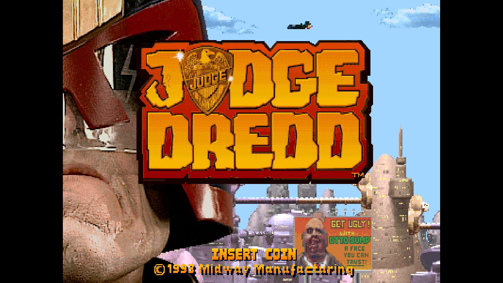
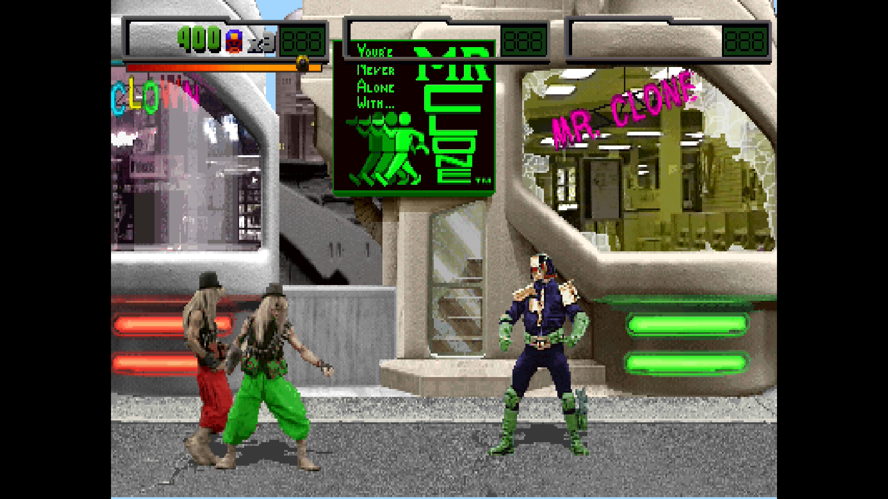

# Judge Dredd

[Back to the core's README](../README.md)

Judge Dredd (Midway, 1992), the location-test version, on the T-Unit board
with the ADPCM sound board.

 

## Versions

| MRA | MAME set |
|---|---|
| Judge Dredd (rev TA1 7-12-92, location test) | jdreddp |

The MRA is in `_Arcade`; the ROMs are in `jdreddp.zip`.

## Controls

Up to three players: Kick, Jump, Punch, Crouch, plus Start, Coin, Test
(service mode) and Pause.

<!-- extra-content:start (from ExtraContent.md by tools/extra_content.py) -->
## Extra content

Judge Dredd (location test) has two extras, both on the Secret Menus page.

| Feature | What it adds | OSD page |
| --- | --- | --- |
| Secret Audit Menu | Six hidden audit pages; any button turns the page | Secret Menus |
| Secret Audit Menu + Credits | Turns through the audits and holds both Start buttons at the end, which shows the staff credits | Secret Menus |

<!-- extra-content:end -->

## Secrets

On the OSD's Secret Menus page:

| OSD item | What it does |
|---|---|
| Secret Audit Menu | Six hidden audit pages; any button turns the page |
| Secret Audit Menu + Credits | Turns through the audits and holds both Start buttons at the end, which shows the staff credits |
