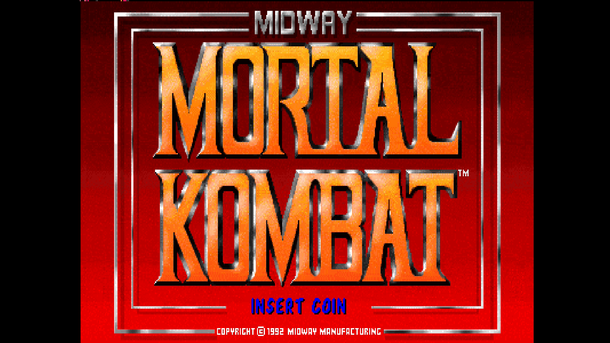
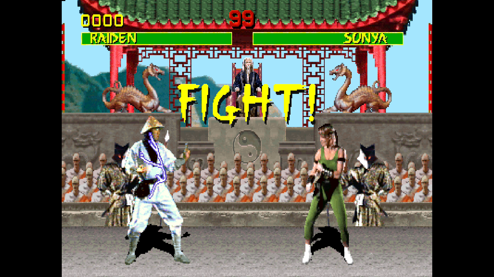

# Mortal Kombat

[Back to the core's README](../README.md)

Mortal Kombat (Midway, 1992) in its T-Unit revisions, with the ADPCM sound
board. The earlier Y Unit revisions are not part of this core.

 

- [Versions](#versions)
- [Controls](#controls)
- [Extra content](#extra-content)
- [Move List](#move-list)
- [Secrets](#secrets)
- [Finishing Moves](#finishing-moves)
- [Fixed AI Difficulty](#fixed-ai-difficulty)
- [Cheats](#cheats)

## Versions

| MRA | MAME set |
|---|---|
| Mortal Kombat (rev 5.0 T-Unit 03-19-93) | mk |
| Mortal Kombat (rev 4.0 T-Unit 02-11-93) | mkr4 |
| Mortal Kombat (Turbo Ninja T-Unit 03-19-93, hack) | mktturbo |
| Mortal Kombat Plus (v5.0.0741, hack) | mk07 (HBMAME) |

The first is in `_Arcade`, the others in `_Arcade/_alternatives/_Mortal Kombat`.
With a merged ROM set they all load from `mk.zip`, the same zip as the Y Unit
Mortal Kombat sets, except Mortal Kombat Plus, which loads HBMAME's.

Mortal Kombat Plus is a hack of rev 5.0 that is not in MAME; it comes from
HBMAME. Its merged `mk.zip` (the rev 5.0 files and the hack's own, in the
`mk07` folder) goes in `games/hbmame`, while MAME's `mk.zip` stays in
`games/mame` for the other versions. Its settings are kept apart from rev
5.0's. The core's extras work on it as on rev 5.0, on the hack's own program,
except the Move List, which is its own.

## Controls

Two players. The buttons, in the order MiSTer's Define joystick buttons asks
for them: High Punch, Low Punch, High Kick, Low Kick, Block, Start, Coin, Test
(service mode) and Pause. The game's second Block input (Block 2) is not
mapped; Block does the same.

<!-- extra-content:start (from ExtraContent.md by tools/extra_content.py) -->
## Extra content

Nine extras on rev 5.0, rev 4.0, the Turbo Ninja hack and the Plus hack: two hidden menus, two Reptile options, Finishing Moves, a Move List window, Attract Sound, Fixed AI Difficulty, and a Cheats menu (24 cheats on rev 5.0 and Plus, one on the others). The Plus hack has a Move List of its own.

| Feature | What it adds | OSD page |
| --- | --- | --- |
| EJB Menu | The programmers' menu: diagnostics, coin bookkeeping, game audits, a hidden Hello page, initials entry and every character's ending | Extras |
| EJB Menu (Copyright Screen) | The same menu, reached through the hidden "This is Mortal Kombat" copyright screen | Extras |
| Reptile Fight Next | Reptile fights after the next match you win in a 1-player game. Select again to cancel; used up when his fight starts | Extras |
| Moon Silhouettes | Every match on The Pit has the silhouettes crossing the moon, and with them the chance to win flawless, never Block, finish with a fatality, and meet Reptile | Extras |
| Finishing Moves | Pick a fighter's fatality (7 fighters, in alphabetical order). At the next FINISH HIM that fighter wins, the core has the game call the fatality and taps the one button it runs on, waiting for the right distance. A message says when it is too far or too close, or not taken. The Plus hack has a page of its own: eight fighters with Reptile, and the Babalities the hack adds | Extras (Auto Finishing Moves) |
| Move List window | Every fighter's special moves, fatality and the distance each needs, over the game's paused title screen: in alphabetical order: page 1 (Johnny Cage, Kano, Liu Kang, Raiden), page 2 (Scorpion, Sonya, Sub-Zero). Set it On in the OSD, close the OSD and turn the pages with Left and Right; open the OSD to set it Off. Distances are given as Close, Sweep, Jump, Half screen, Full screen. The moves are rev 5.0's, found in the game's program and played in MAME (each page ends with the address of MKKomplete's guide); the Plus hack has its own window | Extras |
| Plus Move List window (Mortal Kombat Plus only) | Five pages over the game's paused title screen: three of fighters in alphabetical order (Johnny Cage, Kano and Liu Kang; Raiden, the hidden Reptile and Scorpion; Sonya and Sub-Zero) with the special moves, the fatality and the Babality and their distances, then the general moves with what Plus adds, and notes on the Babalities, The Pit and the distances. The moves the hack adds are marked +. Turned with Left and Right like the other windows. The moves are the Mortal Kombat Plus guide's (MKKomplete; each page ends with its address) | Extras |
| Attract Sound | Default: the game stops the attract mode's sound after a few attract cycles. Always On: the sound plays through the attract mode. Reset to apply the change (the Sound Options page says so); a message names the setting, "Attract Sound: Always On" or "Attract Sound: Default". The Attract Sound DIP switch still applies | Sound Options |
| Fixed AI Difficulty | Pins the computer opponent's level: Off, or 0 (easiest) to 9. The game raises the level after matches you win and lowers it after matches you lose; with the option on, the computer plays at the chosen level whatever the game thinks it is, in 1-player games; the demo fights between games keep the game's own level. Off gives the game's own level back at once. Not applied while the test menu is selected | Extras |
| Cheats menu | 24 cheats on rev 5.0 and Plus (infinite time and energy for both players, drain a player's energy, one-button fatalities, no blocking, hit anywhere, night mode, secret screens and more) and Always have Reptile Clues (Reptile drops in with a hint before every round) on all four versions. The list is on the Mortal Kombat page | Extras (Cheats) |

<!-- extra-content:end -->

## Move List

The OSD's Move List option (Off, On) shows a window over the game, on the
game's title screen, with every fighter's special moves, fatality and the
distance it needs, in alphabetical order: page 1 has Johnny Cage, Kano, Liu Kang and Raiden, page 2
Scorpion, Sonya and Sub-Zero; each fighter's moves are in alphabetical order too. Set it On, close the OSD, and turn the pages
with Left and Right on either controller (from page 2 on to page 1, and Left
from page 1 to page 2); open the OSD and set Move List to Off to play on. The
game waits while the window is on. The window only shows the moves; the core
does not enter them for you (the Auto Finishing Moves page does that).

Commands as the game reads them: F toward the opponent, B away; (BL B F)
means Block held while you enter B F; X+Y pressed together. The list is
the one of rev 5.0; rev 4.0 and the Turbo Ninja hack may differ (the hack's
own moves are not in it). Mortal Kombat Plus has a list of its own (below). The rev 5.0 list was found
in the game's program and played in MAME; the last row of each page names
MKKomplete's guide for the game,
https://icemantraveler.github.io/mkksg/mk1/default.htm.

| Fighter | Move | Command |
|---|---|---|
| Johnny Cage | Green Bolt | B F LP |
|  | Shadow Kick | B F LK |
|  | Split Punch | LP+BL |
| Kano | Cannonball | F D B U |
|  | Knife Throw | (BL B F) |
| Liu Kang | Fireball | F F HP |
|  | Flying Kick | F F HK |
| Raiden | Lightning | D F LP |
|  | Teleport | D U |
|  | Torpedo | B B F |
| Scorpion | Spear | B B LP |
|  | Teleport | D B HP |
| Sonya | Leg Grab | D+LP+LK+BL |
|  | Ring Toss | LP B LP, quickly (all within about 0.4 s) |
|  | Square Wave | F B HP |
| Sub-Zero | Freeze | D F LP |
|  | Slide | B+LP+LK+BL |

### Mortal Kombat Plus

The Plus hack's Move List has five pages: three of fighters in alphabetical order (Johnny Cage,
Kano and Liu Kang; Raiden, the hidden Reptile and Scorpion; Sonya and
Sub-Zero) with each fighter's special moves, fatality and Babality and the
distance each needs, then the moves every fighter has with what Plus adds, and
notes on the Babalities, The Pit and the distances. The rows Plus adds are
marked + in the window and the table, and each fighter's moves are in alphabetical order. Turn the pages as above. The moves are
the Mortal Kombat Plus guide's (MKKomplete,
https://icemantraveler.github.io/mkksg/fan_made/mkplus/default.htm, named on
the last row of each page); the core lists them and does not play them back. The
guide writes Kano's Cannonball and Liu Kang's fatality as (BL) F D B U F,
longer than the rev 5.0 list above.

Babalities: do not press LP, HP or BL in either round. Holding BL through a
fatality is fine, but let go before the last button.

| Fighter | Move | Command | Distance |
|---|---|---|---|
| Johnny Cage | Green Bolt | B F LP |  |
|  | Shadow Kick | B F LK |  |
|  | Split Punch | LP+BL | Close |
|  | Babality | D D D HK | Anywhere |
|  | Fatality: Decap Uppercut | F F F HP | Close |
| Kano | Cannonball | (BL) F D B U F, hold BL to extend the hover |  |
|  | Knife Throw | (BL B F) |  |
|  | Babality | F D B LK | Anywhere |
|  | Fatality: Heart Rip | B D F LP | Close |
| Liu Kang | Fireball | F F HP |  |
|  | Flying Kick | F F HK |  |
|  | Babality | B F F LK | Anywhere |
|  | Fatality: Butterfly Kick | (BL) F D B U F, Deadly Uppercut; must be within range to connect | Anywhere |
| Raiden | Lightning Bolt | D F LP |  |
|  | Teleport | D U |  |
|  | + Torpedo | B B F, also works in the air |  |
|  | Babality | B D B HK | Anywhere |
|  | Fatality: Electro-Decap | F B B B HP | Close |
| Reptile (hidden) | + Freeze | D F LP |  |
|  | + Slide | B+LP+LK+BL |  |
|  | + Spear | B B LP |  |
|  | + Teleport Punch | D B HP, also works in the air |  |
|  | Babality | D B B HK | Anywhere |
|  | Fatality: Spine Rip | F D F HP | Close |
|  | Fatality: Toasty! | (BL) U U | Sweep |
| Scorpion | Spear | B B LP |  |
|  | + Teleport Punch | D B HP, also works in the air |  |
|  | Babality | D B B HK | Anywhere |
|  | Fatality: Toasty! | (BL) U U | Sweep |
| Sonya | Energy Rings | LP B LP |  |
|  | Leg Grab | D+LP+LK+BL | Close |
|  | Square Wave Punch | F B HP |  |
|  | Babality | F B F HK | Anywhere |
|  | Fatality: Flame Kiss | F F B B BL, hold BL for F F B B, let go, then press BL again | Anywhere |
| Sub-Zero | Freeze | D F LP |  |
|  | Slide | B+LP+LK+BL |  |
|  | Babality | D B B HK | Anywhere |
|  | Fatality: Spine Rip | F D F HP | Close |
The general moves: Throw (LP, close), Head-Blow (HP, close), Knee (LK or HK,
close), Crouched Block (D+BL), Uppercut (D+LP or HP), Crouched Kick (D+LK or
HK), Foot Sweep (B+LK), Roundhouse Kick (B+HK), Flying Punch (U, UF or UB +
LP or HP) and Flying Kick (U, UF or UB + LK or HK). Added by Plus: Raiden's
Torpedo and Scorpion's Teleport Punch also work in the air, and Reptile is a
hidden fighter with Sub-Zero's and Scorpion's moves and fatalities and his
own second fatality. On The Pit, finish with an uppercut (D+HP), close.

## Secrets

On the OSD's Extras page. The game drops a half-entered code when the
attract mode moves to its next screen; the core then enters the code again
(three tries at most).

| OSD item | What it does |
|---|---|
| EJB Menu | The programmers' menu ("Mortal Kombat EJB Menu"): diagnostics, coin bookkeeping, game audits, a hidden Hello page, initials entry and every character's ending |
| EJB Menu (Copyright Screen) | The same menu, after a hidden copyright screen ("This is Mortal Kombat") |
| Moon Silhouettes | Every match on The Pit has the silhouettes crossing the moon, and with them the chance: a flawless, no-Block win there finished with a fatality brings Reptile |
| Reptile Fight Next | Reptile comes after the next match you win in a 1-player game, wherever it is and however you won. Select it again to cancel; it is used up when his fight starts |

### Reptile

All four versions have Reptile, the secret green ninja. In the game you
meet him in a 1-player game, after a match on The Pit while a silhouette
crosses the moon: win both rounds flawless, never press Block and finish
with a fatality, and Reptile challenges you on the spikes below ("You have
found me / Now prove yourself!!"; his energy bar reads Scorpion). The
silhouettes come rarely: after power-up the game counts 40 won matches, the
next match on The Pit then has them, and the count starts over. Before a
round Reptile very rarely drops in with a hint ("Look to La Luna",
"Blocking will get you nowhere", ...): the game counts every round the
cabinet plays in the CMOS (the Green Ninja Counter audit) and sends him at
2000 (Mortal Kombat Plus: 100).

Messages: "Reptile fight set: win a match in a 1-player game" and "Reptile
fight cleared"; when the OSD closes, what Moon Silhouettes just turned
on. Moon Silhouettes stays on until you turn it off, and so does
Always have Reptile Clues in the [Cheats](#cheats) menu. The core changes a
few of the game's instructions as the CPU fetches them (nothing is written
to the ROM or the CMOS, and the game's own reads of its ROM still see the
original), so turning an option off puts the game back at once. One
difference with the real hints: when Reptile shows up by himself the game
also clears its audits (the EJB Menu's bookkeeping); with Always have
Reptile Clues the core skips that, so the audits are kept.

Turbo Ninja changed the rules: no silhouettes and no flawless rounds are
needed, and a match on one other stage can bring him as well as The Pit
(Block and the fatality still count). The options work the same on it.

## Finishing Moves

The OSD's Auto Finishing Moves page (opened from the Extras page) plays a fighter's fatality for you. Pick
the Character, then the fatality listed under it: the OSD closes and the move
is set. It plays at the next FINISH HIM where that fighter is the winner, for
either player. With "Pause When OSD is Open" (the default) you can open the OSD
at FINISH HIM and pick the move then. The page lists the fatality with the
distance it needs (the commands are in the table below); the note at the
bottom reads "Select a finishing move and then move to the required
distance".

Mortal Kombat's fatalities are direct finishers: the core does not enter the
combination, it has the game call the fighter's fatality and taps for you only
the button the game runs it on (you press nothing): High Punch for Johnny
Cage, Sub-Zero and Raiden, Low Punch for Kano, Block for Sonya, Down for Liu
Kang, Up with Block held for Scorpion. It starts when the loser stands dizzy
and the winner stands still; the player's own controls are ignored meanwhile.
The game still checks that it is FINISH HIM, that the winner stands ready and
that the distance fits the move (the distances below), so a call that does not
fit is refused as a mistyped combination is. When the fighters are too far
apart or too close, a message says so and the move waits; step in or out and it
goes as soon as the distance fits. The core taps up to five times (about a
second), stopping when the game takes the move; the call exists only while it
taps. Messages also say when FINISH HIM ends before the move could start (the
move stays set for the next one) and when the game did not take the move. A
move is used once; "Clear the set move" drops a set move.

The Pit is not on the page: on The Pit's stage the game's own finisher is a
standard uppercut (D+HP, close), which you enter yourself.

The Character option lists the fighters alphabetically; each fighter's moves are by type, the fatalities first and the Babality last (Mortal Kombat Plus has two or three).

Mortal Kombat Plus has a page of its own, with the Babalities the hack adds and
the hidden Reptile (see [below](#mortal-kombat-plus-finishing-moves)). The
commands in the table above are rev 5.0's.

Commands as the game reads them: F toward the opponent, B away, U up, D
down; HP / LP / HK / LK / BL High Punch, Low Punch, High Kick, Low Kick,
Block. (X) means X held during the rest of the command and let go at the
end.

Distances: Close (touching, up to about a step away), Sweep (within a
sweep's reach), Jump (beyond the sweep, about a jump away), Half screen, Full
screen, Anywhere; "Close to sweep" means anywhere from close up to a sweep
away. Measured in MAME: a sweep reaches about 116 pixels between the
fighters, a forward jump covers about 165; the zones are Close up to 79,
Sweep 80-127, Jump 128-199, Half screen 200-259, Full screen 260 or more.

| Fighter | Move | Command | Distance |
|---|---|---|---|
| Johnny Cage | Decapitation | F F F HP | Close |
| Kano | Heart Rip | B D F LP | Close |
| Liu Kang | Cartwheel | D B U F D | Anywhere |
| Raiden | Electrocution | F B B B HP | Sweep |
| Scorpion | Fire Breath | (BL) U U | Sweep to jump |
| Sonya | Kiss of Death | F F B B BL | Anywhere |
| Sub-Zero | Spine Rip | F D F HP | Close |

### Mortal Kombat Plus Finishing Moves

Mortal Kombat Plus has a page of its own: eight fighters, Reptile included, each
with his fatality and the Babality the hack adds, under the names of the hack's
guide. The fatalities are direct finishers as above (the hack calls them through
the same handlers). A Babality is direct too: the hack has two Babality routines,
one for the Babalities that end with High Kick and one for Low Kick, and the core
has the game call the one it needs and taps that kick once. Babalities work at
any distance, but the game takes one only after a round won without punches or
Block; a message says so when it is not taken. Reptile's Spine Rip and Toasty!
use the Sub-Zero and Scorpion handlers; the hack gives Reptile a character number
of his own (9), which the core follows, and the game measures these two moves by
the fighters' places on the screen, so his Toasty! has a band of its own (Jump).
In MAME the core played the seven fatalities and the seven Babalities of the
other fighters at a FINISH HIM won with kicks only, and Reptile's Spine Rip,
Toasty! and Babality as Reptile.

| Fighter | Move | Command | Distance |
|---|---|---|---|
| Johnny Cage | Decap Uppercut | F F F HP | Close |
|  | Babality | D D D HK | Anywhere |
| Kano | Heart Rip | B D F LP | Close |
|  | Babality | F D B LK | Anywhere |
| Liu Kang | Butterfly Kick | (BL) F D B U F | Anywhere |
|  | Babality | B F F LK | Anywhere |
| Raiden | Electro-Decap | F B B B HP | Sweep |
|  | Babality | B D B HK | Anywhere |
| Reptile | Spine Rip | F D F HP | Close |
|  | Toasty! | (BL) U U | Jump |
|  | Babality | D B B HK | Anywhere |
| Scorpion | Toasty! | (BL) U U | Sweep to jump |
|  | Babality | D B B HK | Anywhere |
| Sonya | Flame Kiss | F F B B BL | Anywhere |
|  | Babality | F B F HK | Anywhere |
| Sub-Zero | Spine Rip | F D F HP | Close |
|  | Babality | D B B HK | Anywhere |

## Fixed AI Difficulty

The OSD's Fixed AI Difficulty option (Off, then 0 to 9; Off by default, on the Extras page) pins the computer opponent's level. The game
keeps that level in one number, 0 (easiest) to 9, and raises it after matches
you win and lowers it after matches you lose; the computer's play follows it.
With the option on, the computer plays at the level you picked whatever the
game thinks the level is, through wins and losses in 1-player games. The demo
fights that play between games are left alone: they run at the level the game
gives them, as in the original, so the attract mode looks the same with the
option on. Set it to Off and the game's own level is back at once. A change
takes effect as the game next reads the level.

The option pins the level; it does not change how the computer plays at a
given level. It has no effect on 2-player fights, and it is off while the test
menu is selected (Service Menu, the Test button or the Test Switch DIP), so
the diagnostics see the game as it is.

## Cheats

The OSD's Cheats menu (on the Extras page) lists the cheats
of the loaded version: 24 on rev 5.0 and Mortal Kombat Plus, and Always have
Reptile Clues alone on rev 4.0 and the Turbo Ninja hack. Select one to switch it on or off; a mark
shows the ones that are on. All are off each time a game loads: the OSD does
not keep them across loads.

Always have Reptile Clues makes Reptile drop in with a hint before every round (see [Reptile](#reptile)). The core
finds its code in each version's program. The other 23 are from MAME's cheat
file for rev 5.0; its addresses are for that revision only, so rev 4.0 and the
Turbo Ninja hack do not have them. Mortal Kombat Plus keeps the game's
variables and routines at the same addresses, so it has all of them. The names are MAME's, cut to the 27 characters the
OSD shows. Versions are named by their MAME set (see [Versions](#versions)).

| Cheat | Units | Versions |
|---|---|---|
| Always Get Fatality Bonus | 1 | mk, mk07 |
| Always have Reptile Clues | 2 | All |
| Always Secret Game Over | 1 | mk, mk07 |
| Attract Mode Volume Never | 1 | mk, mk07 |
| Bloody Floors | 1 | mk, mk07 |
| Break Test Your Might | 1 | mk, mk07 |
| CPU Performs Fatalities | 1 | mk, mk07 |
| CPU Players Won't Block | 3 | mk, mk07 |
| Disable Blocking | 1 | mk, mk07 |
| Enable Single Round Matches | 1 | mk, mk07 |
| Get Double Flawless Bonus | 1 | mk, mk07 |
| Hit Anywhere (Both Players) | 1 | mk, mk07 |
| I Am Reptile. Find Me! | 1 | mk, mk07 |
| Infinite Fatality Time | 1 | mk, mk07 |
| Infinite Time | 2 | mk, mk07 |
| Night Mode | 1 | mk, mk07 |
| One Button Fatalities | 7 | mk, mk07 |
| P1 Drain All Energy Now! | 1 | mk, mk07 |
| P1 Infinite Energy | 1 | mk, mk07 |
| P2 Drain All Energy Now! | 2 | mk, mk07 |
| P2 Infinite Energy | 1 | mk, mk07 |
| Pit Bottom in Stage Lineup | 1 | mk, mk07 |
| Single Opponent Endurance | 1 | mk, mk07 |
| View Ending after 1P Match | 2 | mk, mk07 |

How a cheat acts: one that sets a value makes the game read that value from the word it names, or only the bits of the word it covers (one byte, one player's flag), whenever the CPU reads it while the game runs with interrupts on; the game's own value is never written over, so switching the cheat off gives the game back at once, and the diagnostics' RAM test sees the game as it is. One that changes the game's program replaces a word of it as the CPU fetches it as an instruction; nothing is written to the ROM. The Units column is how many of the core's 8 cheat entries a cheat uses: switch cheats on until their units add up to 8 at most; the menu refuses a switch-on that would pass 8.

P1 Drain All Energy Now! and P2 Drain All Energy Now! act once: switching one
on makes the board write the empty energy into the game, and switching
another cheat on or off does not repeat it. Switch it off and on to do it
again. Leave the player's Infinite Energy off while you use it, or the bar is
full again at once. P1 Infinite Energy and P2 Infinite Energy show the game
full energy (A1h) and store full energy when the game writes it, and once
when switched on, so the bar is still full when they are switched off.
