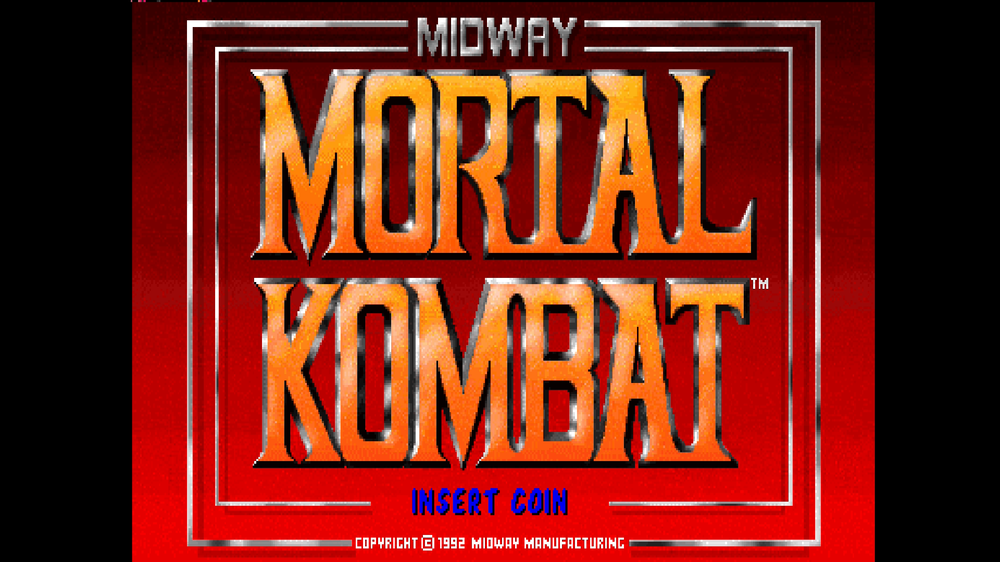
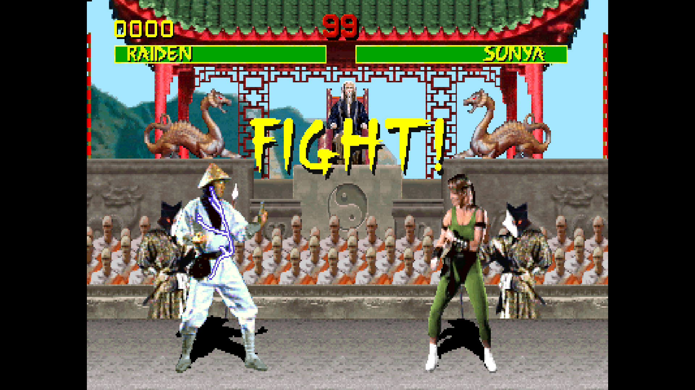

# Mortal Kombat

[Back to the core's README](../README.md)

Mortal Kombat (Midway, 1992) in its T-Unit revisions, with the ADPCM sound
board. The earlier Y Unit revisions are not part of this core.

 

- [Versions](#versions)
- [Controls](#controls)
- [Extra content](#extra-content)
- [Move List](#move-list)
- [Secrets](#secrets)
- [Finishing Moves](#finishing-moves)

## Versions

| MRA | MAME set |
|---|---|
| Mortal Kombat (rev 5.0 T-Unit 03-19-93) | mk |
| Mortal Kombat (rev 4.0 T-Unit 02-11-93) | mkr4 |
| Mortal Kombat (Turbo Ninja T-Unit 03-19-93, hack) | mktturbo |

The first is in `_Arcade`, the others in `_Arcade/_alternatives/_Mortal Kombat`.
With a merged ROM set they all load from `mk.zip`, the same zip as the Y Unit
Mortal Kombat sets.

## Controls

Two players. The buttons, in the order MiSTer's Define joystick buttons asks
for them: High Punch, Low Punch, High Kick, Low Kick, Block, Start, Coin, Test
(service mode) and Pause. The game's second Block input (Block 2) is not
mapped; Block does the same.

<!-- extra-content:start (from ExtraContent.md by tools/extra_content.py) -->
## Extra content

Seven extras on rev 5.0, rev 4.0 and the Turbo Ninja hack: two hidden menus, three Reptile options, Finishing Moves, and a Move List window.

| Feature | What it adds | OSD page |
| --- | --- | --- |
| EJB Menu | The programmers' menu: diagnostics, coin bookkeeping, game audits, a hidden Hello page, initials entry and every character's ending | Hidden Items |
| EJB Menu (Copyright Screen) | The same menu, reached through the hidden "This is Mortal Kombat" copyright screen | Hidden Items |
| Reptile Fight Next | Reptile fights after the next match you win in a 1-player game. Select again to cancel; used up when his fight starts | Hidden Items |
| Moon Silhouettes Always | Every match on The Pit has the silhouettes crossing the moon, and with them the chance to win flawless, never Block, finish with a fatality, and meet Reptile | Hidden Items |
| Reptile Hints Always | Reptile drops in with a hint before every round | Hidden Items |
| Finishing Moves | Pick a fighter's fatality or The Pit (7 fighters). At the next FINISH HIM that fighter wins, the core takes the winner's controls and enters the move, waiting for the right distance. A message says when it is too far or too close, on the wrong stage, or not taken | Finishing Moves |
| Move List window | Every fighter's special moves, fatality and the distance each needs, over the game's paused title screen: List 1 (Johnny Cage, Kano, Sub-Zero, Sonya), List 2 (Raiden, Liu Kang, Scorpion). Distances are given as Close, Sweep, Jump, Half screen, Full screen | Move List |

<!-- extra-content:end -->

## Move List

The OSD's Move List option (Off, List 1, List 2) shows a window over the
game, on the game's title screen, with every fighter's special moves,
fatality and the distance it needs: List 1 has Johnny Cage, Kano, Sub-Zero
and Sonya, List 2 Raiden, Liu Kang and Scorpion. The game waits while the
window is on; set Move List to Off to play on. The window only shows the
moves; the core does not enter them for you (the Finishing Moves page does
that).

Commands as the game reads them: F toward the opponent, B away; (BL B F)
means Block held while you enter B F; X+Y pressed together. The list is
the one of rev 5.0; rev 4.0 and the Turbo Ninja hack may differ.

| Fighter | Move | Command |
|---|---|---|
| Johnny Cage | Green Bolt | B F LP |
|  | Shadow Kick | B F LK |
|  | Split Punch | LP+BL |
| Kano | Knife Throw | (BL B F) |
|  | Cannonball | F D B U |
| Sub-Zero | Freeze | D F LP |
|  | Slide | B+LP+LK+BL |
| Sonya | Ring Toss | LP B LP, quickly (all within about 0.4 s) |
|  | Leg Grab | D+LP+LK+BL |
|  | Square Wave | F B HP |
| Raiden | Lightning | D F LP |
|  | Teleport | D U |
|  | Torpedo | B B F |
| Liu Kang | Fireball | F F HP |
|  | Flying Kick | F F HK |
| Scorpion | Spear | B B LP |
|  | Teleport | D B HP |

## Secrets

On the OSD's Hidden Items page. The game drops a half-entered code when the
attract mode moves to its next screen; the core then enters the code again
(three tries at most).

| OSD item | What it does |
|---|---|
| EJB Menu | The programmers' menu ("Mortal Kombat EJB Menu"): diagnostics, coin bookkeeping, game audits, a hidden Hello page, initials entry and every character's ending |
| EJB Menu (Copyright Screen) | The same menu, after a hidden copyright screen ("This is Mortal Kombat") |
| Moon Silhouettes Always | Every match on The Pit has the silhouettes crossing the moon, and with them the chance: a flawless, no-Block win there finished with a fatality brings Reptile |
| Reptile Fight Next | Reptile comes after the next match you win in a 1-player game, wherever it is and however you won. Select it again to cancel; it is used up when his fight starts |
| Reptile Hints Always | Reptile drops in with a hint before every round |

### Reptile

All three versions have Reptile, the secret green ninja. In the game you
meet him in a 1-player game, after a match on The Pit while a silhouette
crosses the moon: win both rounds flawless, never press Block and finish
with a fatality, and Reptile challenges you on the spikes below ("You have
found me / Now prove yourself!!"; his energy bar reads Scorpion). The
silhouettes come rarely: after power-up the game counts 40 won matches, the
next match on The Pit then has them, and the count starts over. Before a
round Reptile very rarely drops in with a hint ("Look to La Luna",
"Blocking will get you nowhere", ...): the game counts every round the
cabinet plays in the CMOS (the Green Ninja Counter audit) and sends him at
2000.

Messages: "Reptile fight set: win a match in a 1-player game" and "Reptile
fight cleared"; when the OSD closes, what an Always option just turned on.
The two Always options stay on until you turn them off. The core changes a
few of the game's instructions as the CPU fetches them (nothing is written
to the ROM or the CMOS, and the game's own reads of its ROM still see the
original), so turning an option off puts the game back at once. One
difference with the real hints: when Reptile shows up by himself the game
also clears its audits (the EJB Menu's bookkeeping); with Reptile Hints
Always the core skips that, so the audits are kept.

Turbo Ninja changed the rules: no silhouettes and no flawless rounds are
needed, and a match on one other stage can bring him as well as The Pit
(Block and the fatality still count). The options work the same on it.

## Finishing Moves

The OSD's Finishing Moves page enters a fighter's fatality or The Pit for
you. Pick the Character, then one of the moves listed under it: the OSD
closes and the move is set. It plays at the next FINISH HIM where that
fighter is the winner, for either player. With "Pause when OSD is open" (the default) you can open
the OSD at FINISH HIM and pick the move then.

When the loser stands dizzy and the winner stands still, the core takes the
winner's controls (the player's own are ignored meanwhile) and enters the
move. Many moves only work at a certain distance: when the fighters are too
far apart or too close, a message says so and the move waits; step in or
out and it goes as soon as the distance fits. Messages also say when The Pit
is set on another stage, when FINISH HIM ends before the move could start
(the move stays set for the next one) and when the game did not take the
move. A move is used once; "Clear the set move" drops a set move.

Commands as the game reads them: F toward the opponent, B away, U up, D
down; HP / LP / HK / LK / BL High Punch, Low Punch, High Kick, Low Kick,
Block. (X) means X held during the rest of the command and let go at the
end. The Pit works on The Pit stage only.

Distances: Close (touching, up to about a step away), Sweep (within a
sweep's reach), Jump (beyond the sweep, about a jump away), Half screen, Full
screen, Anywhere; "Close to sweep" means anywhere from close up to a sweep
away. Measured in MAME: a sweep reaches about 116 pixels between the
fighters, a forward jump covers about 165; the zones are Close up to 79,
Sweep 80-127, Jump 128-199, Half screen 200-259, Full screen 260 or more.

| Fighter | Move | Command | Distance |
|---|---|---|---|
| Johnny Cage | Decapitation | F F F HP | Close |
| Kano | Heart Rip | B D F LP | Close |
| Sub-Zero | Spine Rip | F D F HP | Close |
| Sonya | Kiss of Death | F F B B BL | Anywhere |
| Raiden | Electrocution | F B B B HP | Sweep |
| Liu Kang | Cartwheel | D B U F D | Anywhere |
| Scorpion | Fire Breath | (BL) U U | Sweep to jump |

Every fighter also has The Pit: D+HP, close.
