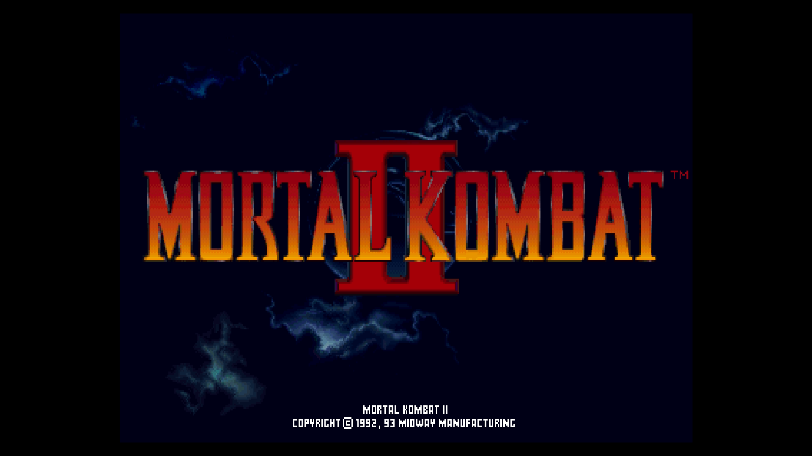
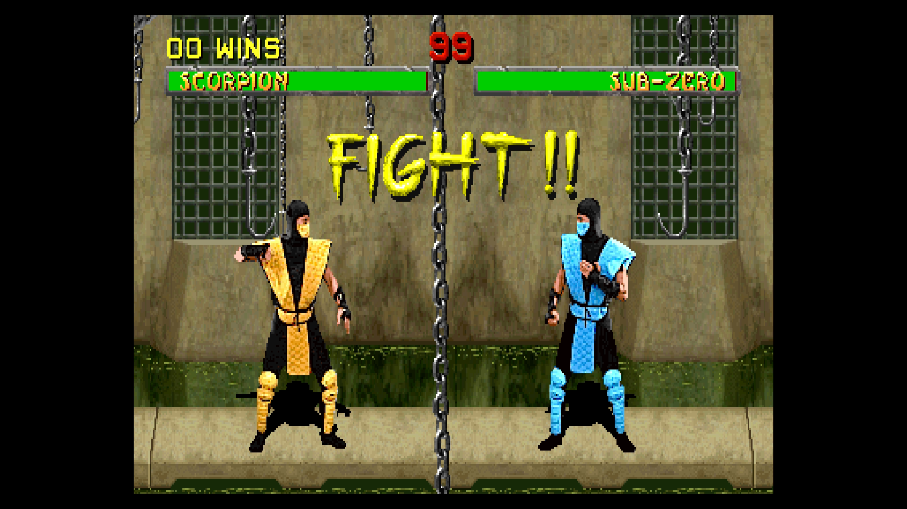

# Mortal Kombat II

[Back to the core's README](../README.md)

Mortal Kombat II (Midway, 1993) on the T-Unit board, with the DCS sound board.

 

- [Versions](#versions)
- [Controls](#controls)
- [Extra content](#extra-content)
- [Move List](#move-list)
- [Secrets](#secrets)
- [Finishing Moves](#finishing-moves)
- [Fixed AI Difficulty](#fixed-ai-difficulty)
- [Cheats](#cheats)
- [Mortal Kombat II Plus](#mortal-kombat-ii-plus)
- [Mortal Kombat II rev 4.0](#mortal-kombat-ii-rev-40)

## Versions

| MRA | MAME set |
|---|---|
| Mortal Kombat II (rev L3.1) | mk2 |
| Mortal Kombat II (rev L3.2, European) | mk2r32e |
| Mortal Kombat II (rev L3.1, European) | mk2r31e |
| Mortal Kombat II (rev L3.0) | mk2r30 |
| Mortal Kombat II (rev L2.1) | mk2r21 |
| Mortal Kombat II (rev L2.0) | mk2r20 |
| Mortal Kombat II (rev L1.4) | mk2r14 |
| Mortal Kombat II (rev L1.1) | mk2r11 |
| Mortal Kombat II (rev L4.2, hack) | mk2r42 |
| Mortal Kombat II (rev L9.1, hack) | mk2r91 |
| Mortal Kombat II Challenger (hack) | mk2chal |
| Mortal Kombat II (rev 4.0, hack) | mk2s08 (HBMAME) |
| Mortal Kombat II Plus (Beta 1, hack) | mk2s03 (HBMAME) |
| Mortal Kombat II Plus (Beta 2, hack) | mk2s04 (HBMAME) |

The first is in `_Arcade`, the others in `_Arcade/_alternatives/_Mortal Kombat II`.
With a merged ROM set they all load from MAME's `mk2.zip`, except rev 4.0 and Mortal Kombat II Plus, which load HBMAME's.

Mortal Kombat II Plus (Beta 1 and Beta 2) and rev 4.0 are hacks that are not
in MAME; they come from HBMAME. HBMAME's merged `mk2.zip` (the rev L3.1 files and
the hacks' own, in the `mk2s03`, `mk2s04` and `mk2s08` folders) goes in
`games/hbmame`, while MAME's `mk2.zip` stays in `games/mame` for the other
versions. Each hack's settings are kept apart from rev L3.1's.

Mortal Kombat II Plus changes the fighters, their moves and the service menu.
The core adds Fixed AI Difficulty and the [Cheats](#cheats) to it and gives it
a Move List and View Secrets of its own,
[described below](#mortal-kombat-ii-plus). The OSD has the Finishing Moves page
of the arcade game's moves (the fighters and moves the hack adds are not on it),
but no EJB Menu or Security Screen, because the hack changes the code those are built on.

Rev 4.0 has its code and variables in other places than the other versions.
The core finds them again: it has the Finishing Moves, the Move List,
Fixed AI Difficulty and 10 [Cheats](#cheats). It does not have the EJB Menu,
the Security Screen or Show Hitboxes, which the core does not find in its
program, so its OSD has no EJB Menu or Security Screen. Its Finishing Moves and Move
List are its own, [below](#mortal-kombat-ii-rev-40).

## Controls

Two players. The buttons, in the order MiSTer's Define joystick buttons asks
for them: High Punch, Low Punch, High Kick, Low Kick, Block, Start, Coin, Test
(service mode) and Pause. The game's second Block input (Block 2) is not
mapped; Block does the same.

<!-- extra-content:start (from ExtraContent.md by tools/extra_content.py) -->
## Extra content

Across the 11 versions in MAME and the rev 4.0 hack: two hidden items, Finishing Moves for all 12 fighters (15 on rev 4.0, 17 on Plus), a Move List window, Attract Sound, Fixed AI Difficulty, and a Cheats menu (44 cheats on L3.1, 7 to 11 on the other versions). Revision limits are noted per row; rev 4.0 (hack) has no hidden items, and its Move List window and Finishing Moves have pages and moves of its own. Mortal Kombat II Plus (Beta 1 and Beta 2, hacks) have Finishing Moves for the arcade game's moves and the five new fighters', Fixed AI Difficulty, four cheats and two windows of its own, a Move List and View Secrets: they add fighters, moves and secrets and change the code the Hidden Items are built on, so their OSD has no Hidden Items page.

| Feature | What it adds | OSD page |
| --- | --- | --- |
| EJB Menu | The programmers' menu: diagnostics, coin bookkeeping, game audits, a hidden Hello page, initials entry and every character's ending. L1.1 and L1.4 have the menu but never check for its code, so the core connects it while the code plays | Extras |
| Security Screen | Each attract cycle starts with a hidden "This version passed the security test" screen | Extras |
| Finishing Moves | Pick a fighter (fighters in alphabetical order, each fighter's moves by type: fatalities, Stage Fatality and Dead Pool, friendship, babality) and a fatality, friendship, babality, Stage Fatality or the Dead Pool (12 fighters, the hacks' hidden ones included: 15 on rev 4.0, 17 on Plus). The core enters it on the winner's controls at the next FINISH HIM, waits for the right distance, and reports a wrong stage, or too far or too close. Rev L2.0 and later, Plus and rev 4.0 have every move but the Dead Pool as a direct finisher: the core has the game call the move and presses only the button it runs on (the moves that hold a button take a short hold for the long one). A revision's page lists only the moves that revision has; Plus lists rev L3.1's and the moves of the hack's five fighters (17 fighters); rev 4.0 (hack) lists its own moves (15 fighters with Ermac, Jade and Rain, no friendships, 66 moves and the Dead Pool; Liu Kang's Red Dragon Flame works in his red costume only) | Extras (Auto Finishing Moves) |
| Move List window | A page per fighter (55 moves in all) with the special moves and finishing moves and their distances, over the game's paused title screen. Set it On in the OSD, close the OSD and turn the pages with Left and Right, from Baraka to Sub-Zero and round; open the OSD to set it Off. Raiden's Super Uppercut, which needs a button held from before FINISH HIM, is listed there too. The moves are rev L3.1's; rev 4.0 and Plus have their own windows | Extras |
| Rev 4.0 Move List window (rev 4.0 only) | 19 pages over the game's paused title screen: a page per fighter in alphabetical order, 15 in all (the 12 fighters and the hidden Jade, Ermac and Rain), with the special moves, the finishing moves and their distances and the morphs of Shang Tsung (a second page for his finishing moves), then three pages on what rev 4.0 changes and on the secret opponents. A + marks what rev 4.0 adds to the arcade game's moves. Turned with Left and Right like the other windows. The moves are the author's guide (v4.0) | Extras |
| Attract Sound | Default: the game stops the attract mode's sound after 3 attract cycles. Always On: the sound plays through the attract mode. Reset to apply the change (the Sound Options page says so); a message names the setting, "Attract Sound: Always On" or "Attract Sound: Default". The Attract Sound DIP switch still applies. Every version, Plus included | Sound Options |
| Fixed AI Difficulty | Pins the computer opponent's level: Off, or 0 (easiest) to 9. The game raises the level after matches you win and lowers it after matches you lose; with the option on, the computer plays at the chosen level whatever the game thinks it is, in 1-player games; the demo fights between games keep the game's own level. Off gives the game's own level back at once. Not applied while the test menu is selected | Extras |
| Infinite Health P1 | Player 1 takes no damage: the energy bar stays exactly where it is whatever hits land, and there is no knockout. Switching the cheat on or off does not move the bar, and a new round fills it as usual. Switch it on in the OSD's Cheats menu. Every version | Extras (Cheats) |
| Infinite Health P2 | The same for player 2, who in a 1-player game is the computer opponent: it cannot be knocked out while this is on | Extras (Cheats) |
| Infinite Round Time | The round clock stops counting: it stays at 99 from the start of the round (or at the time it showed when you switched the cheat on), so a round never ends on time. Switched off, the clock carries on from there. Every version | Extras (Cheats) |
| Stop Finishing Move Timer | FINISH HIM waits for you: its window of 168 frames (about 3 seconds) is held open for about 10 minutes. It still ends when a finishing move starts or when the winner hits the loser. Challenger's window already stays open much longer, so the cheat changes little there. In Plus the window is the same 168 frames, or 360 when one of the hack's own options lengthens it; the cheat holds either open | Extras (Cheats) |
| More cheats | Drain a player's energy, Show Hitboxes, the Jade, Smoke, Pong and Noob Saibot fights (found in each version's program), and on L3.1 the cheats of MAME's cheat file: no blocking, CPU throwing off, Finish Him every round, alternate outfits, Ball Breaker mode, night mode and more. The list is on the Mortal Kombat II page | Extras (Cheats) |
| Plus Move List window (Mortal Kombat II Plus only) | A page per fighter in alphabetical order, 17 in all: the 12 fighters and Jade, Noob Saibot, Smoke, Kintaro and Shao Kahn. Each lists the special moves and the finishing moves with their distances, over the game's paused title screen; the moves the hack adds are marked +. Set it On in the OSD, close the OSD and turn the pages with Left and Right; open the OSD to set it Off. The moves are the MK2 Plus guide's (Ver. 2.8.50) | Extras |
| Plus View Secrets window (Mortal Kombat II Plus only) | Five pages: how to unlock and play Jade, Noob Saibot, Smoke, Kintaro and Shao Kahn; the 14 Kombat Kodes and the buttons for each player; the ending bonuses, the Dead Pool and the hack's settings. With Move List and View Secrets both On, the one turned On last is shown | Extras |

<!-- extra-content:end -->

## Move List

The OSD's Move List option (Off, On) shows a window over the game, on the
game's title screen, with a fighter's special moves and finishing moves and
the distance each finishing move needs: a page per fighter in alphabetical order, Baraka
first and Sub-Zero last (the page's top right says which, 1/12 to 12/12), each fighter's moves in alphabetical order. Set it On,
close the OSD, and turn the pages with Left and Right on either controller
(from the last page on to the first, and Left from the first to the last);
open the OSD and set Move List to Off to play on. The game waits while the
window is on. The window only shows the moves; the core does not enter them
for you (the Auto Finishing Moves page does that).

Commands as the game reads them: F toward the opponent, B away. In
(BL U U) LK, Block keeps the fighter from jumping on U and is let go
before LK; (HP 1 s) means High Punch held for about a second, then let
go; X+Y pressed together; "in air" during a jump. The list is the one of
rev L3.1; other revisions and the hacks may differ. It was found in the game's
program and played in MAME; the last row of each page names MKKomplete's guide
for the game, https://icemantraveler.github.io/mkksg/mk2/default.htm. Mortal
Kombat II Plus and rev 4.0 have a Move List of their own,
[below](#mortal-kombat-ii-plus).

| Fighter | Move | Command |
|---|---|---|
| Baraka | Blade Fury | B B B LP |
|  | Blade Spark | D B HP |
| Jax | Back Breaker | BL in air, next to an opponent in the air |
|  | Energy Wave | F D B HK |
|  | Gotcha Grab | F F LP |
|  | Ground Smash | (LK 2 s) |
| Johnny Cage | Ball Breaker | LP+BL |
|  | High Bolt | F D B HP |
|  | Low Bolt | B D F LP |
|  | Shadow Kick | B F LK |
|  | Uppercut | B D B HP |
| Kitana | Fan Lift | B B B HP |
|  | Fan Throw | F F HP+LP |
|  | Flying Punch | F D B HP |
| Kung Lao | Dive Kick | D HK in air |
|  | Hat Throw | B F LP, Up / Down steer the hat |
|  | Spin | (BL U U) LK |
|  | Teleport | D U |
| Liu Kang | Bicycle Kick | (LK 3 s) |
|  | Flying Kick | F F HK |
|  | High Fireball | F F HP |
|  | Low Fireball | F F LP |
| Mileena | Roll | B B D HK |
|  | Sai Throw | (HP 1 s) |
|  | Teleport Kick | F F LK |
| Raiden | Electric Grab | (HP 2 s), close to the opponent |
|  | Lightning | D F LP |
|  | Teleport | D U |
|  | Torpedo | B B F |
| Reptile | Acid Spit | F F HP |
|  | Force Ball | B B HP+LP |
|  | Invisibility | (BL U U D) HP |
|  | Slide | B+LP+LK+BL |
| Scorpion | Air Throw | BL in air, next to an opponent in the air |
|  | Scissors | F D B LK |
|  | Spear | B B LP |
|  | Teleport | D B HP |
| Shang Tsung | 2 Skulls | B B F HP |
|  | 3 Skulls | B B F F HP |
|  | Skull | B B HP |
|  | Morph into Baraka | D D LK |
|  | Morph into Jax | D F B HK |
|  | Morph into Johnny Cage | B B D LP |
|  | Morph into Kitana | BL BL BL |
|  | Morph into Kung Lao | B D B HK |
|  | Morph into Liu Kang | B F F BL |
|  | Morph into Mileena | (HP 1 s) |
|  | Morph into Raiden | D B F LK |
|  | Morph into Reptile | (BL U D) HP |
|  | Morph into Scorpion | (BL U U) |
|  | Morph into Sub-Zero | F D F HP |
| Sub-Zero | Freeze | D F LP |
|  | Ground Freeze | D B LK |
|  | Slide | B+LP+LK+BL |

## Secrets

On the OSD's Extras page. The Mortal Kombat games drop a half-entered
code when the attract mode moves to its next screen; the core then enters
the EJB code again (three tries at most).

| OSD item | What it does |
|---|---|
| EJB Menu | The programmers' menu, with the same pages as Mortal Kombat's: diagnostics, coin bookkeeping, game audits, a hidden Hello page, initials entry and every character's ending. Revisions L1.1 and L1.4 have the menu and its code but never check for the code; the core connects it while the code plays |
| Security Screen | Each attract cycle starts with a hidden screen, "This version passed the security test", after a few seconds of black |

When the OSD closes, a message says what an option just turned on does. Rev
4.0 has neither item, and Mortal Kombat II Plus changes the code they are
built on, so the OSD has no EJB Menu or Security Screen for either; Mortal Kombat II
Plus has a View Secrets option, [below](#mortal-kombat-ii-plus).

## Finishing Moves

The OSD's Auto Finishing Moves page (opened from the Extras page) enters a fighter's finishing moves for you.
Pick the Character (the fighters are in alphabetical order), then one of the moves listed under it (by type: fatalities, Stage Fatality and Dead Pool, friendship, babality, each type in alphabetical order): the OSD closes and
the move is set. It plays at the next FINISH HIM where that fighter is the
winner, for either player. With "Pause When OSD is Open" (the default) you
can open the OSD at FINISH HIM and pick the move then. The page lists each
move with the distance it needs (the commands are in the table below); the
note at the bottom reads "Select a finishing move and then move to the
required distance".

When the loser stands dizzy and the winner stands still, the core takes the
winner's controls (the player's own are ignored meanwhile) and enters the
move. Many moves only work at a certain distance: when the fighters are too
far apart or too close, a message says so and the move waits; step in or
out and it goes as soon as the distance fits. Messages also say when a stage
move is set on another stage, when FINISH HIM ends before the move could
start (the move stays set for the next one) and when the game did not take
the move. A move is used once; "Clear the set move" drops a set move.

On rev L2.0 and later, rev 4.0 and Plus every move but the Dead Pool is a direct
finisher, as in Mortal Kombat: the core does not enter the combination, it has
the game call the move and presses only what the move runs on, 62 of the 62
moves on rev L3.1's page (the Dead Pool aside) and 55 of rev 4.0's 55. Usually
that is one button or direction, tapped up to five times (about a second) and
stopping when the game takes the move: the fatalities, the friendships, the
babalities and Stage Fatalities. Reptile's Slice and Sub-Zero's Deep Freeze
are two parts: the core calls the first, waits, and calls the second (Deep
Freeze walks up to the frozen loser first). The game still checks FINISH HIM,
the distance, the loser's state and the stage itself, so a call that does not
fit is refused as a mistyped combination is, and a Friendship or Babality
still needs a round won without punches.

The moves that hold a button are direct finishers too, and no longer take as
long as a player's hold: the game runs them when a button is let go after a
hold (Raiden's Electrocution, Low Kick 2 seconds, and Super Uppercut, High Punch
7 seconds; Shang Tsung's Kintaro, Low Punch 30 seconds, more than FINISH HIM
lasts; Shang Tsung's Inner-Ear
Explosion; Mileena's Inhale; Kung Lao's Hat Throw, Sub-Zero's Ice Grenade,
Kitana's Kiss of Death, Jax's Head Smash and Scorpion's Slice, which also have
directions to type; rev 4.0 has them as Hat Decap, Ice Bomb, Kiss of Death,
Head Clap, Spear Slice and Body Suck, with Shang Tsung's Kintaro (the same) and Body Explosion and
Raiden's Lift; its Super Uppercut is the hack's Exploding Uppercut). The game measures the hold from the press of the button, and the
core has it take a short hold as the long one: it presses Block and the
button, types the move's directions for the game to find, lets go of Block and
the button, and the game runs the move at once. The game still checks the
loser, the distance and FINISH HIM. Mileena's Inhale is gated by Low Kick (a
fresh press is what it wants), so the core taps Low Kick and then High Kick.
The Electrocution then wants Block and Low Kick tapped, as fast as a player
can, until the loser explodes: the core taps them about 40 times (3.7
seconds). Rev 4.0's Lift (High Kick) has a second part: after the hold Up is
held and High Punch tapped until the loser explodes, else he is only dropped;
the core holds Up and taps High Punch about 44 times (4 seconds). Only the Dead Pool is entered as a combination, as is every move on
rev L1.1 and L1.4. Rev L2.0 and L2.1 have no Kintaro and no Super Uppercut.

Mortal Kombat II Plus has the same page, with rev L3.1's moves and the same
direct finishers: the hack is rev L3.1 with more code, and the core finds the
game's handlers in it (Beta 2 handles the stage fatality in code of its own,
and the core finds that too). The moves of the hack's five fighters are on the
page too, [below](#plus-finishing-moves). Rev 4.0 has an Auto Finishing Moves
page with its own moves, [below](#rev-40-finishing-moves).

Commands as the game reads them: F toward the opponent, B away, U up, D
down; HP / LP / HK / LK / BL High Punch, Low Punch, High Kick, Low Kick,
Block. (X) means X held during the rest of the command and let go at the
end, (X 2 s) held for about 2 seconds.

Distances: Close (touching, up to about a step away), Sweep (within a
sweep's reach), Jump (beyond the sweep, about a jump away), Half screen, Full
screen, Anywhere; "Close to sweep" means anywhere from close up to a sweep
away. Measured in MAME: a sweep reaches about 118 pixels between the
fighters (they stand no closer than about 62), a forward jump covers about
160; the zones are Close up to 79, Sweep 80-127, Jump 128-199, Half screen
200-259, Full screen 260 or more. Reptile's Tongue works from 164 to 220 and is
listed as Half Screen.

Stage Fatality works on The Pit II and the Kombat Tomb (Shang Tsung's only
on The Pit II), the Dead Pool on The Dead Pool. Friendships and babalities
need a round won without High or Low Punch: the game's rule. Raiden's Super
Uppercut (High Punch held about 7 seconds, close, up to 82 pixels) and Shang
Tsung's Kintaro (Low Punch held 30 seconds, sweep distance, 80 to 120 pixels)
need a button held from before FINISH HIM when entered by hand; the core has
the game take a short hold instead.

The early revisions have fewer moves: L2.0 and L2.1 have no Dead Pool and no
Kung Lao friendship, and Shang Tsung's friendship and Stage Fatality differ there; L1.1
and L1.4 lack most friendships, babalities and stage moves and some
fatalities. The Auto Finishing Moves page of one of those revisions lists only the
moves it has.

| Fighter | Move | Command | Distance |
|---|---|---|---|
| Baraka | Decapitation | B B B B HP | Close to sweep |
|  | Impale | B F D F LP | Close to sweep |
|  | Stage Fatality | F F D HK | Close |
|  | Friendship | U F F HK | Anywhere |
|  | Babality | F F F HK | Anywhere |
| Jax | Arm Rip | BL BL BL BL LP | Close to sweep |
|  | Head Smash | (LP) F F F | Close |
|  | Stage Fatality | U U D LK | Close |
|  | Friendship | D D U U LK | Anywhere |
|  | Babality | D U D U LK | Anywhere |
| Johnny Cage | Decapitation | F F D U | Close |
|  | Torso Rip | D D F F LP | Close |
|  | Stage Fatality | D D D HK | Close |
|  | Friendship | D D D D HK | Anywhere |
|  | Babality | B B B HK | Anywhere |
| Kitana | Fan Decap | BL BL BL HK | Close |
|  | Kiss of Death | (LK) F F D F | Close |
|  | Stage Fatality | F D F HK | Close |
|  | Friendship | D D D U LK | Anywhere |
|  | Babality | D D D LK | Anywhere |
| Kung Lao | Decapitation | F F F LK | Sweep |
|  | Hat Throw | (LP) B F | Full screen |
|  | Stage Fatality | F F F HP | Close |
|  | Friendship | B B B D HK | Anywhere |
|  | Babality | B B F F HK | Anywhere |
| Liu Kang | Cartwheel | D F U B D | Close to jump |
|  | Dragon | D F B B HK | Close to sweep |
|  | Stage Fatality | B F F LK | Close |
|  | Friendship | F B B B LK | Anywhere |
|  | Babality | D D F B LK | Anywhere |
| Mileena | Inhale | (HK 2 s) | Close |
|  | Sai Stab | F B F LP | Close |
|  | Stage Fatality | F D F LK | Close |
|  | Friendship | D D D U HK | Anywhere |
|  | Babality | D D D HK | Anywhere |
| Raiden | Electrocution | (LK 2 s), then tap BL+LK | Close |
|  | Super Uppercut | (HP 7 s) | Close |
|  | Stage Fatality | U U HP | Close |
|  | Friendship | D B F HK | Jump or farther |
|  | Babality | D D U HK | Anywhere |
| Reptile | Slice | U U D HP, then F F D HK | Close |
|  | Tongue | B B D LP | Half Screen |
|  | Stage Fatality | D F F BL | Close |
|  | Friendship | B B D LK | Anywhere |
|  | Babality | D B B LK | Anywhere |
| Scorpion | Slice | (HP) D F F F | Close |
|  | Toasty | D D U U HP | Anywhere |
|  | Torch | U U HP | Jump |
|  | Stage Fatality | D F F BL | Close |
|  | Friendship | B B D HK | Anywhere |
|  | Babality | D B B HK | Anywhere |
| Shang Tsung | Inner-Ear Explosion | (HK 1 s) | Sweep |
|  | Kintaro | (LP 30 s) | Sweep |
|  | Soul Drain | U D U LK | Close |
|  | Stage Fatality | D D U D | Close |
|  | Friendship | B B D F HK | Anywhere |
|  | Babality | B F D HK | Anywhere |
| Sub-Zero | Deep Freeze | F F D HK, then F D F F HP | Sweep to jump |
|  | Ice Grenade | (LP) B B D F | Full screen |
|  | Stage Fatality | D F F BL | Close |
|  | Friendship | B B D HK | Anywhere |
|  | Babality | D B B HK | Anywhere |

Every fighter also has the Dead Pool: D+LP+LK HP, close.

## Fixed AI Difficulty

The OSD's Fixed AI Difficulty option (Off, then 0 to 9; Off by default, on the Extras page) pins the computer opponent's level. The game
keeps that level in one number, 0 (easiest) to 9, and raises it after matches
you win and lowers it after matches you lose; the computer's play follows it.
With the option on, the computer plays at the level you picked whatever the
game thinks the level is, through wins and losses in 1-player games. The demo
fights that play between games are left alone: they run at the level the game
gives them, as in the original, so the attract mode looks the same with the
option on. Set it to Off and the game's own level is back at once. A change
takes effect as the game next reads the level.

The option pins the level; it does not change how the computer plays at a
given level. It has no effect on 2-player fights, and it is off while the test
menu is selected (Service Menu, the Test button or the Test Switch DIP), so
the diagnostics see the game as it is.

Every Mortal Kombat II version has the option, Mortal Kombat II Plus included.

## Cheats

The OSD's Cheats menu (on the Extras page) lists the cheats
of the loaded version: 44 on rev L3.1, 7 to 11 on the other versions in MAME,
10 on rev 4.0 and 4 on Mortal Kombat II Plus. Select one to switch it on or off; a mark
shows the ones that are on. All are off each time a game loads: the OSD does
not keep them across loads.

Where they come from:

- Infinite Health P1, Infinite Health P2, Infinite Round Time, Stop Finishing
  Move Timer (all 14 versions, Mortal Kombat II Plus included) and P1 / P2
  Drain all Energy Now!: found in each version's program by
  `tools/tunit_cheats.py` and written into its MRA.
- Show Hitboxes, Always Play Pong, Jade Fight no Low Kick, Press Start To
  Fight Smoke and Winner Battles Noob Saibot: found in each version's
  program, with the revision limits the table shows.
- The other 33 are from MAME's cheat file for rev L3.1; its addresses are for
  that revision only, so the other versions do not have them. The names are
  MAME's, cut to the 27 characters the OSD shows.

Versions are named by their MAME set (see [Versions](#versions)).

| Cheat | Units | Versions |
|---|---|---|
| Allow Fighting Before Round | 4 | mk2 |
| Always Play Pong | 1 | All but mk2r11, mk2r14, mk2s03, mk2s04 |
| Always Toasty Uppercut | 3 | mk2 |
| Ball Breaker Mode | 4 | mk2 |
| Bloody Floors | 1 | mk2 |
| CPU Throwing Disabled | 7 | mk2 |
| CPU Won't Block | 1 | mk2 |
| Disable Blocking | 1 | mk2 |
| En Cage's Shadow Smash | 5 | mk2 |
| En Reptile Invisible Slice | 1 | mk2 |
| En Sub-Z Shatter No Freeze | 1 | mk2 |
| Enable Cage Kick Fatality | 1 | mk2 |
| Finish Him/Her Every Round | 1 | mk2 |
| Hit Anywhere (Both Players) | 1 | mk2 |
| Infinite Health P1 | 1 | All |
| Infinite Health P2 | 1 | All |
| Infinite Round Time | 1 | All |
| Jade Fight no Low Kick | 2 | All but mk2r11, mk2r14, mk2s03, mk2s04 |
| Johnny Cage Red Shadow | 1 | mk2 |
| Kombat Tomb stage auto fall | 1 | mk2 |
| Night Mode | 1 | mk2 |
| P1 Drain all Energy Now! | 1 | All but mk2s03, mk2s04 |
| P2 Drain all Energy Now! | 1 | All but mk2s03, mk2s04 |
| Play on Goro's Lair Stage | 1 | mk2 |
| Play Pong After Every Round | 3 | mk2 |
| Press Start To Fight Smoke | 1 | All but mk2r11, mk2r14, mk2s03, mk2s04 |
| Projectiles work on Jade | 1 | mk2 |
| Rem Friendship Requirements | 4 | mk2 |
| Rem KL Accuracy Requirement | 1 | mk2 |
| Remove Stage Restriction | 3 | mk2 |
| Restore Fatality Sounds | 4 | mk2 |
| Restore Kintaro's Kick | 1 | mk2 |
| Restore Shang Tsung's | 1 | mk2 |
| Restore Shang Tsung's Laugh | 5 | mk2 |
| Secret Game Over Screen | 1 | mk2 |
| Select Alternate Outfit | 6 | mk2 |
| Shao Kahn Always Taunts | 1 | mk2 |
| Show Hitboxes | 1 | All but mk2s08, mk2s03, mk2s04 |
| Skip CPU Ladder Screen | 1 | mk2 |
| Skip Two Player Vs Screen | 1 | mk2 |
| Smoke and Jade Clues | 1 | mk2 |
| Stop Finishing Move Timer | 1-2 | All |
| Vs Throwing Disabled | 1 | mk2 |
| Winner Battles Noob Saibot | 1 | All but mk2r11, mk2r14, mk2r20, mk2r21, mk2s03, mk2s04 |

| Cheat | What it does |
|---|---|
| Infinite Health P1 | Player 1 takes no damage and cannot be knocked out. The energy bar and the energy the game keeps stay exactly where they are, whatever hits land, and switching the cheat on or off does not move them: a fighter who is half way down stays half way down. A new round fills the bar as usual |
| Infinite Health P2 | The same for player 2. In a 1-player game player 2 is the computer opponent, who then cannot be knocked out, so a round only ends on time (or not at all with Infinite Round Time on) |
| Infinite Round Time | The round clock stops counting: it stays at 99 from the start of the round (or at the time it showed when you switched the cheat on), so a round never ends on time. The clock is two digits the game keeps in registers while it counts; the cheat replaces the one instruction that counts the ones digit down, so switching it off lets the clock carry on from where it stopped |
| Stop Finishing Move Timer | The FINISH HIM window lasts 168 frames (about 3 seconds). With the cheat on it is held open for 32,767 frames (about 10 minutes), so there is time to enter a finishing move by hand, hold a button for Kintaro or the Super Uppercut, or pick one from Finishing Moves |
| P1 / P2 Drain all Energy Now! | Sets that player's energy to 1, so the next hit ends the round. It acts once: switching another cheat on or off does not repeat it; switch it off and on to do it again. Leave Infinite Health for that player off while you use it |
| Show Hitboxes | A debug feature left in the game: the hit box of every attack is drawn in green during fights |
| Jade Fight no Low Kick | In a one-player game, the first round you win is followed by the fight against Jade ("Now you must battle with an undiscovered warrior from Mortal Kombat One"). Normally that takes winning a round with Low Kicks only in the battle before the "?" on the tower |
| Winner Battles Noob Saibot | The fight the game keeps for a player with 50 wins in a row: in a two-player battle, the winner of the first round goes on to fight Noob Saibot ("Incredible winning streak!!"). The game then carries on as after a real streak |
| Always Play Pong | Every two-player battle counts as battle 250: the VS screen shows "Kombat Zone: Back in Time", and after the first round both players face a game of Pong |
| Press Start To Fight Smoke | Hold Down and press Start during any fight to fight Smoke next ("You have found the passage from the Outworld to the Earth Realm"). Normally that only works on The Portal while the "Toasty!" man is on screen |

How a cheat acts: one that sets a value makes the game read that value from the word it names, or only the bits of the word it covers (one byte, one player's flag), whenever the CPU reads it while the game runs with interrupts on; the game's own value is never written over, so switching the cheat off gives the game back at once, and the diagnostics' RAM test sees the game as it is. One that changes the game's program replaces a word of it as the CPU fetches it as an instruction; nothing is written to the ROM. Infinite Health changes a word of a table in the game's program that the game reads as data, whenever it reads it (below). The Units column is how many of the core's 8 cheat entries a cheat uses: switch cheats on until their units add up to 8 at most; the menu refuses a switch-on that would pass 8.

The FINISH HIM window still ends the way the game ends it: when a finishing
move starts (it then runs to the end as usual), and when the winner hits the
other player with any attack. Hit the loser to carry on to the next round or
the end of the match. Challenger's window already stays open much longer, so
the cheat changes little there.

Switching an Infinite Health cheat on or off does not move the bar: the
fighter keeps the energy he has at that moment, hurt or not, and the core
never changes the energy word. The game has one routine that takes a hit off
a fighter. It finds the fighter's energy through a table of two pointers in
its program, takes the hit off it, and writes the result back (and the fighter
is knocked out if the result is not above zero). With the cheat on, the core
changes the high half of that fighter's pointer, so the routine finds a number
in the game's program that is positive and far larger than any hit instead: the
hit comes off that, the result is far above zero, and the write goes to the
program ROM, which ignores it. The fighter's energy is not read or written at all by a hit,
so the bar stays where it was. Switched off, the pointer is the game's own
again and the next hit comes off the energy the fighter has. A new round still
fills the bar as usual, because that is not a hit. The cheat changes what the
game reads from one word of its program, so the service menu's ROM test can
report a fault while an Infinite Health cheat is on; switch it off before
running the tests.

Each version has the cheats it finds in its program at its own addresses,
found by `tools/tunit_cheats.py` and written into its MRA.

Mortal Kombat II Plus (both betas) has the first four cheats (Infinite Health
P1, Infinite Health P2, Infinite Round Time, Stop Finishing Move Timer). Its hack counts
the round clock and the FINISH HIM window in routines of its own, which also
test options of the hack, so the cheats act there: Infinite Round Time on the
routine's count of the ones digit, Stop Finishing Move Timer on the window's
length, 168 frames, and on the longer one of 360 frames that the routine uses
when one of those options is on. Both are held open.

## Mortal Kombat II Plus

Mortal Kombat II Plus (Beta 1 and Beta 2, hacks) adds fighters, moves and
secrets to Mortal Kombat II. The windows were written from Beta 2; Beta 1
shows the same pages, so what the earlier beta lacks is still listed. The core gives it two windows of its own, a Move List and
View Secrets, both Off or On on the OSD's Extras page and shown over the game's
paused title screen like the Move List above. Set one On, close the OSD, and
turn the pages with Left and Right on either controller (from the last page
on to the first, and Left from the first to the last); open the OSD and set
it to Off to play on. If both are On, the one turned On last is shown, from
its first page; set that one to Off and the other comes back. The windows
only show; the core does not enter anything for you. The Auto Finishing Moves
page, Fixed AI Difficulty and the Cheats menu work as for the other versions
(see above); the page has the arcade game's moves and the five new fighters' ([below](#plus-finishing-moves)).

### Plus Finishing Moves

The OSD's Auto Finishing Moves page lists rev L3.1's moves for the 12 fighters of
the character select and the moves of the hack's five fighters, Jade, Kintaro,
Noob Saibot, Shao Kahn and Smoke (17 fighters; the Character option lists
them alphabetically). It works as [described above](#finishing-moves). The
five fighters' 20 moves are entered as combinations (the core calls no game
handler for them); the moves of the twelve are direct finishers, as above.
The commands and distances are the MK2 Plus guide's (Ver. 2.8.50) where not
measured. Kintaro and Shao Kahn have no Dead Pool.

Tried in MAME on Beta 1, at a FINISH HIM won as the fighter: Jade's Fan Decap and
Kiss of Death, Noob Saibot's Explosive Uppercut (its combination; the button
hold after it was not tried) and Slice, and the Friendship, Babality, Stage
Fatality and Dead Pool of Jade, Noob Saibot and Smoke, with their
distances. Not tried: Smoke's Smoke Death and Telekinetic Decap (Beta 1 did not take
them; the guide is Beta 2's, whose hidden fighters the core could not play to a
FINISH HIM), Kintaro's and Shao Kahn's moves, and Beta 2 as a whole.

| Fighter | Move | Command | Distance |
|---|---|---|---|
| Jade | Fan Decap | BL BL BL HK | Close |
|  | Kiss of Death | (LK) F F D F | Close |
|  | Stage Fatality | F D F HK | Close |
|  | Friendship | D D D U LK | Anywhere |
|  | Babality | D D D LK | Anywhere |
| Kintaro | Oblivion Stomp | D D D D HK | Sweep |
|  | Torso Punch | D D B B HP | Close |
|  | Babality | (BL) U D D LK | Anywhere |
| Noob Saibot | Explosive Uppercut | F F D D HP, then hold U+HP+HK | Close |
|  | Slice | (HP) D F F F | Close |
|  | Stage Fatality | D F F BL | Close |
|  | Friendship | B B D HK | Anywhere |
|  | Babality | D B B HK | Anywhere |
| Shao Kahn | Matter over Mind | D D D F HP | Close |
|  | Babality | D B F HK | Anywhere |
| Smoke | Smoke Death | B D B B HP | Anywhere |
|  | Telekinetic Decap | F B B F HP | Anywhere |
|  | Stage Fatality | D F F BL | Close |
|  | Friendship | B B D HK | Anywhere |
|  | Babality | D B B HK | Anywhere |

Jade, Noob Saibot and Smoke also have the Dead Pool: D+LP+LK HP, close.

Jade, Noob Saibot and Smoke also have the Dead Pool: D+LP+LK HP, close.

### Move List

17 pages (the top right says which, 1/17 to 17/17): the 17 fighters in
alphabetical order, Baraka first and Sub-Zero last, Jade, Noob Saibot, Smoke,
Kintaro and Shao Kahn among them. Each page lists the fighter's
special moves, then the finishing moves with the distance each needs
(Shang Tsung's page also lists his morphs), and a few lines on how to read
them. Distances are the guide's words: Close, Sweep (within a sweep's reach),
Half screen (a jump away), Full screen, Anywhere. A + marks a move the guide
lists as an addition to Mortal Kombat II: it needs Extra Moves On in the
hack's settings (Service Mode, MK2+ Settings).

Commands as the game reads them: F toward the opponent, B away, X+Y pressed
together, (X) Y or (X Y) X held while Y is entered and then let go, (X 2 s)
X held for about 2 seconds, then let go. Every fighter but Kintaro and Shao
Kahn also has the Dead Pool: hold LP+LK, then D+HP, close. Hornbuckle, the
opponent you fight to unlock Smoke, has Liu Kang's moves and finishing moves
and no page of his own.

| Fighter | Move | Command |
|---|---|---|
| Baraka | Blade Fury | B B B LP |
|  | Blade Spark | D B HP |
|  | + Blade Spin | F D F BL (tap BL for more spins) |
|  | Blade Swipe | B+HP |
|  | Double Kick | HK HK (close, quickly) |
| Jade | Fan Throw | F F LP+HP (also in air) |
| Jax | Backbreaker | BL in air (next to an opponent in the air) |
|  | Energy Wave | F D B HK |
|  | Gotcha Grab | F F LP (tap LP for more hits) |
|  | Ground Pound | (LK 3 s) |
|  | Multi-Slam | tap HP (quickly, while throwing) |
| Johnny Cage | High Green Orb | F D B HP |
|  | Low Green Orb | B D F LP |
|  | Shadow Kick | B F LK |
|  | Shadow Uppercut | B D B HP |
|  | Split Punch | LP+BL (close) |
| Kintaro | Fireball | B D F LP |
|  | Teleport Stomp | D D U |
| Kitana | Fan Lift | B B B HP |
|  | Fan Swipe | B+HP |
|  | Fan Throw | F F LP+HP (also in air) |
|  | Square Wave Punch | F D B HP |
| Kung Lao | Diving Kick | D+HK in air |
|  | Hat Throw | B F LP (Up / Down steer the hat) |
|  | Teleport | D U (then HP / HK attacks) |
|  | Whirlwind Spin | (BL U U) LK (tap LK to keep spinning) |
| Liu Kang | Bicycle Kick | (LK 4 s) |
|  | Flying Kick | F F HK |
|  | High Fireball | F F HP (also in air) |
|  | Low Fireball | F F LP |
| Mileena | Ground Roll | B B D HK |
|  | Sai Throw | (HP 2 s) (also in air) |
|  | Teleport Kick | F F LK |
| Noob Saibot | Leg Takedown | F D B LK |
|  | Slide | B+LP+LK+BL |
|  | Spear | B B LP |
|  | Teleport | D U |
| Raiden | Electric Grab | (HP 3 s) (close to the opponent) |
|  | Lightning Bolt | D F LP |
|  | Teleport | D U (quickly) |
|  | Torpedo | B B F (also in air) |
| Reptile | Acid Spit | F F HP |
|  | + Fast Forceball | F F HP+LP |
|  | Forceball | B B HP+LP |
|  | Invisibility | (BL U U D) HP |
|  | Slide | B+LP+LK+BL |
| Scorpion | Air Throw | BL in air (next to an opponent in the air) |
|  | + Forward Teleport | D F HP (also in air) |
|  | Leg Takedown | F D B LK |
|  | Spear | B B LP |
|  | Teleport Punch | D B HP (also in air) |
| Shang Tsung | 2 Skulls | B B F HP |
|  | 3 Skulls | B B F F HP |
|  | Skull | B B HP |
|  | Morph into Baraka | D D LK |
|  | Morph into Jade | F B F LK |
|  | Morph into Jax | D F B HK |
|  | Morph into Johnny Cage | B B D LP |
|  | Morph into Kitana | BL BL BL |
|  | Morph into Kung Lao | B D B HK |
|  | Morph into Liu Kang | B F F BL |
|  | Morph into Mileena | (HP 2 s) |
|  | Morph into Noob Saibot | B D B HP |
|  | Morph into Raiden | D B F LK |
|  | Morph into Reptile | (BL U D) HP |
|  | Morph into Scorpion | (BL U U) |
|  | Morph into Smoke | F F B LP |
|  | Morph into Sub-Zero | F D F HP |
| Shao Kahn | Grab & Punch | (HP 3 s) (close to the opponent) |
|  | Shoulder Charge | B F F HP |
|  | Spear Toss | B D F LP |
|  | Upward Shoulder | B D B HK |
| Smoke | Air Throw | BL in air (next to an opponent in the air) |
|  | Dash Throw | F D B LK |
|  | Spear | B B LP |
|  | Teleport Punch | D B HP (also in air) |
| Sub-Zero | + Air Freeze | D F LP in air |
|  | Freeze | D F LP |
|  | Ground Freeze | D B LK |
|  | Slide | B+LP+LK+BL |

| Fighter | Move | Command | Distance |
|---|---|---|---|
| Baraka | Babality | F F F HK | Anywhere |
|  | Blade Decap | B B B B HP | Close |
|  | Blade Lift | B F D F LP | Close |
|  | Friendship | U F F HK | Anywhere |
|  | Stage Fatality | F F D HK | Close |
| Jade | Babality | D D D LK | Anywhere |
|  | Fan Decap | BL BL BL HK | Close |
|  | Friendship | D D D U+LK | Anywhere |
|  | Kiss of Death | (LK) F F D F | Close |
|  | Stage Fatality | F D F HK | Close |
| Jax | Arm Rip | BL BL BL BL LP | Sweep |
|  | Babality | D U D U LK | Anywhere |
|  | Friendship | D D U U LK | Anywhere |
|  | Head Smash | (LP) F F F | Close |
|  | Stage Fatality | U U D LK | Close |
| Johnny Cage | Babality | B B B HK | Anywhere |
|  | Decap Uppercut | F F D U | Close |
|  | + Decap Uppercut | hold D+LP+LK+BL for the Triple Decap | |
|  | Friendship | D D D D HK | Anywhere |
|  | Stage Fatality | D D D HK | Close |
|  | Torso Rip | D D F F LP | Close |
| Kintaro | Babality | (BL) U D D LK | Anywhere |
|  | Oblivion Stomp | D D D D HK | Sweep |
|  | Torso Punch | D D B B HP | Close |
| Kitana | Babality | D D D LK | Anywhere |
|  | Fan Decap | BL BL BL HK | Close |
|  | Friendship | D D D U+LK | Anywhere |
|  | Kiss of Death | (LK) F F D F | Close |
|  | Stage Fatality | F D F HK | Close |
| Kung Lao | Babality | B B F F HK | Anywhere |
|  | Body Slice | F F F LK | Sweep |
|  | Friendship | B B B D HK | Anywhere |
|  | Hat Decap | (LP) B F (Up / Down aim at the neck) | Full screen |
|  | + Hat Splitter | (LP) B F (Up / Down aim at the waist) | Full screen |
|  | Stage Fatality | F F F HP | Close |
| Liu Kang | Babality | D D F B LK | Anywhere |
|  | Butterfly Kick | (BL) F U B D F (Deadly Uppercut; a full stick turn) | Sweep |
|  | + Butterfly Kick | hold D+BL for the decapitation | |
|  | + Butterfly Kick | hold LP+LK for the stage fatality | |
|  | Dragon's Bite | D F B B HK | Close |
|  | Friendship | F B B B LK | Anywhere |
|  | Stage Fatality | B F F LK | Close |
| Mileena | Babality | D D D HK | Anywhere |
|  | Friendship | D D D U+HK | Anywhere |
|  | Man-Eater | (HK 3 s) | Close |
|  | Sai Stabs | F B F LP | Close |
|  | Stage Fatality | F D F LK | Close |
| Noob Saibot | Babality | D B B HK | Anywhere |
|  | Explosive Uppercut | F F D D HP (then hold U+HP+HK till heads drop) | Close |
|  | Friendship | B B D HK | Anywhere |
|  | Slice | (HP) D F F F | Close |
|  | Stage Fatality | D F F BL | Close |
| Raiden | Babality | D D U+HK | Anywhere |
|  | Electrocution | (LK 3 s) tap LK+BL | Close |
|  | Explosive Uppercut | (HP 10 s) (start before FINISH HIM, or hold U+HP+HK till heads drop) | Close |
|  | Friendship | D B F HK | Anywhere |
|  | Stage Fatality | U U U HP | Close |
| Reptile | Babality | D B B LK | Anywhere |
|  | Friendship | B B D LK | Anywhere |
|  | Invisible Slice | F F D HK (while invisible) | Close |
|  | Stage Fatality | D F F BL | Close |
|  | Yummy! | B B D LP | Half screen |
| Scorpion | Babality | D B B HK | Anywhere |
|  | Friendship | B B D HK | Anywhere |
|  | Spear Slice | (HP) D F F F | Close |
|  | Stage Fatality | D F F BL | Close |
|  | Toasty! | (BL) U U HP | Sweep |
|  | Toasty!! | (BL) D D U U HP | Anywhere |
| Shang Tsung | Babality | B F D HK | Anywhere |
|  | Friendship | B B D F HK | Anywhere |
|  | Inner-Ear Explosion | (HK 2 s) | Sweep |
|  | Kintaro Morph | (LP 30 s) | Sweep |
|  | Soul Steal | U D U+LK | Close |
|  | Stage Fatality | D D U D | Close |
| Shao Kahn | Babality | D B F HK | Anywhere |
|  | Matter over Mind | D D D F HP | Close |
| Smoke | Babality | D B B HK | Anywhere |
|  | Friendship | B B D HK | Anywhere |
|  | Smoke Death | B D B B HP | Anywhere |
|  | Stage Fatality | D F F BL | Close |
|  | Telekinetic Decap | F B B F HP | Anywhere |
| Sub-Zero | Babality | D B B HK | Anywhere |
|  | Friendship | B B D HK | Anywhere |
|  | Grenade Shatter | F F D HK, then (LP) B B D F (Deep Freeze, then Ice Grenade) | Sweep, then Full screen |
|  | Ice Grenade | (LP) B B D F | Full screen |
|  | Ice Shatter | F F D HK, then F D F F HP (Deep Freeze, then Uppercut) | Sweep, then Close |
|  | Stage Fatality | D F F BL | Close |

### View Secrets

Five pages: Jade and Noob Saibot; Smoke and Hornbuckle; Kintaro and Shao
Kahn; the Kombat Kodes; other secrets (the ending bonuses, the Dead Pool and
the hack's settings). Unlocking a secret character needs the right settings
in the hack's Service Mode (MK2+ Settings): Improved AI Off for Jade and Noob
Saibot, On for the two bosses, and Versus Cheats On to play as them.

| Secret | Step | What to do |
|---|---|---|
| Jade | Unlock | Difficulty Very Hard and Improved AI Off, then beat the game, Jade included, without losing a match (a lost round is fine) |
|  | Fight | Beat the opponent just below the ? on the ladder using Low Kicks (LK) only; Jade is in Goro's Lair |
|  | Select | Hold START on the character select screen, then pick Kitana with another button |
|  | Clues | "A princess is the key", "I am one of four!" |
| Noob Saibot | Unlock | Difficulty Very Hard and Improved AI Off, then beat the game in under 12 minutes 50 seconds |
|  | Fight | Win 50 matches in a row; Noob Saibot is in Goro's Lair |
|  | Select | Hold START, then pick Sub-Zero with another button |
|  | Clues | "Holding START is the key", "Ytfif ot teg", "It's cold in the shadows", "I am one of four!" |
| Smoke | Unlock | Difficulty Very Easy. Win a match with a double Flawless and a Fatality on The Pit II while the silhouettes cross the moon: you then fight Hornbuckle, and beating him unlocks Smoke |
|  | Tip | The silhouettes are rare (about 1 in 100): start a 1-player game and lose until The Pit II; with none, press Player 2 START, let the timer run out undamaged and start again |
|  | Fight | At the Portal, uppercut the opponent until Dan Forden appears (Toasty!), then quickly press D+START: Smoke is in Goro's Lair |
|  | Select | Hold START, then pick Reptile with another button |
|  | Clues | "He is the original", "I am one of four!" |
| Hornbuckle | Who | The opponent after the Pit II fatality; he has Liu Kang's moves and finishing moves |
| Kintaro and Shao Kahn | Needs | Improved AI On, and Jade, Noob Saibot and Smoke unlocked |
|  | Earn | Score at least 600 points in Survival mode, twice: the first time unlocks one boss, the second the other |
|  | Sign | The results screen says "You are rewarded with a new fighter" |
|  | Play as | Kintaro: hold U+LP+HP+LK+HK before the match starts |
|  | Play as | Shao Kahn: hold D+LP+HP+LK+HK before the match starts |
|  | Play needs | Versus Cheats On; works in Kahn's Arena |

The Kombat Kodes: hold the buttons on the battle screen, before the match
starts. In a 2-player game both players hold theirs. They work in Klassic
Kombat too, and a message names the code when it is on, as FASTER UPPERCUTS!

| Kombat Kode | Player 1 | Player 2 |
|---|---|---|
| Faster Uppercuts | HP | HP |
| Super Uppercuts | U+HP | U+HP |
| Blocking Disabled | BL | BL |
| Throwing Disabled | LP | LP |
| Outworld Weather | HP+HK | HP+HK |
| Going Back in Time (Pong) | LP+LK+BL | LP+LK+BL |
| La Luna Mode | U | U |
| Dude Where's My Bar | D | D |
| Round Timer Disabled | D+HK | - |
| Display Hit Boxes | F | F |
| Tug of War Kombat | B+BL | B+BL |
| Randper Kombat | F+LK | B+LK |
| Explosive Kombat | LP+HP | LK+HK |
| 2 vs 2: Finishing Tags Allowed | LP+HP+BL | LP+HP+BL |

Other secrets: during an ending, before the cast of characters, hold Down
for the Dizzy Disco Ball or Up for the Babalities. The settings of the hack's
Service Mode (MK2+ Settings) that matter here are Extra Moves, Improved AI,
Versus Cheats, Secret Characters (lock or unlock each one) and Cheat Selection
(forces a Kombat Kode on all the time).

### Where the pages come from

The pages follow the MK2+ guide (MKKomplete, Ver. 2.8.50,
https://icemantraveler.github.io/mkksg/fan_made/mk2plus/default.htm); the last
row of each fighter's page names it, except Shang Tsung's, which has no room.
The hack in the MRA is MK2+ VER 1.48 (Beta 2, build of 12/22/2018).

## Mortal Kombat II rev 4.0

Mortal Kombat II (rev 4.0, hack) is a rebuild of the game from 2026 that adds
moves, three hidden fighters (Jade, Ermac and Rain) and new rules. Its guide is
at https://junkwax.github.io/mk2-rev4/ (v4.0). The core gives it a Move List of
its own, shown over the game's paused title screen like the Move List above:
set it On in the OSD, close the OSD, and turn the pages with Left and Right on
either controller (from the last page on to the first, and Left from the
first to the last); open the OSD and set Move List to Off to play on. The
window only shows; the core does not enter anything for you. The Finishing
Moves page lists the moves of its guide, [below](#rev-40-finishing-moves).
Fixed AI Difficulty and the Cheats menu work as for the other versions (see
above).

### Rev 4.0 Finishing Moves

The OSD's Auto Finishing Moves page of rev 4.0 lists the finishing moves of its
guide for its 15 fighters: the 12 of the character select and the hidden Ermac,
Jade and Rain (the Character option lists all 15 alphabetically). It works as [described above](#finishing-moves):
at the next FINISH HIM where the chosen fighter is the winner the core takes
the winner's controls and enters the move when the distance fits. Rev 4.0 has
no friendships. Its Stage Fatality works on the stages that have one (Kombat
Tomb, The Pit II, Yoteigai Tor and The Pit of Mortal Kombat); the core does not
check the stage, so on another stage the game does not take the move and the
message names those stages.

55 of the 56 moves of the 12 fighters of the character select are direct finishers (the Dead Pool aside), found in rev 4.0's
own code (see [above](#finishing-moves)); the hold-time moves, Mileena's Body
Suck, Shang Tsung's Body Explosion and Kintaro and Raiden's Lift among them, have the game
take a short hold as the long one. Each direct finisher was tried in
MAME at a FINISH HIM, Babality and Stage Fatality with all 12 fighters, and the
Electrocution with its taps (the loser explodes). The distances of the moves
that are not rev L3.1's (Brain Punch, Head Rip, Backflip Decap, Blade Decap,
Body Explosion and Lift) are the guide's words (Close up to 70, Sweep 72 to 124),
not measured. Liu Kang's Cartwheel was measured: rev 4.0 takes it up to a distance of
80, not the 200 of rev L3.1 (the page says Close). Shang Tsung's Kintaro was measured too: 80 to 120, as on rev L3.1.

The 10 moves of Ermac, Jade and Rain are entered as combinations (the core calls no
game handler for them). They were tried in MAME at a FINISH HIM won as each fighter:
every combination, Babality and Stage Fatality and the Dead Pool were taken, and the
distances were measured (Ermac's Tele Slam 97 to 192, his Tele Head Rip from 216 on,
Rain's Lightning up to 192, Jade's Staff Impale up to 80).

Liu Kang's Red Dragon Flame is a Block press of its own and works in the Start+LP (red) costume only: the game's handler
tests the costume, then the distance (up to 200). It has no combination for the game to match, so no site, and the core taps Block at a FINISH HIM
won with him; in another costume the game does not take it and the message says so. MAME: taken in the red costume up to 200
(201 is too far), never in the others. Raiden's Lift was played with its second part (Up held, High Punch tapped: at least 34 taps
complete it, from any start 3 to 47 frames after the High Kick is let go). The page calls Raiden's Exploding Uppercut Super Uppercut, as rev L3.1
does.

| Fighter | Move | Command | Distance |
|---|---|---|---|
| Baraka | Decapitation | B B B B HP | Close to sweep |
|  | Impale | B F D F LP | Close to sweep |
|  | Stage Fatality | F F D HK | Close |
|  | Babality | F F F HK | Anywhere |
| Ermac | Tele Head Rip | F B F F LK | Half screen or farther |
|  | Tele Slam | D U D D D BL | Sweep to jump |
|  | Stage Fatality | D F F BL | Close |
|  | Babality | D B B LK | Anywhere |
| Jade | Staff Impale | BL BL BL F BL | Close |
|  | Stage Fatality | F D F HK | Close |
|  | Babality | D D D LK | Anywhere |
| Jax | Arm Rip | BL BL BL BL LP | Close to sweep |
|  | Head Clap | (LP) F F F | Close |
|  | Stage Fatality | U U D LK | Close |
|  | Babality | D U D U LK | Anywhere |
| Johnny Cage | Brain Punch | F B B HP | Close |
|  | Torso Rip | D D F F LP | Close |
|  | Triple Head Pop | F F D U | Close |
|  | Stage Fatality | D D D HK | Close |
|  | Babality | B B B HK | Anywhere |
| Kitana | Fan Decap | BL BL BL HK | Close |
|  | Kiss of Death | (LK) F F D F | Close |
|  | Stage Fatality | F D F HK | Close |
|  | Babality | D D D LK | Anywhere |
| Kung Lao | Hat Decap | (LP) B F | Full screen |
|  | Hat Slice | F F F LK | Sweep |
|  | Stage Fatality | F F F HP | Close |
|  | Babality | B B F F HK | Anywhere |
| Liu Kang | Cartwheel | (BL) D F U B D | Close |
|  | Dragon | D F B B HK | Close to sweep |
|  | Red Dragon Flame | BL, red costume only | Close to jump |
|  | Stage Fatality | B F F LK | Close |
|  | Babality | D D F B LK | Anywhere |
| Mileena | Body Suck | (HK 2 s) | Close |
|  | Sai Stab | F B F LP | Close |
|  | Stage Fatality | F D F LK | Close |
|  | Babality | D D D HK | Anywhere |
| Raiden | Electrocution | (LK 2 s), then tap BL+LK | Close |
|  | Lift | (HK 3 s), then hold U, tap HP | Close |
|  | Super Uppercut | (HP 7 s) | Close |
|  | Stage Fatality | U U HP | Close |
|  | Babality | D D U HK | Anywhere |
| Rain | Lightning | D D B F HK | Close to jump |
|  | Stage Fatality | D F F BL | Close |
|  | Babality | D B B HK | Anywhere |
| Reptile | Invisible Slice | U U D HP, then F F D HK | Close |
|  | Tongue | B B D LP | Half Screen |
|  | Stage Fatality | D F F BL | Close |
|  | Babality | D B B LK | Anywhere |
| Scorpion | MK1 Burn | U U HP | Jump |
|  | Spear Slice | (HP) D F F F | Close |
|  | Toasty | D D U U HP | Anywhere |
|  | Stage Fatality | D F F BL | Close |
|  | Babality | D B B HK | Anywhere |
| Shang Tsung | Backflip Decap | F D F LK | Close |
|  | Blade Decap | B B F U LP | Close to sweep |
|  | Body Explosion | (HK 3 s) | Sweep or farther |
|  | Kintaro | (LP 30 s) | Sweep |
|  | Soul Steal | U D U+LK | Close |
|  | Stage Fatality | D D U D | Close |
|  | Babality | B F D HK | Anywhere |
| Sub-Zero | Deep Freeze | F F D HK, then F D F F HP | Sweep to jump |
|  | Head Rip | F D F LP | Close |
|  | Ice Bomb | (LP) B B D F | Full screen |
|  | Stage Fatality | D F F BL | Close |
|  | Babality | D B B HK | Anywhere |

Every fighter also has the Dead Pool: D+LP+LK HP, close.

Every fighter also has the Dead Pool: D+LP+LK HP, close. The guide gives the Dead Pool as an uppercut (D+HP);
the core enters the command of the other versions, which ends in it; MAME took it
with Ermac, Jade and Rain, and it has not been tried with the other 12.

### Rev 4.0 Move List

19 pages (the top right says which, 1/19 to 19/19): the 15 fighters in
alphabetical order, Baraka first and Sub-Zero last, Ermac, Jade and Rain
among them (they are chosen by tapping START on another fighter at the
select screen). Each page lists the fighter's special moves, then the finishing
moves with the distance each needs, and a few lines on how to read them
(Shang Tsung's morphs follow his special moves, and his finishing moves have a
page of their own). Three pages follow: what is new in rev 4.0, more changes,
and the secret opponents. A + marks a move or rule that rev 4.0 adds to the
arcade game. Distances are the guide's words: Close, Sweep (within a sweep's
reach), Mid (a third to half a screen), Far (two thirds or more), Anywhere.

Commands as the game reads them: F toward the opponent, B away, X+Y pressed
together, (X) Y or (X Y) X held while Y is entered and then let go, (X 2 s)
X held for about 2 seconds, then let go.

The pages come from the author's move list (https://junkwax.github.io/mk2-rev4/,
named on the last row of each page); they were not played back in the core, so
a move that the build changes after the guide may not match.

| Fighter | Move | Command |
|---|---|---|
| Baraka | Blade Fury | B B B LP |
|  | + Blade Sparks | D B HP (U / D steer it) |
|  | + Blade Spin | U U LK (as the jump starts) |
|  | Blade Swipe | B+HP (standing) |
|  | + Sword Kick | D+LP+BL (handstand on a blade; scissors him) |
| Ermac (tap START on Scorpion) | Fireball | D B LP |
|  | Telekinetic Slam | B D B HK (not past the 5th hit; 2 s apart) |
|  | Teleport Punch | D B HP (in air) |
| Jade (tap START on Kitana) | Boomerang, high | B F HP |
|  | Boomerang, low | B F LK |
|  | Boomerang, returning | B B F LP |
|  | Boomerang, straight | B F LP |
|  | Flash | B F HK (shots pass through her) |
|  | Shadow Kick | D F LK |
| Jax | Backbreaker | BL (in air, next to an airborne foe) |
|  | + Energy Wave | F D B HK (also in air; flies flat) |
|  | Gotcha Grab | F F LP (tap LP for more punches) |
|  | Ground Pound | (LK 2 s) |
|  | Multi-Slam | tap HP (quickly, during his throw) |
|  | + Power Punch | B+HP (standing) |
| Johnny Cage | + Ceiling Uppercut | F F B HP |
|  | + Low Green Bolt | D F LP (arcade: B D F; U / D steer it) |
|  | Nut Punch | BL+LP |
|  | + Power Punch | B+HP (standing) |
|  | Shadow Kick | B F LK |
|  | + Shadow Uppercut | B B HP (arcade: B D B) |
| Kitana | Fan Lift | B B B HP |
|  | + Fan Swipe | B+HP (standing) |
|  | + Fan Throw | F F HP+LP (in air; U / D steer; HP: it returns) |
|  | Square Wave Punch | F D B HP |
| Kung Lao | + Air Escape | F F LP (in air) |
|  | + Backfist | B+HP (standing) |
|  | Dive Kick | D+HK (in air, near the top of a jump) |
|  | + Hat Throw | B F LP (U / D steer it; hold LP: it returns) |
|  | + Spin | F F LK (arcade: U U) |
|  | Teleport | D U |
| Liu Kang | + Backfist | B+HP (standing) |
|  | Bicycle Kick | (LK 2 s) |
|  | + Double Knee | HK HK (close; the 2nd HK at once bounces him) |
|  | Flying Kick | F F HK |
|  | High Fireball | F F HP (also in air) |
|  | Low Fireball | F F LP |
| Mileena | Ground Roll | B B D HK |
|  | Sai Throw | (HP 0.5 s) (in air) |
|  | Teleport Kick | F F LK |
| Raiden | Electric Grab | (HP 1.5 s) (close) |
|  | + Lightning | D F LP (U / D steer it) |
|  | + Short Lightning | B+HP (standing) |
|  | Teleport | D U |
|  | Torpedo | B B F (no button) |
| Rain (tap START on Sub-Zero) | + Lightning Bolt | B B HP (hits where he stood; not 3+ hits in) |
|  | + Storm Cloud | D F HP (U / D steer; move him with the stick) |
|  | + Super Roundhouse | B+HK (knocks him across the screen) |
| Reptile | + Acid Spit | F F HP (also in air) |
|  | + Dive Kick | D+HK (in air, near the top; afterimage) |
|  | + Fast Forceball | F F HP+LP |
|  | Invisibility | U U D HP |
|  | Slide | B+LP+BL+LK |
|  | + Slow Forceball | B B HP+LP (U / D steer it) |
| Scorpion | Air Throw | BL (in air, next to an airborne foe) |
|  | + Forward Teleport | D F HP (in air; lands in front) |
|  | Leg Takedown | F D B LK |
|  | Spear | B B LP |
|  | + Sword Slash | B+HP (standing) |
|  | Teleport Punch | D B HP (in air) |
| Shang Tsung | 2 Skulls | B B F HP |
|  | 3 Skulls | B B F F HP |
|  | + Drop a Morph | BL+U+HK (back to Shang from any form) |
|  | + Elbow Chain | HP HP (close; a second elbow) |
|  | + Round Punch | B+HP (standing) |
|  | Skull | B B HP |
|  | Morph into Baraka | D D LK |
|  | Morph into Ermac | (BL) D D U |
|  | Morph into Jade | F F D D BL |
|  | Morph into Jax | D F B HK |
|  | Morph into Johnny Cage | B B D LP |
|  | Morph into Kitana | BL BL BL |
|  | Morph into Kung Lao | B D B HK |
|  | Morph into Liu Kang | B F F BL |
|  | Morph into Mileena | (HP 1 s) |
|  | Morph into Raiden | D B F LK |
|  | Morph into Rain | (D+BL) LK |
|  | Morph into Reptile | (BL) U D HP |
|  | Morph into Scorpion | (BL) U U |
|  | Morph into Sub-Zero | F D F HP |
| Sub-Zero | + Ground Freeze | D B LK (now also in a corner) |
|  | + Ice Ball | D F LP (also in air) |
|  | Slide | B+LP+BL+LK |
|  | + Tornado | D B LP (Midway's cut move, back) |

| Fighter | Move | Command | Distance |
|---|---|---|---|
| Baraka | Babality | F F F HK | Anywhere |
|  | Decapitation | B B B B HP | Sweep |
|  | Impale | B F D F LP | Mid |
|  | Stage Fatality | F F D HK | Close |
| Ermac | + Babality | D B B LK | Anywhere |
|  | Stage Fatality | D F F BL | Close |
|  | + Telekinetic Head Rip | F B F F LK | Far |
|  | + Telekinetic Slam | D U D D D BL | Mid |
| Jade | Babality | D D D LK | Anywhere |
|  | + Staff Impale | BL BL BL F BL | Close |
|  | Stage Fatality | F D F HK | Close |
| Jax | Arm Rip | BL BL BL BL LP | Sweep |
|  | Babality | D U D U LK | Anywhere |
|  | Head Clap | (LP) F F F | Close |
|  | Stage Fatality | U U D LK | Close |
| Johnny Cage | Babality | B B B HK | Anywhere |
|  | + Brain Punch | F B B HP | Close |
|  | Stage Fatality | D D D HK | Close |
|  | Torso Rip | D D F F LP | Close |
|  | Triple Head Pop | F F D U (no button) | Close |
| Kitana | Babality | D D D LK | Anywhere |
|  | + Fan Decapitation | BL BL BL HK (two swings, out and back) | Close |
|  | Kiss of Death | (LK) F F D F | Close |
|  | Stage Fatality | F D F HK | Close |
| Kung Lao | Babality | B B F F HK | Anywhere |
|  | Hat Decapitation | (LP) B F | Far |
|  | Hat Slice | F F F LK | Sweep |
|  | Stage Fatality | F F F HP | Close |
| Liu Kang | Babality | D D F B LK | Anywhere |
|  | Cartwheel | (BL) D F U B D | Mid |
|  | Dragon | D F B B HK | Sweep |
|  | + Red Dragon Flame | BL (in the Start+LP (red) costume only) | Mid |
|  | Stage Fatality | B F F LK | Close |
| Mileena | Babality | D D D HK | Anywhere |
|  | Body Suck | (HK 2 s) | Close |
|  | + Sai Stab | F B F LP (she cuts him in half) | Close |
|  | Stage Fatality | F D F LK | Close |
| Raiden | Babality | D D U HK | Anywhere |
|  | Electrocution | (LK 2 s) (then tap BL+LK) | Close |
|  | Exploding Uppercut | (HP 7 s) | Close |
|  | + Lift | (HK 3 s) (then hold U, tap HP) | Close |
|  | Stage Fatality | U U HP | Close |
| Rain | + Babality | D B B HK | Anywhere |
|  | + Lightning | D D B F HK | Mid |
|  | Stage Fatality | D F F BL | Close |
| Reptile | Babality | D B B LK | Anywhere |
|  | Invisible Slice | F F D HK (turn invisible first) | Close |
|  | Stage Fatality | D F F BL | Close |
|  | Tongue | B B D LP (while visible) | Mid |
| Scorpion | Babality | D B B HK | Anywhere |
|  | + MK1 Burn | U U HP (the MK1 flame and skeleton) | Mid |
|  | Spear Slice | (HP) D F F F | Close |
|  | Stage Fatality | D F F BL | Close |
|  | Toasty (MK2 burn) | D D U U HP | Anywhere |
| Shang Tsung | Babality | B F D HK | Anywhere |
|  | + Backflip Decap | F D F LK | Close |
|  | + Blade Decap | B B F U LP | Sweep |
|  | Inner-Ear Explosion | (HK 3 s) (facing him) | Sweep or far |
|  | Kintaro | (LP 30 s) | Sweep |
|  | Soul Steal | U D U+LK | Close |
|  | Stage Fatality | D D U D | Close |
| Sub-Zero | Babality | D B B HK | Anywhere |
|  | Deep Freeze | F F D HK, then F D F F HP (freeze him, then shatter) | Mid, then Close |
|  | + Head Rip | F D F LP | Close |
|  | Ice Bomb | (LP) B B D F | Far |
|  | Stage Fatality | D F F BL | Close |

What rev 4.0 changes in the rules:

| What | Rev 4.0 |
|---|---|
| Hidden fighters | at the select screen, tap START on Scorpion (Ermac), Kitana (Jade) or Sub-Zero (Rain); tap again to switch back |
| Back-block | on by default: hold Back from the opponent to block |
| Special from block | holding BL no longer stops a special: cancel a block into one |
| Perfect block | tap BL just before a hit lands: a quarter of the chip damage and a faster recovery; holding does not count |
| Combo scaling | each extra hit in a string does less damage; throws and holds scale too |
| Anti-juggle | after more than 3 hits the attacker is pushed away and held until the victim lands |
| Draws | the first tie is a DRAW; the next is SUDDEN DEATH: both on 10% health, any hit wins, no chip damage |
| Costumes | hold START and press HP, LP, HK, LK or BL (or insert a coin) as you pick a fighter; two players never share colours |
| Friendships | none in this build |
| Babalities | a round won without any punch (HP or LP) |
| Stage Fatalities | Kombat Tomb, The Pit II, Yoteigai Tor, The Pit (MK1) |
| The Dead Pool | an uppercut (D+HP) during FINISH HIM knocks him into the acid |

The secret opponents:

| Opponent | How |
|---|---|
| Jade | on the match right before the "?" on the Battle Plan, win a round with only LK: no HP, LP, HK or BL at all |
| Smoke | on The Portal, when Dan Forden says "Toasty!" after an uppercut, quickly press D+START |
| Noob Saibot | on the Battle Plan screen between matches, hold START for about 3 seconds |
| Khameleon | on the Battle Plan screen, tap START five times |

On an arcade board the hidden fighters are earned in a 1-player game: beat
Jade for Jade, Shao Kahn for Ermac and Smoke for Rain. Unlocks are saved.
