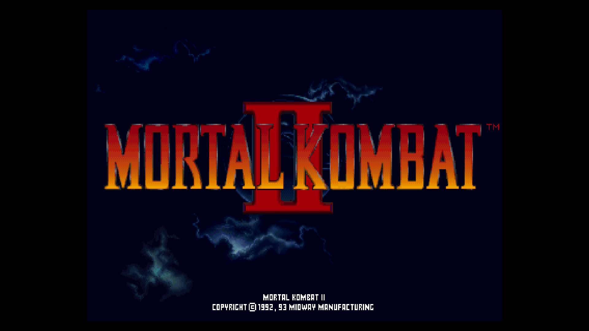
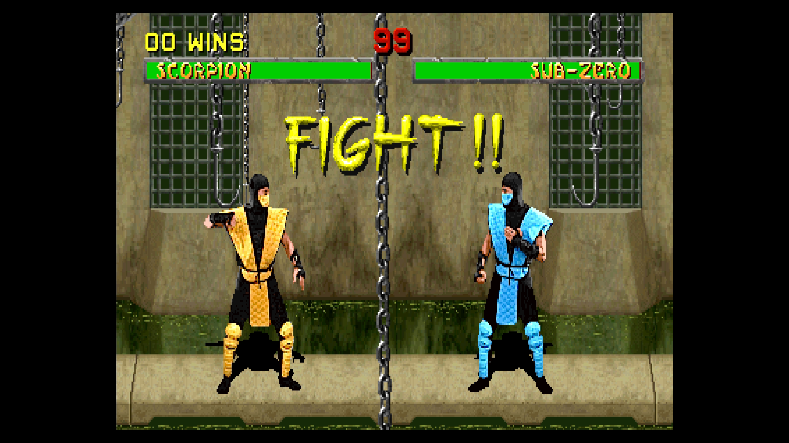

# Mortal Kombat II

[Back to the core's README](../README.md)

Mortal Kombat II (Midway, 1993) on the T-Unit board, with the DCS sound board.

 

- [Versions](#versions)
- [Controls](#controls)
- [Extra content](#extra-content)
- [Move List](#move-list)
- [Secrets](#secrets)
- [Finishing Moves](#finishing-moves)
- [Fixed AI Difficulty](#fixed-ai-difficulty)
- [Mortal Kombat II Plus](#mortal-kombat-ii-plus)

## Versions

| MRA | MAME set |
|---|---|
| Mortal Kombat II (rev L3.1) | mk2 |
| Mortal Kombat II (rev L3.2, European) | mk2r32e |
| Mortal Kombat II (rev L3.1, European) | mk2r31e |
| Mortal Kombat II (rev L3.0) | mk2r30 |
| Mortal Kombat II (rev L2.1) | mk2r21 |
| Mortal Kombat II (rev L2.0) | mk2r20 |
| Mortal Kombat II (rev L1.4) | mk2r14 |
| Mortal Kombat II (rev L1.1) | mk2r11 |
| Mortal Kombat II (rev L4.2, hack) | mk2r42 |
| Mortal Kombat II (rev L9.1, hack) | mk2r91 |
| Mortal Kombat II Challenger (hack) | mk2chal |
| Mortal Kombat II Plus (Beta 2, hack) | mk2p (HBMAME) |

The first is in `_Arcade`, the others in `_Arcade/_alternatives/_Mortal Kombat II`.
With a merged ROM set they all load from `mk2.zip`, except Mortal Kombat II Plus.

Mortal Kombat II Plus is a hack that is not in MAME; it comes from HBMAME. Its
own complete `mk2.zip` (every file, including those that did not change from
rev L3.1) goes in `games/hbmame`, while MAME's `mk2.zip` stays in `games/mame`
for the other versions. The hack changes the fighters, their moves and the
service menu. Its settings are kept apart from rev L3.1's. The core adds
Fixed AI Difficulty to it and gives it a Move List and View Secrets of its
own, [described below](#mortal-kombat-ii-plus). The OSD has no Finishing
Moves or Hidden Items, because the hack changes the moves and the code those
are built on.

## Controls

Two players. The buttons, in the order MiSTer's Define joystick buttons asks
for them: High Punch, Low Punch, High Kick, Low Kick, Block, Start, Coin, Test
(service mode) and Pause. The game's second Block input (Block 2) is not
mapped; Block does the same.

<!-- extra-content:start (from ExtraContent.md by tools/extra_content.py) -->
## Extra content

Ten extras across the 11 versions in MAME: seven hidden items, Finishing Moves for all 12 fighters, a Move List window, and Fixed AI Difficulty. Revision limits are noted per row. Mortal Kombat II Plus (Beta 2, hack) has Fixed AI Difficulty and two windows of its own, a Move List and View Secrets: it adds fighters, moves and secrets and changes the code the other extras are built on, so its OSD shows no Finishing Moves or Hidden Items.

| Feature | What it adds | OSD page |
| --- | --- | --- |
| EJB Menu | The programmers' menu: diagnostics, coin bookkeeping, game audits, a hidden Hello page, initials entry and every character's ending. L1.1 and L1.4 have the menu but never check for its code, so the core connects it while the code plays | Hidden Items |
| Hitboxes | A debug feature left in the game: every attack's hit box is drawn in green during fights | Hidden Items |
| Security Screen | Each attract cycle starts with a hidden "This version passed the security test" screen | Hidden Items |
| Pong at Battle 250 | Every two-player battle counts as battle 250: the VS screen shows "Kombat Zone: Back in Time" and both players face a game of Pong after the first round (L2.0 and later) | Hidden Items |
| Jade Fight | In a one-player game the first round you win is followed by the Jade fight, which normally takes winning a round with Low Kicks only before the "?" on the tower (L2.0 and later) | Hidden Items |
| Noob Saibot Fight | In a two-player battle the winner of the first round fights Noob Saibot, as after a 50-win streak (L3.0 and later) | Hidden Items |
| Smoke Fight | Hold Down and press Start in any fight to fight Smoke next, instead of only on The Portal while "Toasty!" shows (L2.0 and later) | Hidden Items |
| Finishing Moves | Pick a fighter and a fatality, friendship, babality, Pit / Spikes, Dead Pool or stage move (12 fighters). The core enters it on the winner's controls at the next FINISH HIM, waits for the right distance, and reports a wrong stage, too far or too close, or a move the revision lacks | Finishing Moves |
| Move List window | A page per fighter (55 moves in all) with the special moves and finishing moves and their distances, over the game's paused title screen. Set it On in the OSD, close the OSD and turn the pages with Left and Right, from Liu Kang to Raiden and round; open the OSD to set it Off. Kintaro and Super Uppercut, which need a held button, are listed there too. The moves are rev L3.1's | Move List |
| Fixed AI Difficulty | Pins the computer opponent's level: Off, or 0 (easiest) to 9. The game raises the level after matches you win and lowers it after matches you lose; with the option on, the computer plays at the chosen level whatever the game thinks it is, in 1-player games. Off gives the game's own level back at once. Not applied while the test menu is selected | Main menu |
| Plus Move List window (Mortal Kombat II Plus only) | A page per fighter, 17 in all: the 12 fighters, then Jade, Noob Saibot, Smoke, Kintaro and Shao Kahn. Each lists the special moves and the finishing moves with their distances, over the game's paused title screen; the moves the hack adds are marked +. Set it On in the OSD, close the OSD and turn the pages with Left and Right; open the OSD to set it Off. The moves are the MK2 Plus guide's (Ver. 2.8.50) | Move List |
| Plus View Secrets window (Mortal Kombat II Plus only) | Five pages: how to unlock and play Jade, Noob Saibot, Smoke, Kintaro and Shao Kahn; the 14 Kombat Kodes and the buttons for each player; the ending bonuses, the Dead Pool and the hack's settings. With Move List and View Secrets both On, the one turned On last is shown | View Secrets (main menu) |

<!-- extra-content:end -->

## Move List

The OSD's Move List option (Off, On) shows a window over the game, on the
game's title screen, with a fighter's special moves and finishing moves and
the distance each finishing move needs: a page per fighter, Liu Kang first,
Raiden last (the page's top right says which, 1/12 to 12/12). Set it On,
close the OSD, and turn the pages with Left and Right on either controller
(from the last page on to the first, and Left from the first to the last);
open the OSD and set Move List to Off to play on. The game waits while the
window is on. The window only shows the moves; the core does not enter them
for you (the Finishing Moves page does that).

Commands as the game reads them: F toward the opponent, B away. In
(BL U U) LK, Block keeps the fighter from jumping on U and is let go
before LK; (HP 1 s) means High Punch held for about a second, then let
go; X+Y pressed together; "in air" during a jump. The list is the one of
rev L3.1; other revisions and the hacks may differ. Mortal Kombat II Plus has
a Move List of its own, [below](#mortal-kombat-ii-plus).

| Fighter | Move | Command |
|---|---|---|
| Liu Kang | High Fireball | F F HP |
|  | Low Fireball | F F LP |
|  | Flying Kick | F F HK |
|  | Bicycle Kick | (LK 3 s) |
| Kung Lao | Hat Throw | B F LP, Up / Down steer the hat |
|  | Teleport | D U |
|  | Spin | (BL U U) LK |
|  | Dive Kick | D HK in air |
| Johnny Cage | High Bolt | F D B HP |
|  | Low Bolt | B D F LP |
|  | Shadow Kick | B F LK |
|  | Uppercut | B D B HP |
|  | Ball Breaker | LP+BL |
| Reptile | Acid Spit | F F HP |
|  | Force Ball | B B HP+LP |
|  | Invisibility | (BL U U D) HP |
|  | Slide | B+LP+LK+BL |
| Sub-Zero | Freeze | D F LP |
|  | Ground Freeze | D B LK |
|  | Slide | B+LP+LK+BL |
| Shang Tsung | Skull | B B HP |
|  | 2 Skulls | B B F HP |
|  | 3 Skulls | B B F F HP |
|  | Morph into Liu Kang | B F F BL |
|  | Morph into Kung Lao | B D B HK |
|  | Morph into Johnny Cage | B B D LP |
|  | Morph into Reptile | (BL U D) HP |
|  | Morph into Sub-Zero | F D F HP |
|  | Morph into Kitana | BL BL BL |
|  | Morph into Jax | D F B HK |
|  | Morph into Mileena | (HP 1 s) |
|  | Morph into Baraka | D D LK |
|  | Morph into Scorpion | (BL U U) |
|  | Morph into Raiden | D B F LK |
| Kitana | Fan Throw | F F HP+LP |
|  | Fan Lift | B B B HP |
|  | Flying Punch | F D B HP |
| Jax | Energy Wave | F D B HK |
|  | Gotcha Grab | F F LP |
|  | Ground Smash | (LK 2 s) |
|  | Back Breaker | BL in air, next to an opponent in the air |
| Mileena | Sai Throw | (HP 1 s) |
|  | Teleport Kick | F F LK |
|  | Roll | B B D HK |
| Baraka | Blade Spark | D B HP |
|  | Blade Fury | B B B LP |
| Scorpion | Spear | B B LP |
|  | Teleport | D B HP |
|  | Scissors | F D B LK |
|  | Air Throw | BL in air, next to an opponent in the air |
| Raiden | Lightning | D F LP |
|  | Teleport | D U |
|  | Torpedo | B B F |
|  | Electric Grab | (HP 2 s), close to the opponent |

## Secrets

On the OSD's Hidden Items page. The Mortal Kombat games drop a half-entered
code when the attract mode moves to its next screen; the core then enters
the EJB code again (three tries at most).

| OSD item | What it does |
|---|---|
| EJB Menu | The programmers' menu, with the same pages as Mortal Kombat's: diagnostics, coin bookkeeping, game audits, a hidden Hello page, initials entry and every character's ending. Revisions L1.1 and L1.4 have the menu and its code but never check for the code; the core connects it while the code plays |
| Hitboxes | A debug feature left in the game: the hit box of every attack is drawn in green during fights |
| Jade Fight | In a one-player game, the first round you win is followed by the fight against Jade ("Now you must battle with an undiscovered warrior from Mortal Kombat One"). Normally that takes winning a round with Low Kicks only in the battle before the "?" on the tower (rev L2.0 and later) |
| Noob Saibot Fight | The fight the game keeps for a player with 50 wins in a row: in a two-player battle, the winner of the first round goes on to fight Noob Saibot ("Incredible winning streak!!"). The game then carries on as after a real streak (rev L3.0 and later) |
| Pong at Battle 250 | Every two-player battle counts as battle 250: the VS screen shows "Kombat Zone: Back in Time", and after the first round both players face a game of Pong (rev L2.0 and later) |
| Security Screen | Each attract cycle starts with a hidden screen, "This version passed the security test", after a few seconds of black |
| Smoke Fight | Hold Down and press Start during any fight to fight Smoke next ("You have found the passage from the Outworld to the Earth Realm"). Normally that only works on The Portal while the "Toasty!" man is on screen (rev L2.0 and later) |

When the OSD closes, a message says what an option just turned on does, or
that the loaded revision does not have it. Mortal Kombat II Plus has no Hidden
Items page; its View Secrets option is [below](#mortal-kombat-ii-plus).

## Finishing Moves

The OSD's Finishing Moves page enters a fighter's finishing moves for you.
Pick the Character, then one of the moves listed under it: the OSD closes and
the move is set. It plays at the next FINISH HIM where that fighter is the
winner, for either player. With "Pause when OSD is open" (the default) you
can open the OSD at FINISH HIM and pick the move then.

When the loser stands dizzy and the winner stands still, the core takes the
winner's controls (the player's own are ignored meanwhile) and enters the
move. Many moves only work at a certain distance: when the fighters are too
far apart or too close, a message says so and the move waits; step in or
out and it goes as soon as the distance fits. Messages also say when a stage
move is set on another stage, when FINISH HIM ends before the move could
start (the move stays set for the next one) and when the game did not take
the move. A move is used once; "Clear the set move" drops a set move.

Mortal Kombat II Plus has no Finishing Moves page: its moves differ from rev
L3.1's, so the OSD leaves the page out. Its Move List shows its finishing
moves.

Commands as the game reads them: F toward the opponent, B away, U up, D
down; HP / LP / HK / LK / BL High Punch, Low Punch, High Kick, Low Kick,
Block. (X) means X held during the rest of the command and let go at the
end, (X 2 s) held for about 2 seconds.

Distances: Close (touching, up to about a step away), Sweep (within a
sweep's reach), Jump (beyond the sweep, about a jump away), Half screen, Full
screen, Anywhere; "Close to sweep" means anywhere from close up to a sweep
away. Measured in MAME: a sweep reaches about 118 pixels between the
fighters (they stand no closer than about 62), a forward jump covers about
160; the zones are Close up to 79, Sweep 80-127, Jump 128-199, Half screen
200-259, Full screen 260 or more.

Pit / Spikes works on The Pit II and the Kombat Tomb (Shang Tsung's Pit only
on The Pit II), the Dead Pool on The Dead Pool. Friendships and babalities
need a round won without High or Low Punch: the game's rule. Two fatalities
are not in the list because they need a button held from before FINISH HIM:
Shang Tsung's Kintaro (Low Punch held about 18 seconds and let go at FINISH
HIM, sweep distance) and Raiden's Super Uppercut (High Punch about 7
seconds, close). The Move List window shows them too (from the game's code; not
tried in MAME).

The early revisions have fewer moves: L2.0 and L2.1 have no Dead Pool and no
Kung Lao friendship, and Shang Tsung's friendship and Pit differ there; L1.1
and L1.4 lack most friendships, babalities and stage moves and some
fatalities. Picking one of those shows "Not available in this revision of
the game".

| Fighter | Move | Command | Distance |
|---|---|---|---|
| Liu Kang | Dragon | D F B B HK | Close to sweep |
|  | Cartwheel | D F U B D | Close to jump |
|  | Friendship | F B B B LK | Anywhere |
|  | Babality | D D F B LK | Anywhere |
|  | Pit / Spikes | B F F LK | Close |
| Kung Lao | Hat Throw | (LP) B F | Full screen |
|  | Decapitation | F F F LK | Sweep |
|  | Friendship | B B B D HK | Anywhere |
|  | Babality | B B F F HK | Anywhere |
|  | Pit / Spikes | F F F HP | Close |
| Johnny Cage | Torso Rip | D D F F LP | Close |
|  | Decapitation | F F D U | Close |
|  | Friendship | D D D D HK | Anywhere |
|  | Babality | B B B HK | Anywhere |
|  | Pit / Spikes | D D D HK | Close |
| Reptile | Tongue | B B D LP | Jump to half screen |
|  | Slice | U U D HP, then F F D HK | Close |
|  | Friendship | B B D LK | Anywhere |
|  | Babality | D B B LK | Anywhere |
|  | Pit / Spikes | D F F BL | Close |
| Sub-Zero | Deep Freeze | F F D HK, then F D F F HP | Sweep to jump |
|  | Ice Grenade | (LP) B B D F | Full screen |
|  | Friendship | B B D HK | Anywhere |
|  | Babality | D B B HK | Anywhere |
|  | Pit / Spikes | D F F BL | Close |
| Shang Tsung | Soul Drain | U D U LK | Close |
|  | Spikes | (HK 1 s) | Sweep |
|  | Friendship | B B D F HK | Anywhere |
|  | Babality | B F D HK | Anywhere |
|  | Pit | D D U D | Close |
| Kitana | Fan Decap | BL BL BL HK | Close |
|  | Kiss of Death | (LK) F F D F | Close |
|  | Friendship | D D D U LK | Anywhere |
|  | Babality | D D D LK | Anywhere |
|  | Pit / Spikes | F D F HK | Close |
| Jax | Arm Rip | BL BL BL BL LP | Close to sweep |
|  | Head Smash | (LP) F F F | Close |
|  | Friendship | D D U U LK | Anywhere |
|  | Babality | D U D U LK | Anywhere |
|  | Pit / Spikes | U U D LK | Close |
| Mileena | Sai Stab | F B F LP | Close |
|  | Inhale | (HK 2 s) | Close |
|  | Friendship | D D D U HK | Anywhere |
|  | Babality | D D D HK | Anywhere |
|  | Pit / Spikes | F D F LK | Close |
| Baraka | Decapitation | B B B B HP | Close to sweep |
|  | Impale | B F D F LP | Close to sweep |
|  | Friendship | U F F HK | Anywhere |
|  | Babality | F F F HK | Anywhere |
|  | Pit / Spikes | F F D HK | Close |
| Scorpion | Toasty | D D U U HP | Anywhere |
|  | Torch | U U HP | Jump |
|  | Slice | (HP) D F F F | Close |
|  | Friendship | B B D HK | Anywhere |
|  | Babality | D B B HK | Anywhere |
|  | Pit / Spikes | D F F BL | Close |
| Raiden | Electrocution | (LK 2 s) | Close |
|  | Friendship | D B F HK | Jump or farther |
|  | Babality | D D U HK | Anywhere |
|  | Pit / Spikes | U U HP | Close |

Every fighter also has the Dead Pool: D+LP+LK HP, close.

## Fixed AI Difficulty

The OSD's Fixed AI Difficulty option (Off, then 0 to 9; Off by default, on the
main menu below Finishing Moves) pins the computer opponent's level. The game
keeps that level in one number, 0 (easiest) to 9, and raises it after matches
you win and lowers it after matches you lose; the computer's play follows it.
With the option on, the computer plays at the level you picked whatever the
game thinks the level is, through wins and losses in 1-player games. Set it
to Off and the game's own level is back at once. A change takes effect as the
game next reads the level.

The option pins the level; it does not change how the computer plays at a
given level. It has no effect on 2-player fights, and it is off while the test
menu is selected (Service Mode, the Test button or the Test Switch DIP), so
the diagnostics see the game as it is.

Every Mortal Kombat II version has the option, Mortal Kombat II Plus included.

## Mortal Kombat II Plus

Mortal Kombat II Plus (Beta 2, hack) adds fighters, moves and secrets to
Mortal Kombat II. The core gives it two windows of its own, a Move List and
View Secrets, both Off or On on the OSD's main menu and shown over the game's
paused title screen like the Move List above. Set one On, close the OSD, and
turn the pages with Left and Right on either controller (from the last page
on to the first, and Left from the first to the last); open the OSD and set
it to Off to play on. If both are On, the one turned On last is shown, from
its first page; set that one to Off and the other comes back. The windows
only show; the core does not enter anything for you.

### Move List

17 pages (the top right says which, 1/17 to 17/17): the 12 fighters in the
order of the character select, Liu Kang first and Raiden twelfth, then Jade,
Noob Saibot, Smoke, Kintaro and Shao Kahn. Each page lists the fighter's
special moves, then the finishing moves with the distance each needs
(Shang Tsung's page also lists his morphs), and a few lines on how to read
them. Distances are the guide's words: Close, Sweep (within a sweep's reach),
Half screen (a jump away), Full screen, Anywhere. A + marks a move the guide
lists as an addition to Mortal Kombat II: it needs Extra Moves On in the
hack's settings (Service Mode, MK2+ Settings).

Commands as the game reads them: F toward the opponent, B away, X+Y pressed
together, (X) Y or (X Y) X held while Y is entered and then let go, (X 2 s)
X held for about 2 seconds, then let go. Every fighter but Kintaro and Shao
Kahn also has the Dead Pool: hold LP+LK, then D+HP, close. Hornbuckle, the
opponent you fight to unlock Smoke, has Liu Kang's moves and finishing moves
and no page of his own.

| Fighter | Move | Command |
|---|---|---|
| Liu Kang | High Fireball | F F HP (also in air) |
|  | Low Fireball | F F LP |
|  | Flying Kick | F F HK |
|  | Bicycle Kick | (LK 4 s) |
| Kung Lao | Hat Throw | B F LP (Up / Down steer the hat) |
|  | Teleport | D U (then HP / HK attacks) |
|  | Diving Kick | D+HK in air |
|  | Whirlwind Spin | (BL U U) LK (tap LK to keep spinning) |
| Johnny Cage | High Green Orb | F D B HP |
|  | Low Green Orb | B D F LP |
|  | Shadow Kick | B F LK |
|  | Split Punch | LP+BL (close) |
|  | Shadow Uppercut | B D B HP |
| Reptile | Acid Spit | F F HP |
|  | Forceball | B B HP+LP |
|  | + Fast Forceball | F F HP+LP |
|  | Slide | B+LP+LK+BL |
|  | Invisibility | (BL U U D) HP |
| Sub-Zero | Freeze | D F LP |
|  | + Air Freeze | D F LP in air |
|  | Ground Freeze | D B LK |
|  | Slide | B+LP+LK+BL |
| Shang Tsung | Skull | B B HP |
|  | 2 Skulls | B B F HP |
|  | 3 Skulls | B B F F HP |
|  | Morph into Baraka | D D LK |
|  | Morph into Jax | D F B HK |
|  | Morph into Johnny Cage | B B D LP |
|  | Morph into Kitana | BL BL BL |
|  | Morph into Kung Lao | B D B HK |
|  | Morph into Liu Kang | B F F BL |
|  | Morph into Mileena | (HP 2 s) |
|  | Morph into Raiden | D B F LK |
|  | Morph into Reptile | (BL U D) HP |
|  | Morph into Scorpion | (BL U U) |
|  | Morph into Sub-Zero | F D F HP |
|  | Morph into Jade | F B F LK |
|  | Morph into Noob Saibot | B D B HP |
|  | Morph into Smoke | F F B LP |
| Kitana | Fan Swipe | B+HP |
|  | Fan Throw | F F LP+HP (also in air) |
|  | Fan Lift | B B B HP |
|  | Square Wave Punch | F D B HP |
| Jax | Energy Wave | F D B HK |
|  | Gotcha Grab | F F LP (tap LP for more hits) |
|  | Multi-Slam | tap HP (quickly, while throwing) |
|  | Ground Pound | (LK 3 s) |
|  | Backbreaker | BL in air (next to an opponent in the air) |
| Mileena | Sai Throw | (HP 2 s) (also in air) |
|  | Teleport Kick | F F LK |
|  | Ground Roll | B B D HK |
| Baraka | Blade Swipe | B+HP |
|  | Blade Spark | D B HP |
|  | Blade Fury | B B B LP |
|  | Double Kick | HK HK (close, quickly) |
|  | + Blade Spin | F D F BL (tap BL for more spins) |
| Scorpion | Spear | B B LP |
|  | Teleport Punch | D B HP (also in air) |
|  | + Forward Teleport | D F HP (also in air) |
|  | Leg Takedown | F D B LK |
|  | Air Throw | BL in air (next to an opponent in the air) |
| Raiden | Lightning Bolt | D F LP |
|  | Torpedo | B B F (also in air) |
|  | Teleport | D U (quickly) |
|  | Electric Grab | (HP 3 s) (close to the opponent) |
| Jade | Fan Throw | F F LP+HP (also in air) |
| Noob Saibot | Spear | B B LP |
|  | Slide | B+LP+LK+BL |
|  | Teleport | D U |
|  | Leg Takedown | F D B LK |
| Smoke | Spear | B B LP |
|  | Teleport Punch | D B HP (also in air) |
|  | Air Throw | BL in air (next to an opponent in the air) |
|  | Dash Throw | F D B LK |
| Kintaro | Fireball | B D F LP |
|  | Teleport Stomp | D D U |
| Shao Kahn | Spear Toss | B D F LP |
|  | Grab & Punch | (HP 3 s) (close to the opponent) |
|  | Shoulder Charge | B F F HP |
|  | Upward Shoulder | B D B HK |

| Fighter | Move | Command | Distance |
|---|---|---|---|
| Liu Kang | Butterfly Kick | (BL) F U B D F (Deadly Uppercut; a full stick turn) | Sweep |
|  | + Butterfly Kick | hold D+BL for the decapitation | |
|  | + Butterfly Kick | hold LP+LK for the stage fatality | |
|  | Dragon's Bite | D F B B HK | Close |
|  | Friendship | F B B B LK | Anywhere |
|  | Babality | D D F B LK | Anywhere |
|  | Pit / Spikes | B F F LK | Close |
| Kung Lao | Hat Decap | (LP) B F (Up / Down aim at the neck) | Full screen |
|  | Body Slice | F F F LK | Sweep |
|  | + Hat Splitter | (LP) B F (Up / Down aim at the waist) | Full screen |
|  | Friendship | B B B D HK | Anywhere |
|  | Babality | B B F F HK | Anywhere |
|  | Pit / Spikes | F F F HP | Close |
| Johnny Cage | Decap Uppercut | F F D U | Close |
|  | + Decap Uppercut | hold D+LP+LK+BL for the Triple Decap | |
|  | Torso Rip | D D F F LP | Close |
|  | Friendship | D D D D HK | Anywhere |
|  | Babality | B B B HK | Anywhere |
|  | Pit / Spikes | D D D HK | Close |
| Reptile | Yummy! | B B D LP | Half screen |
|  | Invisible Slice | F F D HK (while invisible) | Close |
|  | Friendship | B B D LK | Anywhere |
|  | Babality | D B B LK | Anywhere |
|  | Pit / Spikes | D F F BL | Close |
| Sub-Zero | Ice Shatter | F F D HK, then F D F F HP (Deep Freeze, then Uppercut) | Sweep, then Close |
|  | Ice Grenade | (LP) B B D F | Full screen |
|  | Grenade Shatter | F F D HK, then (LP) B B D F (Deep Freeze, then Ice Grenade) | Sweep, then Full screen |
|  | Friendship | B B D HK | Anywhere |
|  | Babality | D B B HK | Anywhere |
|  | Pit / Spikes | D F F BL | Close |
| Shang Tsung | Inner-Ear Explosion | (HK 2 s) | Sweep |
|  | Soul Steal | U D U+LK | Close |
|  | Kintaro Morph | (LP 30 s) | Sweep |
|  | Friendship | B B D F HK | Anywhere |
|  | Babality | B F D HK | Anywhere |
|  | Pit / Spikes | D D U D | Close |
| Kitana | Kiss of Death | (LK) F F D F | Close |
|  | Fan Decap | BL BL BL HK | Close |
|  | Friendship | D D D U+LK | Anywhere |
|  | Babality | D D D LK | Anywhere |
|  | Pit / Spikes | F D F HK | Close |
| Jax | Arm Rip | BL BL BL BL LP | Sweep |
|  | Head Smash | (LP) F F F | Close |
|  | Friendship | D D U U LK | Anywhere |
|  | Babality | D U D U LK | Anywhere |
|  | Pit / Spikes | U U D LK | Close |
| Mileena | Sai Stabs | F B F LP | Close |
|  | Man-Eater | (HK 3 s) | Close |
|  | Friendship | D D D U+HK | Anywhere |
|  | Babality | D D D HK | Anywhere |
|  | Pit / Spikes | F D F LK | Close |
| Baraka | Blade Decap | B B B B HP | Close |
|  | Blade Lift | B F D F LP | Close |
|  | Friendship | U F F HK | Anywhere |
|  | Babality | F F F HK | Anywhere |
|  | Pit / Spikes | F F D HK | Close |
| Scorpion | Spear Slice | (HP) D F F F | Close |
|  | Toasty! | (BL) U U HP | Sweep |
|  | Toasty!! | (BL) D D U U HP | Anywhere |
|  | Friendship | B B D HK | Anywhere |
|  | Babality | D B B HK | Anywhere |
|  | Pit / Spikes | D F F BL | Close |
| Raiden | Electrocution | (LK 3 s) tap LK+BL | Close |
|  | Explosive Uppercut | (HP 10 s) (start before FINISH HIM, or hold U+HP+HK till heads drop) | Close |
|  | Friendship | D B F HK | Anywhere |
|  | Babality | D D U+HK | Anywhere |
|  | Pit / Spikes | U U U HP | Close |
| Jade | Kiss of Death | (LK) F F D F | Close |
|  | Fan Decap | BL BL BL HK | Close |
|  | Friendship | D D D U+LK | Anywhere |
|  | Babality | D D D LK | Anywhere |
|  | Pit / Spikes | F D F HK | Close |
| Noob Saibot | Explosive Uppercut | F F D D HP (then hold U+HP+HK till heads drop) | Close |
|  | Slice | (HP) D F F F | Close |
|  | Friendship | B B D HK | Anywhere |
|  | Babality | D B B HK | Anywhere |
|  | Pit / Spikes | D F F BL | Close |
| Smoke | Smoke Death | B D B B HP | Anywhere |
|  | Telekinetic Decap | F B B F HP | Anywhere |
|  | Friendship | B B D HK | Anywhere |
|  | Babality | D B B HK | Anywhere |
|  | Pit / Spikes | D F F BL | Close |
| Kintaro | Oblivion Stomp | D D D D HK | Sweep |
|  | Torso Punch | D D B B HP | Close |
|  | Babality | (BL) U D D LK | Anywhere |
| Shao Kahn | Matter over Mind | D D D F HP | Close |
|  | Babality | D B F HK | Anywhere |

### View Secrets

Five pages: Jade and Noob Saibot; Smoke and Hornbuckle; Kintaro and Shao
Kahn; the Kombat Kodes; other secrets (the ending bonuses, the Dead Pool and
the hack's settings). Unlocking a secret character needs the right settings
in the hack's Service Mode (MK2+ Settings): Improved AI Off for Jade and Noob
Saibot, On for the two bosses, and Versus Cheats On to play as them.

| Secret | Step | What to do |
|---|---|---|
| Jade | Unlock | Difficulty Very Hard and Improved AI Off, then beat the game, Jade included, without losing a match (a lost round is fine) |
|  | Fight | Beat the opponent just below the ? on the ladder using Low Kicks (LK) only; Jade is in Goro's Lair |
|  | Select | Hold START on the character select screen, then pick Kitana with another button |
|  | Clues | "A princess is the key", "I am one of four!" |
| Noob Saibot | Unlock | Difficulty Very Hard and Improved AI Off, then beat the game in under 12 minutes 50 seconds |
|  | Fight | Win 50 matches in a row; Noob Saibot is in Goro's Lair |
|  | Select | Hold START, then pick Sub-Zero with another button |
|  | Clues | "Holding START is the key", "Ytfif ot teg", "It's cold in the shadows", "I am one of four!" |
| Smoke | Unlock | Difficulty Very Easy. Win a match with a double Flawless and a Fatality on The Pit II while the silhouettes cross the moon: you then fight Hornbuckle, and beating him unlocks Smoke |
|  | Tip | The silhouettes are rare (about 1 in 100): start a 1-player game and lose until The Pit II; with none, press Player 2 START, let the timer run out undamaged and start again |
|  | Fight | At the Portal, uppercut the opponent until Dan Forden appears (Toasty!), then quickly press D+START: Smoke is in Goro's Lair |
|  | Select | Hold START, then pick Reptile with another button |
|  | Clues | "He is the original", "I am one of four!" |
| Hornbuckle | Who | The opponent after the Pit II fatality; he has Liu Kang's moves and finishing moves |
| Kintaro and Shao Kahn | Needs | Improved AI On, and Jade, Noob Saibot and Smoke unlocked |
|  | Earn | Score at least 600 points in Survival mode, twice: the first time unlocks one boss, the second the other |
|  | Sign | The results screen says "You are rewarded with a new fighter" |
|  | Play as | Kintaro: hold U+LP+HP+LK+HK before the match starts |
|  | Play as | Shao Kahn: hold D+LP+HP+LK+HK before the match starts |
|  | Play needs | Versus Cheats On; works in Kahn's Arena |

The Kombat Kodes: hold the buttons on the battle screen, before the match
starts. In a 2-player game both players hold theirs. They work in Klassic
Kombat too, and a message names the code when it is on, as FASTER UPPERCUTS!

| Kombat Kode | Player 1 | Player 2 |
|---|---|---|
| Faster Uppercuts | HP | HP |
| Super Uppercuts | U+HP | U+HP |
| Blocking Disabled | BL | BL |
| Throwing Disabled | LP | LP |
| Outworld Weather | HP+HK | HP+HK |
| Going Back in Time (Pong) | LP+LK+BL | LP+LK+BL |
| La Luna Mode | U | U |
| Dude Where's My Bar | D | D |
| Round Timer Disabled | D+HK | - |
| Display Hit Boxes | F | F |
| Tug of War Kombat | B+BL | B+BL |
| Randper Kombat | F+LK | B+LK |
| Explosive Kombat | LP+HP | LK+HK |
| 2 vs 2: Finishing Tags Allowed | LP+HP+BL | LP+HP+BL |

Other secrets: during an ending, before the cast of characters, hold Down
for the Dizzy Disco Ball or Up for the Babalities. The settings of the hack's
Service Mode (MK2+ Settings) that matter here are Extra Moves, Improved AI,
Versus Cheats, Secret Characters (lock or unlock each one) and Cheat Selection
(forces a Kombat Kode on all the time).

### Where the pages come from

The pages follow the MK2+ guide (MKKomplete, Ver. 2.8.50,
https://icemantraveler.github.io/mkksg/fan_made/mk2plus/default.htm). The
hack in the MRA is HBMAME's MK2+ VER 1.48 (Beta 2, build of 12/22/2018), which
is older than the guide, so a move or secret the guide adds may be missing in
it. The moves were not tried in the core, and not checked in the hack's code;
the clues, the Kombat Kode messages and the settings the pages name are in
its ROM. The guide's SHRUNKEN KOMBAT!, LARGE EFFECTS! and TINY EFFECTS! codes
are in the ROM too, but the guide gives no buttons for them, so they are not
listed.
