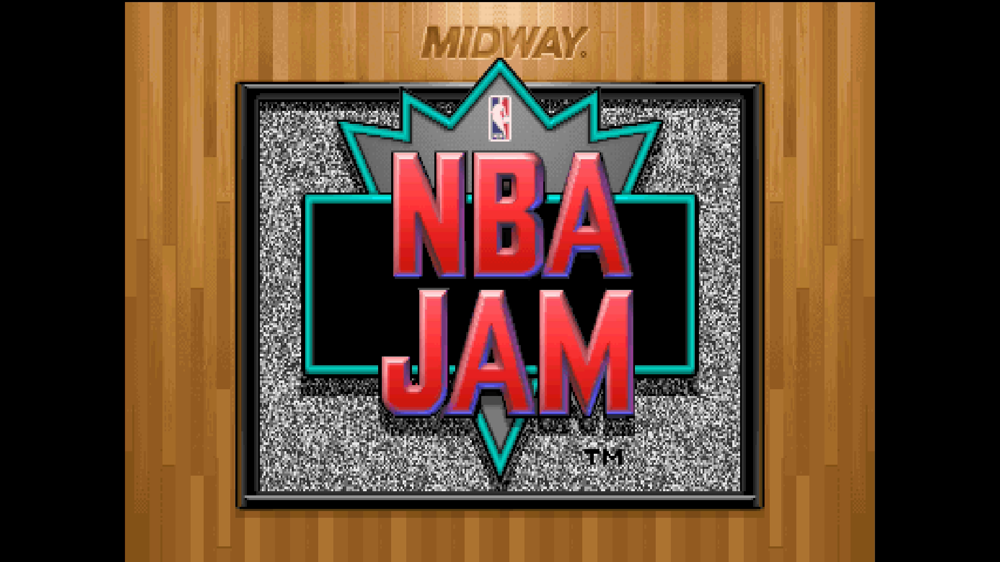
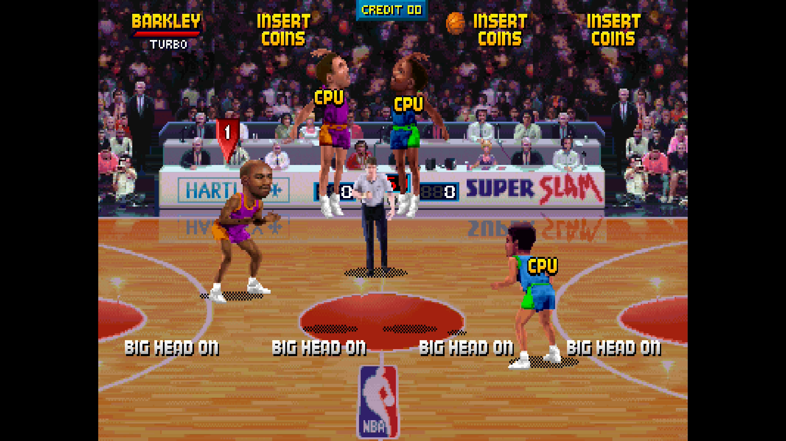

# NBA Jam

[Back to the core's README](../README.md)

NBA Jam (Midway, 1993) on the T-Unit board, with the ADPCM sound board.

 

## Versions

| MRA | MAME set |
|---|---|
| NBA Jam (rev 3.01 4-07-93) | nbajam |
| NBA Jam (rev 2.00 2-10-93) | nbajamr2 |
| NBA Jam (rev 1.00 2-1-93) | nbajamr1 |
| NBA Jam (proto v 2.00 1-24-93) | nbajamp2 |
| NBA Jam (proto v 1.01 1-23-93) | nbajamp1 |

The first is in `_Arcade`, the others in `_Arcade/_alternatives/_NBA Jam`.
With a merged ROM set they all load from `nbajam.zip`.

## Controls

Up to four players: Turbo, Shoot / Block, Pass / Steal, plus Start, Coin,
Test (service mode) and Pause.

<!-- extra-content:start (from ExtraContent.md by tools/extra_content.py) -->
## Extra content

Three extras across the five versions: one hidden menu, a Cheats menu (26 cheats on 3.01, 20 on 2.00, 4 to 5 on the others) and a Secret Player List window with 13 secret players and the cheat codes. Revision limits are noted per row.

| Feature | What it adds | OSD page |
| --- | --- | --- |
| Open Secret Menu (Attract) | The design team screen, then the secret Midway menu with the Jam Info statistics (hidden audit pages on 1.00, 2.00 and the prototypes). Attract mode only | Cheat Codes & Hidden Items |
| Cheats menu | The power-ups for each of the four players (big head, power-up defense and interceptions; Big Head on every version), Shot Percentage, Computer Assistance Turned Off, the hidden 3D tank game (1.00, 2.00 and 3.01) and the cheats of MAME's cheat file: infinite turbo for each player, infinite quarter and shot time, never miss a shot, dunks from anywhere and more. The list is on the NBA Jam page | Cheats |
| Secret Player List window | Page 1 lists the 13 secret players with name, initials, birthday and versions; Page 2 lists every cheat code as the players enter it. Set it On in the OSD, close the OSD and turn the pages with Left and Right; open the OSD to set it Off. The game waits while it is shown | View Secret Players (main menu) |

<!-- extra-content:end -->

## Secrets

View Secret Players (OSD main menu: Off, On) shows a window over the game,
on the title screen, with the hidden players (below): their names,
initials, birthdays and the versions that have them, and the cheat codes as
the players enter them (below). Page 1 has the players, Page 2 the codes.
Set it On, close the OSD, and turn the pages with Left and Right on either
controller (Right on page 2 goes round to page 1); open the OSD and set it
Off to play on. The game waits while the window is on.

On the OSD's Cheat Codes & Hidden Items page:

| OSD item | What it does |
|---|---|
| Open Secret Menu (Attract) | The design team screen, then the secret Midway menu with the Jam Info statistics (hidden audit pages on revisions 1.00 and 2.00 and the prototypes). In the attract mode only |

The power-ups, Shot Percentage, No CPU Assistance and the Tank Game are in the
[Cheats](#cheats) menu. When the OSD closes, a message says whether the game
took the secret menu code.

### Cheat codes

The codes as the players enter them, as the window lists them. "Press" is
a press of Turbo, Shoot or Pass (buttons pressed together count once).
Power-Up Offense (21 presses), found in code lists on the web, is in no
revision of the game.

| Code | When | Enter | Versions |
|---|---|---|---|
| Big Heads | Tonight's Match-Up | Hold Up + Turbo + Pass until the tip-off | All |
| No CPU Assistance | Tonight's Match-Up | Press exactly 10 times | 3.01 |
| Power-Up Defense | Tonight's Match-Up | Press exactly 8 times | 2.00, 3.01 |
| Power-Up Interceptions | Tonight's Match-Up | Press 5 times or more, then hold Down + Turbo + Shoot + Pass until the tip-off | 2.00, 3.01 |
| Shot Percentage | Tonight's Match-Up | Turn the joystick a full circle and press 15 times or more | 2.00, 3.01 |
| Tank Game | Tonight's Match-Up | P1 holds Down + Turbo + Shoot + Pass and P2 Turbo + Shoot + Pass until the tip-off (3.01: once a game) | 1.00, 2.00, 3.01 |
| Secret Menu | Attract mode | Both players hold Up + Turbo + Shoot + Pass, then hold Down for 2 s; 3.01 then on the design team screen: P1 Turbo 2x, P2 Shoot 3x, P2 Pass 2x, P1 Shoot, P1 Pass, P2 Turbo 2x | All |

### Secret players

To play as one: answer YES to "Enter initials for record keeping?", then
enter the player's initials (`_` is SPC on the letter grid), the birth month
and the day. The team select then shows that player as yours. The
prototypes have no secret players; "On screen" is the name the team select
shows.

| Player | On screen | Initials | Birthday | Versions |
|---|---|---|---|---|
| Tony Goskie | Goskie | TWG | Dec 7 | 1.00, 2.00, 3.01 |
| Jamie Rivett | Rivett | RJR | Jan 17 | 1.00, 2.00, 3.01 |
| John Carlton | Carlton | JMC | Aug 5 | 1.00, 2.00, 3.01 |
| Sal DiVita | Di Vita | SAL | Feb 1 | 1.00, 2.00, 3.01 |
| Shawn Liptak | Liptak | SL_ | Jun 24 | 1.00, 2.00, 3.01 |
| Mark Turmell | Turmell | MJT | Mar 22 | 1.00, 2.00, 3.01 |
| Jon Hey | Hey | JWH | Sep 20 | 1.00, 2.00, 3.01 |
| George Petro | Petro | GNP | Oct 8 | 1.00, 2.00, 3.01 |
| John Newcomer | Newcomer | JRN | Jun 18 | 1.00, 2.00, 3.01 |
| Sheridan Oursler | Oursler | SNO | Jan 3 | 1.00, 2.00, 3.01 |
| Stephen Howard | Howard | HOW | Jul 15 | 1.00, 2.00, 3.01 |
| Willie Morris Jr. | Air Morris | WIL | Jan 1 | 1.00, 2.00, 3.01 |
| Tony Scott | Scott | TON | Jul 3 | 1.00, 2.00, 3.01 |

## Cheats

The OSD's Cheats menu (on the main menu, below Cheat Codes & Hidden Items)
lists the cheats of the loaded version: 26 on rev 3.01, 20 on rev 2.00, 5 on
rev 1.00 and 4 on each prototype. Select one to switch it on or off; a mark
shows the ones that are on. All are off each time a game loads: the OSD does
not keep them across loads.

The power-ups of the four players (Big Head on every version, Powerup Defense
and Powerup Intercept on 3.01 and 2.00), Shot Percentage, Computer Assistance
Turned (off) and Play Hidden 3D Tank Game are found in each version's
program; each player has a cheat for each power-up. The others are from MAME's cheat files for rev 3.01 and rev 2.00, whose addresses
are for those revisions only. The names are MAME's, cut to the 27 characters
the OSD shows. Versions are named by their MAME set (see
[Versions](#versions)).

| Cheat | Units | Versions |
|---|---|---|
| Computer Assistance Turned | 1 | nbajam |
| Disable In-Game Play Tip | 2 | nbajam |
| Dunk/Glide/Layup Anywhere | 6 | nbajam |
| Dunks Always Break Backbrd | 1 | nbajam |
| Infinite Quarter Time | 2 | nbajam, nbajamr2 |
| Infinite Shot Time | 1 | nbajam, nbajamr2 |
| Invincibility on 3D Tank | 1 | nbajam |
| Never Miss A Shot | 2 | nbajam |
| P1 Big Head | 1 | All |
| P1 Infinite Turbo | 1 | nbajam, nbajamr2 |
| P1 Powerup Defense | 1 | nbajam, nbajamr2 |
| P1 Powerup Intercept | 1 | nbajam, nbajamr2 |
| P2 Big Head | 1 | All |
| P2 Infinite Turbo | 1 | nbajam, nbajamr2 |
| P2 Powerup Defense | 1 | nbajam, nbajamr2 |
| P2 Powerup Intercept | 1 | nbajam, nbajamr2 |
| P3 Big Head | 1 | All |
| P3 Infinite Turbo | 1 | nbajam, nbajamr2 |
| P3 Powerup Defense | 1 | nbajam, nbajamr2 |
| P3 Powerup Intercept | 1 | nbajam, nbajamr2 |
| P4 Big Head | 1 | All |
| P4 Infinite Turbo | 1 | nbajam, nbajamr2 |
| P4 Powerup Defense | 1 | nbajam, nbajamr2 |
| P4 Powerup Intercept | 1 | nbajam, nbajamr2 |
| Play Hidden 3D Tank Game | 1 | All but nbajamp1, nbajamp2 |
| Shot Percentage | 1 | nbajam, nbajamr2 |

How a cheat acts: one that sets a value makes the game read that value from the word it names, or only the bits of the word it covers (one byte, one player's flag), whenever the CPU reads it while the game runs with interrupts on; the game's own value is never written over, so switching the cheat off gives the game back at once, and the diagnostics' RAM test sees the game as it is. One that changes the game's program replaces a word of it as the CPU fetches it as an instruction; nothing is written to the ROM. The Units column is how many of the core's 8 cheat entries a cheat uses: switch cheats on until their units add up to 8 at most; the menu refuses a switch-on that would pass 8.

The game's own codes (see Cheat codes above) work as before. A power-up
cheat gives its power-up to one player without entering the code.
