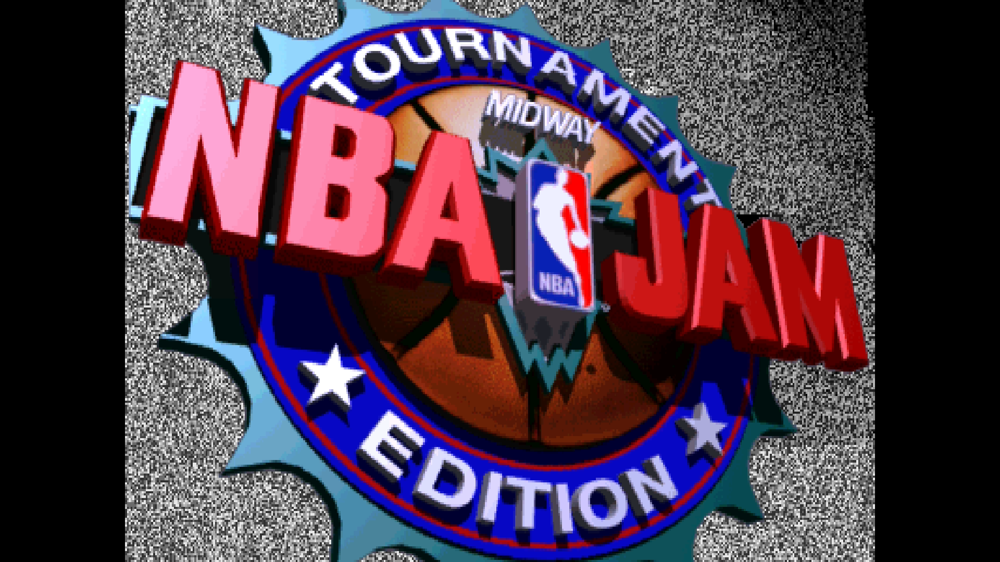
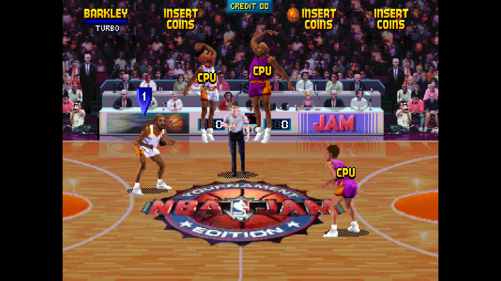

# NBA Jam Tournament Edition

[Back to the core's README](../README.md)

NBA Jam Tournament Edition (Midway, 1994) on the T-Unit board, with the
ADPCM sound board.

 

## Versions

| MRA | MAME set |
|---|---|
| NBA Jam Tournament Edition (rev 4.0 3-23-94) | nbajamte |
| NBA Jam Tournament Edition (rev 4.0 3-03-94) | nbajamte4 |
| NBA Jam Tournament Edition (rev 3.0 3-04-94) | nbajamte3 |
| NBA Jam Tournament Edition (rev 3.0 2-26-94) | nbajamte3a |
| NBA Jam Tournament Edition (rev 2.1 2-06-94) | nbajamte2 |
| NBA Jam Tournament Edition (rev 2.0 1-28-94) | nbajamte2a |
| NBA Jam Tournament Edition (rev 1.00 1-17-94) | nbajamte1 |
| NBA Jam Tournament Edition (proto 2.00 12-17-93) | nbajamtep2 |
| NBA Jam Tournament Edition (Nani Edition, rev 5.2 8-11-95, prototype) | nbajamten |
| NBA Jam Tournament Edition (SE rev 5.02, hack) | nbajamtese (`games/hbmame`) |
| NBA Jam Tournament Edition (Rewind, hack) | nbajamre (`games/hbmame`) |
| NBA Jam Tournament Edition (Rewind, Get that Bleep outta here, hack) | nbajamreb (`games/hbmame`) |

The first is in `_Arcade`, the others in
`_Arcade/_alternatives/_NBA Jam Tournament Edition`. With a merged ROM set
they all load from `nbajamte.zip`, except the Special Edition and the two
Rewind versions, which are hacks with zips of their own.

### Special Edition 5.02

The Special Edition is a ROM hack that is not in MAME; it comes from HBMAME.
It is the Tournament Edition rebuilt from its source code, with new players,
options in the game's CMOS menu and new voice samples. Its own complete set
goes in `games/hbmame` as `nbajamtese.zip`, while MAME's `nbajamte.zip` stays
in `games/mame` for the other versions. Its settings and high scores are kept
apart from the other versions'.

What the hack's author lists for release 5.02 (the release notes that come
with it): Shaq, Jordan, Laimbeer, Petrovic and Lewis join the teams (replacing
Anderson, Kukoc, Hunter, Benjamin and Gamble), Hornacek and D. Harper change
teams, Jordan is also a hidden player (replacing Webber), Griffey is back with
a birthday code, there are new voice samples (Griffey, Jordan and Shaq), the
3D tank game is enabled again (hold P1 Shoot at the match-up screen; not from
the attract mode), the CMOS menu has Extra Settings (Idiot boxes, Roster, GC
Team unlock, Fatalities, Baby Size, Max Power and Shot %), Raiden has his
lightning bolts, and there is a credits screen. Gameplay is not changed.

The core treats it as a Tournament Edition: the same DIP switches and buttons,
the secret menu code, No CPU Assistance and the [Cheats](#cheats) menu, and the
Secret Player List window, which now has the Special Edition's secret players
(68 of them; Griffey and Jordan are new). The code, No CPU Assistance and the
power-up cheats are found in the hack's own program, which is the Tournament
Edition's code with its variables moved.
The cheats that come from MAME's cheat files are not available for the hack
(MAME has no file for it): its infinite turbo, infinite shot time, never miss
a shot and play tip cheats are the Tournament Edition 4.0 3-23's, moved to
where the hack keeps those words (`tools/tunit_relocate.py` finds them).
Dunks Always Break Backbrd and Unlock All-Star Jam Team are left out (the hack
has an option for the second).

### Rewind

NBA Jam Rewind is a ROM hack of the Tournament Edition that is not in MAME.
The core's two MRAs read `nbajamre.zip` and `nbajamreb.zip` from
`games/hbmame`, each a complete set. The second is the optional "Get that
Bleep outta here" version, in which the announcer says it (the hack's readme).
Their settings and high scores are kept apart from the other versions' and
from each other's.

| MRA | Zip | Program (`uj12`) | Sound (`u12`, `u13`) |
|---|---|---|---|
| Rewind | nbajamre.zip | CRC 9b3fc483 | cd5d4532, e92fb0d3 |
| Rewind, Get that Bleep outta here | nbajamreb.zip | CRC 383cd3ec | 7061fbc0, 25edad0d |

The program is the Tournament Edition's rev 2.0 (1-28-94, `nbajamte2a`) with
about 2,600 bytes changed (the readme names rev 2.1, but the program matches
2.0 where the two differ), and 12 graphics ROMs are changed. The Bleep version
differs from the plain one in 2 program bytes and in its `u12` and `u13`
sample ROMs. The hack's readme lists a code to turn fatalities on (at the team
select screen hold Up and press Pass / Steal 20 times), the Big Head and Huge
Head codes and an Expanded Roster code (at the player select screen, hold
Down, press Pass twice, turn the joystick a full circle counterclockwise and
press Pass three times); the arcade-projects thread says Jordan and Shaq are
added to the teams. These are the game's own codes: the core has no OSD item
for them.

The core treats both as Tournament Edition rev 2.0: the same DIP switches and
buttons, the secret menu code, No CPU Assistance and the [Cheats](#cheats)
menu (30 cheats, rev 2.0's, found in the hack's own program). The secret
player table is rev 2.0's, so the Secret Player List window lists Rewind
wherever it lists 2.0 and has no player of its own for it.

## Controls

Up to four players: Turbo, Shoot / Block, Pass / Steal, plus Start, Coin,
Test (service mode) and Pause.

<!-- extra-content:start (from ExtraContent.md by tools/extra_content.py) -->
## Extra content

Four extras on all twelve versions: one hidden menu, No CPU Assistance, a Cheats menu (20 to 30 cheats a version) and a seven-page Secret Player List window. Every version has all the cheat codes.

| Feature | What it adds | OSD page |
| --- | --- | --- |
| Open Secret Menu (Attract) | The design team screen, then the secret Midway menu with the Jam Info statistics. Attract mode only | Cheat Codes & Hidden Items |
| No CPU Assistance | Turns off the computer assistance that keeps games close | Cheat Codes & Hidden Items |
| Cheats menu | The power-ups of the four players (Big/Huge Head, Max Power, Powerup Goal Tending, Quick Hands), infinite turbo for each, Baby Size Players, Huge Heads, Shot Percentage, Tournament Mode and the cheats of MAME's cheat file (for the Special Edition, which has none, the same addresses moved to where the hack keeps them; Rewind has rev 2.0's, unmoved): infinite shot time, never miss a shot, dunks always break the backboard, fatalities, the All-Star Jam Team and more. The list is on the NBA Jam Tournament Edition page | Cheats |
| Secret Player List window | Pages 1-5 list the secret players with name, initials, birthday and the versions that have them (a player whose initials changed between versions has a line for each); Pages 6-7 list every cheat code as the players enter it. Set it On in the OSD, close the OSD and turn the pages with Left and Right; open the OSD to set it Off. The game waits while it is shown | View Secret Players (main menu) |

<!-- extra-content:end -->

## Secrets

View Secret Players (OSD main menu: Off, On) shows a window over the game,
on the title screen, with the hidden players (below): their names,
initials, birthdays and the versions that have them, and the cheat codes as
the players enter them (below). Pages 1-5 have the players, Pages 6-7 the
codes. Set it On, close the OSD, and turn the pages with Left and Right on
either controller (Right on page 7 goes round to page 1); open the OSD and
set it Off to play on. The game waits while the window is on.

On the OSD's Cheat Codes & Hidden Items page:

| OSD item | What it does |
|---|---|
| Open Secret Menu (Attract) | The design team screen, then the secret Midway menu with the Jam Info statistics. In the attract mode only |
| No CPU Assistance | Turns off the computer assistance that keeps games close |

The power-ups, Baby Size Players, Huge Heads, Shot Percentage and Tournament
Mode are in the [Cheats](#cheats) menu. When the
OSD closes, a message says whether the game took a code.

### Cheat codes

The codes as the players enter them, as the window lists them. "Press" is
a press of Turbo, Shoot or Pass (buttons pressed together count once).

| Code | When | Enter | Versions |
|---|---|---|---|
| Baby Size Players | Tonight's Match-Up | Hold Down + Right and press Turbo, Shoot, Pass three times over | All |
| Big Heads | Tonight's Match-Up | Hold Up + Turbo + Pass until the tip-off | All |
| Huge Heads | Tonight's Match-Up | Press exactly 6 times, then hold Up + Turbo + Pass until the tip-off | All |
| Max Power | Tonight's Match-Up | Hold Down + Turbo + Shoot + Pass + Start | All |
| No CPU Assistance | Tonight's Match-Up | Press exactly 10 times | All |
| Power-Up Goaltending | Tonight's Match-Up | Press exactly 24 times | All |
| Quick Hands | Tonight's Match-Up | Press 5 times or more, then hold Down + Shoot until the tip-off | All |
| Shot Percentage | Tonight's Match-Up | Turn the joystick a full circle and press 15 times or more | All |
| Tournament Mode | Tonight's Match-Up | Hold Right + Turbo + Shoot + Pass: no power-ups, CPU assistance or secrets in this game | All |
| Secret Menu | Attract mode | Both players hold Up + Turbo + Shoot + Pass, then hold Down for 2 s, then on the design team screen: P1 Turbo 2x, P2 Shoot 3x, P2 Pass 2x, P1 Shoot, P1 Pass, P2 Turbo 2x | All |

### Secret players

To play as one: answer YES to "Enter initials for record keeping?", then
enter the player's initials (`_` is SPC on the letter grid), the birth month
and the day. The team select then shows that player as yours. "On screen"
is the name the team select shows. A player whose initials or birthday
changed between versions has a line for each. Versions by revision, oldest
first: proto (2.00, 12-17-93), 1.00, 2.0, 2.1, 3.0 2-26 (2-26-94), 4.0 3-03,
3.0 3-04, 4.0 3-23, the Nani Edition, Rewind (both versions, which have rev
2.0's players) and the Special Edition (SE 5.02);
"1.00 to 3.0 2-26" means every revision in between. Revision 3.0 (2-26-94) changes the first letter of
everyone's initials but the NBA players' in its table, so there only the NBA
players can be entered.

| Player | On screen | Initials | Birthday | Versions |
|---|---|---|---|---|
| Tony Goskie | Goskie | TWG | Dec 7 | All |
| Jamie Rivett | Rivett | RJR | Jan 17 | All |
| John Carlton | Carlton | JMC | Aug 5 | All |
| Sal DiVita | Di Vita | SAL | Feb 1 | All |
| Shawn Liptak | Liptak | SL_ | Jun 24 | All |
| Mark Turmell | Turmell | MJT | Mar 22 | All |
| Jon Hey | Hey | JWH | Sep 20 | All |
| George Petro | Petro | GNP | Oct 8 | All |
| John Newcomer | Newcomer | JRN | Jun 18 | All |
| Sheridan Oursler | Oursler | SNO | Jan 3 | All |
| Al Lasko | Lasko | AML | Aug 31 | All |
| Willie Morris Jr. | Air Morris | WIL | Jan 1 | All |
| Cary Mednick | Mednick | CMM | Jul 2 | All |
| Dan Forden | Forden | DWF | Sep 28 | All |
| Eric Kinkead | Kinkead | DIE | Jan 1 | All |
| Eugene Jarvis | Jarvis | EPJ | Jan 27 | All |
| Jack Haeger | Haeger | JEH | Jul 13 | All |
| Jake Simpson | Simpson | JMS | Feb 22 | All |
| Jim Green | Green | JDG | May 31 | All |
| Jim Gentile | Gentile | JPG | Jan 23 | All but proto |
|  |  | JZG | Jan 1 | Proto |
| Joe Dillon | Dillon | JPD | Jun 3 | All |
| John Lowes | Lowes | JML | Nov 4 | All |
| John Vogel | Vogel | VOG | Jun 27 | All |
| Josh Tsui | Tsui | JYT | Nov 28 | All |
| Larry DeMar | Kamm | VLK | Nov 9 | All |
| Linda Deal | Deal | LTD | Apr 30 | All |
| Matt Booty | Booty | MVB | Apr 18 | All |
| Mark Loffredo | Loffredo | ML_ | May 25 | All |
| Mark Penacho | Penacho | MDP | Jan 13 | All |
| Paul Barker | Barker | PCB | May 9 | All |
| Pat Cox | Cox | PGC | Apr 11 | All |
| Ray Macika | Macika | REM | Mar 26 | All but proto |
|  |  | RZM | Jan 1 | Proto |
| Roger Sharpe | Sharpe | ROG | Aug 1 | All |
| Steve Beran | Beran | SAB | Aug 29 | All |
| Vince Pontarelli | Pontarelli | VJP | Apr 11 | All |
| Warren Davis | Davis | WBD | Aug 17 | All but proto |
|  |  | WZD | Jan 1 | Proto |
| Ed Boon | Boon | EJB | Feb 22 | All |
| John Tobias | Tobias | TOB | Aug 24 | All |
| Paul Heitsch | Heitsch | WMN | Nov 11 | All |
| Bill Dabelstein | Dabelstein | DOZ | Dec 31 | All but proto |
|  |  | BZD | Jan 1 | Proto |
| Martin Martinez | Martinez | MAM | Aug 7 | All |
| Rachel Davies | Davies | RJD | Sep 3 | All |
| Kerri Hoskins | Hoskins | KER | Oct 10 | All but proto |
|  |  | KER | Jan 1 | Proto |
| Lorraine Olivia | Olivia | LOR | Feb 20 | All but proto |
|  |  | LOR | Jan 1 | Proto |
| Chris Granner | Granner | CG_ | Dec 4 | All |
| Ray Gay | Gay | RMG | Aug 11 | All but SE 5.02 |
| Ken Griffey Jr. | Griffey | KID | Nov 21 | SE 5.02 |
| Jason Skiles | Skiles | JMS | Jul 29 | All |
| Joe Linhoff | Linhoff | JFL | Apr 16 | All but proto |
|  |  | JZL | Jan 1 | Proto |
| Dominique Wilkins | Wilkins | DOM | Apr 16 | All but proto |
| Dee Brown | Brown | DEE | Nov 29 | All but proto |
| Alonzo Mourning | Mourning | ZO_ | Feb 8 | All but proto |
| Scottie Pippen | Pippen | PIP | Sep 25 | All but proto |
| Isiah Thomas | Thomas | ZEK | Apr 30 | 1.00 to 4.0 3-23, Rewind |
| Chris Webber | Webber | WEB | Mar 1 | All but proto, SE 5.02 |
| Hakeem Olajuwon | Olajuwon | HAK | Jan 21 | All but proto |
| Derrick Coleman | Coleman | DC_ | Jun 21 | All but proto |
| Patrick Ewing | Ewing | PAT | Aug 5 | All but proto |
| Charles Barkley | Barkley | BRK | Feb 20 | 1.00 to 3.0 2-26, 4.0 3-23 to SE 5.02 |
| David Robinson | Robinson | ROB | Aug 6 | All but proto |
| Shawn Kemp | Kemp | KMP | Nov 26 | All but proto |
| Karl Malone | Malone | KRL | Jul 24 | All but proto |
| Dennis Rodman | Rodman | ROD | May 13 | 4.0 3-03, 3.0 3-04 |
| Gary Payton | Payton | GEE | Jul 23 | Nani, SE 5.02 |
| Michael Jordan | Jordan | AIR | Feb 17 | SE 5.02 |
| Sub-Zero | Sub-Zero | SUB | Dec 5 | Proto, 1.00, 2.0, Rewind |
|  |  | SUB | Nov 5 | 2.1, 3.0 2-26, SE 5.02 |
| Scorpion | Scorpion | SCO | Jul 6 | Proto, 1.00, 2.0, Rewind |
|  |  | SCO | Jul 5 | 2.1, 3.0 2-26, SE 5.02 |
| Reptile | Reptile | RPT | Nov 11 | Proto, 1.00, 2.0, Rewind |
|  |  | RPT | Nov 10 | 2.1, 3.0 2-26, SE 5.02 |
| Raiden | Raiden | RAD | Jul 9 | Proto to 3.0 2-26, Rewind, SE 5.02 |
| Grim Reaper | Reaper | GRM | Oct 31 | Proto, 1.00, 2.0, Rewind |
|  |  | BIG | Sep 31 | 2.1, 3.0 2-26, SE 5.02 |
| Kongo | Kongo | KNG | Jan 16 | Proto, 1.00, 2.0, Rewind |
|  |  | KNG | Mar 26 | 2.1, 3.0 2-26, SE 5.02 |
| Tim Coman | Coman | TJC | Oct 11 | Proto to 3.0 2-26, Rewind |
| Elviscious | Elviscious | ELV | Jan 8 | Proto to 3.0 2-26, Rewind, SE 5.02 |

## Cheats

The OSD's Cheats menu (on the main menu, below Cheat Codes & Hidden Items)
lists the cheats of the loaded version: 20 to 30 of them, as the table shows.
Select one to switch it on or off; a mark shows the ones that are on. All are
off each time a game loads: the OSD does not keep them across loads.

The power-ups of the four players (Big/Huge Head, Max Power, Powerup Goal
Tending, Quick Hands), Baby Size Players, Huge Heads, Shot Percentage and
Tournament Mode are found in each version's program; each player has a
cheat for each power-up. The others are from MAME's
cheat files for the versions that have them (the addresses are for those
revisions only): infinite shot time and turbo, never miss a shot, dunks that
always break the backboard, no in-game play tip, the All-Star Jam Team and the
fatalities. The names are MAME's, cut to the 27 characters the OSD shows. The
Special Edition (nbajamtese) has no cheat file: its infinite shot time and
turbo, never miss a shot and no in-game play tip are rev 4.0 3-23's with the
addresses moved to where the hack has the same words, found by
`tools/tunit_relocate.py`; it has no Dunks Always Break Backbrd or Unlock
All-Star Jam Team. The two Rewind versions (nbajamre, nbajamreb) have the
cheats of rev 2.0's file (nbajamte2a), all at the same places in their
programs (`tools/tunit_relocate.py` finds each one unmoved).
Versions are named by their MAME set (see [Versions](#versions)).

| Cheat | Units | Versions |
|---|---|---|
| Baby Size Players | 1 | All |
| Disable In-Game Play Tip | 2 | All but nbajamten, nbajamtep2, nbajamte2, nbajamte3a, nbajamte4 |
| Dunks Always Break Backbrd | 1 | nbajamte, nbajamreb, nbajamre, nbajamte1, nbajamte2a, nbajamte3 |
| Fatalities Enabled! | 1 | nbajamreb, nbajamre, nbajamte1, nbajamte2a |
| Huge Heads | 1 | All |
| Infinite Shot Time | 1 | All but nbajamten, nbajamtep2 |
| Never Miss A Shot | 2 | All but nbajamten, nbajamtep2, nbajamte2, nbajamte3a, nbajamte4 |
| P1 Big/Huge Head | 1 | All |
| P1 Infinite Turbo | 1 | All but nbajamten, nbajamtep2 |
| P1 Max Power | 1 | All |
| P1 Powerup Goal Tending | 1 | All |
| P1 Quick Hands | 1 | All |
| P2 Big/Huge Head | 1 | All |
| P2 Infinite Turbo | 1 | All but nbajamten, nbajamtep2 |
| P2 Max Power | 1 | All |
| P2 Powerup Goal Tending | 1 | All |
| P2 Quick Hands | 1 | All |
| P3 Big/Huge Head | 1 | All |
| P3 Infinite Turbo | 1 | All but nbajamten, nbajamtep2 |
| P3 Max Power | 1 | All |
| P3 Powerup Goal Tending | 1 | All |
| P3 Quick Hands | 1 | All |
| P4 Big/Huge Head | 1 | All |
| P4 Infinite Turbo | 1 | All but nbajamten, nbajamtep2 |
| P4 Max Power | 1 | All |
| P4 Powerup Goal Tending | 1 | All |
| P4 Quick Hands | 1 | All |
| Shot Percentage | 1 | All |
| Tournament Mode | 1 | All |
| Unlock All-Star Jam Team | 5 | nbajamte, nbajamreb, nbajamre, nbajamte1, nbajamte2a, nbajamte3 |

30 cheats; versions: nbajamte (29), nbajamten (20), nbajamreb (30), nbajamre (30), nbajamtese (27), nbajamtep2 (20), nbajamte1 (30), nbajamte2a (30), nbajamte2 (25), nbajamte3a (25), nbajamte3 (29), nbajamte4 (25)

How a cheat acts: one that sets a value makes the game read that value from the word it names, or only the bits of the word it covers (one byte, one player's flag), whenever the CPU reads it while the game runs with interrupts on; the game's own value is never written over, so switching the cheat off gives the game back at once, and the diagnostics' RAM test sees the game as it is. One that changes the game's program replaces a word of it as the CPU fetches it as an instruction; nothing is written to the ROM. The Units column is how many of the core's 8 cheat entries a cheat uses: switch cheats on until their units add up to 8 at most; the menu refuses a switch-on that would pass 8.

No CPU Assistance stays on the Cheat Codes & Hidden Items page.
